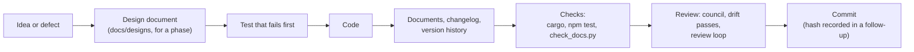

# Contributing to Inbox Agent

Thank you for helping. This page is the short version; the details are linked.

## Ground rules

* The app never sends mail, never needs a paid service, and keeps all setup inside the app. A change that breaks one of these needs an
  [ADR](docs/adr/README.md) first.
* Documents are code. A change that makes a document untrue is not finished until the document is fixed, in the same pull request.
* Say what is verified and what is not. CI runs the tests on Linux and macOS, but the app has not been used by hand there and no installer has been built for them; it has not been tried against a live mailbox, and its
  releases are unsigned; do not write otherwise.

## Setting up

Follow [Develop in the README](README.md#develop). The checks CI runs, and how to reproduce each, are in the
[CI runbook](docs/runbooks/ci-failure.md).

## How a change goes

1. For anything bigger than a fix, write a design document from [the template](docs/templates/design-doc.md) and discuss it first.
2. Write the test first and watch it fail; then make it pass. Put each new guard back to its old behaviour once and check a test notices.
3. Follow the [coding standards](docs/standards/coding-standards.md) and the [documentation style guide](docs/standards/docs-style-guide.md).
4. Update the documents ([which, for what you changed](docs/runbooks/documentation-maintenance.md)), [CHANGELOG.md](CHANGELOG.md) and the
   [version history](docs/VERSION_HISTORY.md).
5. Run the checks, then open a pull request using the template. How a change is reviewed is in the [testing strategy](docs/testing/strategy.md).

## Reporting a problem

* A bug: open an issue with the output of **Copy diagnostics** (it holds counts and option names, not addresses or text; read it first).
* A security problem: do not open a public issue; see [SECURITY.md](SECURITY.md).

By contributing you agree your work is released under the project's [MIT licence](LICENSE).
