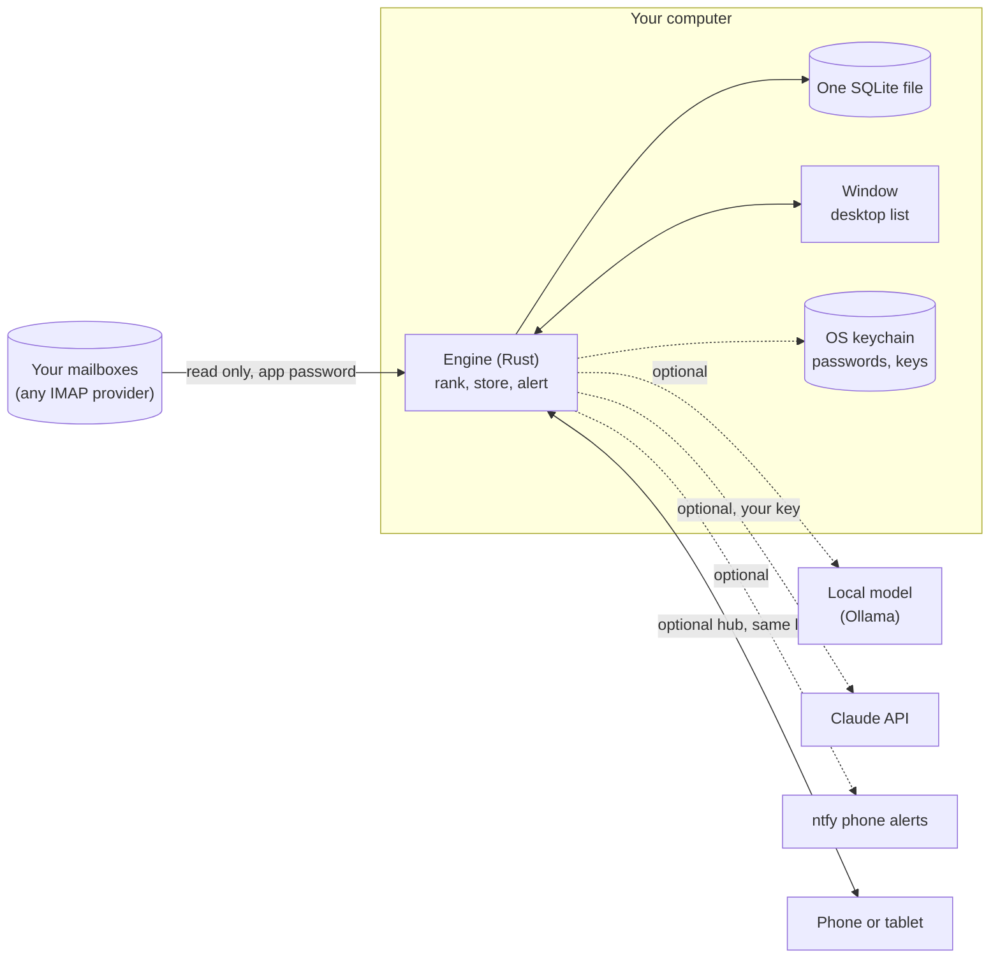
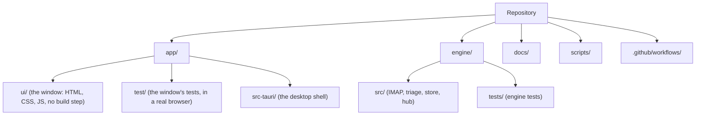

# Inbox Agent

An AI-triaged to-do list for your email. One installer, and all setup happens inside the app.
It watches your mailbox, ranks every message by how much it needs you, shows one focused list,
and alerts you only when something is important. It never sends mail.



- **Private by design.** Mail is read on your computer; your password lives in the OS keychain.
  See [PRIVACY.md](PRIVACY.md).
- **Your choice of brain.** Rules only (default, nothing leaves your computer), a local model
  through Ollama, or Claude with your own API key. See [how mail is ranked](docs/guides/choose-how-mail-is-ranked.md).
- **Works on your phone and iPad.** The desktop app can serve the same list to your devices
  (QR code in Settings). See [phone and tablet](docs/guides/phone-and-tablet.md).
- **Drafts reply for you, never sends.** Mail that needs an answer gets a draft inside its task: written by your
  chosen AI (or a quick-reply template), editable, copyable, and saveable to your mailbox's Drafts folder.
- **Sorts everything.** Priority, category, due date and "needs a reply" for every message; filter chips,
  search, five sort orders, snooze, "always important" or "mute" per sender, quiet hours and a daily digest.
- **A list that tidies itself.** Tasks close when you reply, conversations are one row, and the order learns from how you
  correct it. Newsletters and mail that left your inbox fold away.
- **Your own tasks and notes.** Add tasks that never came by email (`a`), and keep a note on any task. Attachments and a
  copy-only unsubscribe link show on each message; due dates are found even without AI.
- **Your own rules and follow-ups.** "If the address, domain or subject matches, set the priority or category, or file
  it", edited in Settings and applied to new mail and, on request, to the list. Optional follow-up reminders turn a
  conversation you started that nobody answered into a task that closes itself when a reply arrives.
  See [rules and sender choices](docs/guides/rules-and-sender-choices.md).
- **Select many.** `v` (or the Select button) lets you pick several rows, then done, star, priority, snooze or mute
  for all of them at once; one undo takes back a batch (muting a sender is the exception: you reverse it from a task).
- **Reminders, search inside messages, calendar invitations.** Give a task of your own a time to be reminded and let it
  repeat daily, weekly or monthly. Search finds words inside the stored message text, not only in the subject. An
  invitation shows its event, and "Save .ics" writes a calendar file you open yourself.
- **Several mailboxes, one list.** Add up to five mailboxes (any IMAP provider with an app password) in Settings. Their mail
  merges into one list with a small tag on each task and a filter chip per mailbox; each is read, filed and followed up in
  its own account, and removing one deletes its tasks, drafts, follow-up records and saved password and leaves the mailbox itself untouched.
- **Backup and restore.** One file with your rules, sender choices, corrections, tasks, notes and what you did with mail, for a new
  computer or a fresh start. No password goes in it, and no message bodies. Restoring adds what is missing, never removes anything, and shows a preview first.
  See [backup and restore](docs/guides/backup-and-restore.md).
- **Fast with a big mailbox.** The window is sent every open task but only the newest finished ones (the Done tab can show older ones), and
  the list draws 150 rows at a time, so thousands of tasks do not slow it down.
- **Keyboard first.** `j` `k` or the arrow keys move, `Enter` opens a task, `x` (or `e`) done, `1`-`5` priority,
  `s` star, `r` reply draft (mail only), `h` snooze, `v` select several, `a` add task, `/` search, `z` undo, `,` settings, `?` for the full
  list. Capitals work too. See [all shortcuts](docs/reference/keyboard-shortcuts.md).

## Documentation

All documents are in the repository and change with the code. Start from the [documentation map](docs/README.md).

| If you want to | Read |
| --- | --- |
| Set it up and use it | [Connect a mailbox](docs/guides/connect-a-mailbox.md), the [FAQ](docs/faq.md) |
| Fix a problem | [Troubleshooting](docs/troubleshooting.md), the [runbooks](docs/runbooks/README.md) |
| Understand how it is built | [Architecture](docs/architecture/overview.md), the [decision records](docs/adr/README.md) |
| Call the engine or the phone hub | [Engine commands](docs/api/rpc.md), [hub HTTP interface](docs/api/hub-http.md) |
| Change the code | [Coding standards](docs/standards/coding-standards.md), the [testing strategy](docs/testing/strategy.md) |
| Cut a release | [RELEASING.md](RELEASING.md), the [release runbook](docs/runbooks/cut-a-release.md), the [changelog](CHANGELOG.md) |

## Repository



| Path | What it is |
| --- | --- |
| `app/` | Tauri 2 desktop app. UI in `app/ui` (plain HTML, CSS and JS, no build step); its tests in `app/test`; shell in `app/src-tauri` |
| `engine/` | Rust engine: IMAP watcher, signals, triage, SQLite, mailbox write-back, phone hub |
| `docs/` | Architecture, decisions, API reference, guides, runbooks, product, testing, standards ([map](docs/README.md)) |
| `scripts/` | Checks and generators: documentation, test catalogue, versions, scale measurement |
| `CONTRIBUTING.md` | How to propose and make a change |
| `SECURITY.md` | Security review, fixes, residual risks |
| `PRIVACY.md` | What is stored and what leaves your computer |
| `RELEASING.md` | How to cut a release: signing secrets, tagging, CI, verification, rollback |
| `CHANGELOG.md` | What changed in each version |
| `.github/workflows/` | CI (format, lint, tests, documentation checks, audit) and a three-OS release build |

## Develop

You need Rust (stable, with `clippy` and `rustfmt`), Node 22 or later, and Python 3.10 or later for the scripts (written `python` below; use
`python3` on macOS and Linux). The window's tests also need Edge, Chrome or Chromium. On Linux the app shell needs
`libwebkit2gtk-4.1-dev libayatana-appindicator3-dev librsvg2-dev libdbus-1-dev libssl-dev pkg-config`
(the [CI runbook](docs/runbooks/ci-failure.md) lists what each check needs). Run each line from the repository root:

```bash
cd engine && cargo test --locked
```

```bash
cd engine && cargo clippy --locked --all-targets -- -D warnings
```

```bash
cd app && npm test
```

```bash
python scripts/check_docs.py
```

```bash
cd app && npm ci && npx tauri build
```

The last line builds the Windows installer (it needs the MSVC Build Tools; the installer is the path that has been built and tried).
`cd app && npm ci && npx tauri dev` should open the app from source; it has not been tried in this repository.
The checks CI runs, and how to reproduce each, are in the [CI runbook](docs/runbooks/ci-failure.md). The Rust documentation builds
with warnings as errors: `RUSTDOCFLAGS="-D warnings" cargo doc --no-deps` in `engine` (bash), or
`$env:RUSTDOCFLAGS = "-D warnings"; cargo doc --no-deps` (PowerShell). `python scripts/test_check_docs.py` tests the documentation checker.

Preview the UI with demo data and no engine: serve `app/ui` over HTTP and open `/demo.html?demo=1`.
`demo.html` loads the invented-mail backend and accepts any password, so the phone hub refuses to serve it; it is for
development only.

`npm test` in `app` runs the window's own tests: they open the real `app/ui` files in a browser that is already on the machine
(Edge or Chrome on Windows, Chrome, Edge or Chromium on macOS and Linux, found automatically; set `INBOX_AGENT_BROWSER` to the path of another Chromium-based browser) and drive them with real key presses and
clicks against the demo backend. They need no install. Without a browser they are skipped, unless `INBOX_AGENT_UI_TESTS=require`.
How a change is tested and reviewed is in the [testing strategy](docs/testing/strategy.md).

Read-only check against a real mailbox, without the app:

```bash
cd engine && IMAP_HOST=imap.example.com IMAP_USER=you@example.com IMAP_PASS=... cargo run --example probe --release
```

## Status

Built and tested: engine (470 tests, including protocol tests against a scripted mock IMAP server and a dedicated edge-case suite), the window (51 tests in a real browser), UI in a browser, phone hub, installer build.
The IMAP sync and write-back are tested against a scripted mock server, which proves what the client sends and how it parses
standard responses, but a real Gmail or other server may differ. Not yet exercised against a live mailbox, and releases are unsigned.
See [SECURITY.md](SECURITY.md) for the full list of limits, and the [version history](docs/VERSION_HISTORY.md) for how the project got here.
