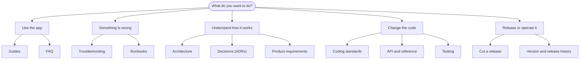

# Documentation map

> **Status:** current · **Audience:** everyone · **Last reviewed:** 2026-11-14

Every document of Inbox Agent, by what you want to do. The documents live in the repository next to the code and change in the same
commit; `python scripts/check_docs.py` checks that this map reaches each one, that links and diagrams are valid, that the command
reference matches the engine, and that nothing has gone unreviewed for 180 days.

## Use the app

| Document | What it is for |
| --- | --- |
| [README](../README.md) | What Inbox Agent is, what it does, how to build and test it |
| [Connect a mailbox](guides/connect-a-mailbox.md) | Set up the first mailbox or add another |
| [Choose how mail is ranked](guides/choose-how-mail-is-ranked.md) | Rules only, a local model, or your own cloud key |
| [Phone and tablet](guides/phone-and-tablet.md) | Use the list on a phone through the hub |
| [Alerts and reminders](guides/alerts-and-reminders.md) | Desktop alerts, phone alerts, quiet hours, reminders and repeats |
| [Backup and restore](guides/backup-and-restore.md) | Keep your rules, tasks and choices, and move them |
| [Rules and sender choices](guides/rules-and-sender-choices.md) | Teach the list what matters |
| [Let the app file mail](guides/let-the-app-file-mail.md) | Optional changes to your mailbox |
| [Calendar invitations](guides/calendar-invitations.md) | What happens to an invitation |
| [The simple view](guides/the-simple-view.md) | Big buttons, plain words, large text and light colours |
| [FAQ](faq.md) | Short answers to common questions |
| [Keyboard shortcuts](reference/keyboard-shortcuts.md) | Every key the window handles |
| [Privacy](../PRIVACY.md) | What is stored and what leaves your computer |

## Something is wrong

| Document | What it is for |
| --- | --- |
| [Troubleshooting](troubleshooting.md) | Find your symptom, get the fix |
| [Runbooks](runbooks/README.md) | Step-by-step procedures: a mailbox that will not connect, an empty list, a crash, a damaged database, a leaked secret, a failed build, a release |

## Understand how it works

| Document | What it is for |
| --- | --- |
| [Architecture overview](architecture/overview.md) | The system in pictures, the engine's modules |
| [Life of a message](architecture/message-lifecycle.md) | From new mail to a finished task, and the states of a task |
| [Data model](architecture/data-model.md) | What is stored, how, and for how long |
| [Runtime](architecture/runtime.md) | Threads, the poll loop, error containment |
| [Security model](architecture/security-model.md) | Trust boundaries, secrets, untrusted input |
| [Architecture decision records](adr/README.md) | Why the system is the way it is |
| [Engine step by step](PSEUDOCODE.md) | The engine's algorithms and their edge cases |
| [Product requirements](product/prd.md) | What the product is for, and what it will not do |
| [User stories](product/user-stories.md) | What people can do, with acceptance criteria and the tests that check them |
| [Glossary](reference/glossary.md) | The words this project uses |
| [Security review](../SECURITY.md) | Findings, fixes and the limits that remain |

## Change the code

| Document | What it is for |
| --- | --- |
| [Contributing](../CONTRIBUTING.md) | How a change goes, from design to commit |
| [Coding standards](standards/coding-standards.md) | Rust, the window, tests, commits, and checklists for common changes |
| [Documentation style guide](standards/docs-style-guide.md) | How documents are written and kept |
| [Templates](templates/README.md) | Starting points for each kind of document |
| [Engine commands](api/rpc.md) | Every command the window and the phone can call |
| [API overview](api/README.md) | The two ways into the engine |
| [Phone hub HTTP interface](api/hub-http.md) | The hub's routes, access code and limits ([OpenAPI file](api/openapi.yaml)) |
| [The state answer](reference/state-shape.md) | Every field the window receives |
| [Settings](reference/settings.md) | Every setting, default and limit |
| [Testing strategy](testing/strategy.md) | What is tested where, and how a change is reviewed |
| [Test plan for a release](testing/test-plan.md) | The gates, in order, with pass criteria |
| [Automated test catalogue](TESTCASES.md) | Every automated test (generated) and the manual cases |
| [Manual test cases](TESTCASES.manual.md) | The live-mailbox and real-calendar cases still owed |
| [Documentation maintenance](runbooks/documentation-maintenance.md) | What to update with which change |

## Release and history

| Document | What it is for |
| --- | --- |
| [Changelog](../CHANGELOG.md) | What changed, per version |
| [Version history](VERSION_HISTORY.md) | Which build had what: commit, date, tests, review |
| [Release history](RELEASE_HISTORY.md) | What was actually published |
| [Releasing](../RELEASING.md) | How to cut a release |
| [Cut a release (runbook)](runbooks/cut-a-release.md) | The same, as a checklist with the checks in order |

## Designs and review records

The [design documents](designs/README.md) say what each phase set out to do. Each run of work was reviewed, and the review is written down:

| Record | Run |
| --- | --- |
| [Drift report, 2026-11-13](2026-11-13_DRIFT_REPORT.md) | The first council and drift pass |
| [Phase 4 review](2026-11-13_PHASE4_REVIEW.md) | Select many, rules, follow-ups |
| [Phase 5 review](2026-11-13_PHASE5_REVIEW.md) | Reminders, search, calendar |
| [Phase 6 review](2026-11-13_PHASE6_REVIEW.md) | Several mailboxes |
| [Phase 7 review](2026-11-14_PHASE7_REVIEW.md) | Backup and restore |
| [Phase 8 review](2026-11-14_PHASE8_REVIEW.md) | A big mailbox stays fast |
| [Phase 9 review](2026-11-14_PHASE9_REVIEW.md) | Tests for the window |
| [Phase 10 review](2026-11-14_PHASE10_REVIEW.md) | Documentation as code |
| [Phase 11 review](2026-11-14_PHASE11_REVIEW.md) | Gaps closed that the documentation and the first CI run found |
| [Review of everything after Phase 11](2026-11-15_POST_PHASE11_REVIEW.md) | The council, drift passes and review loop over the upkeep, accessibility, release and licence work |
