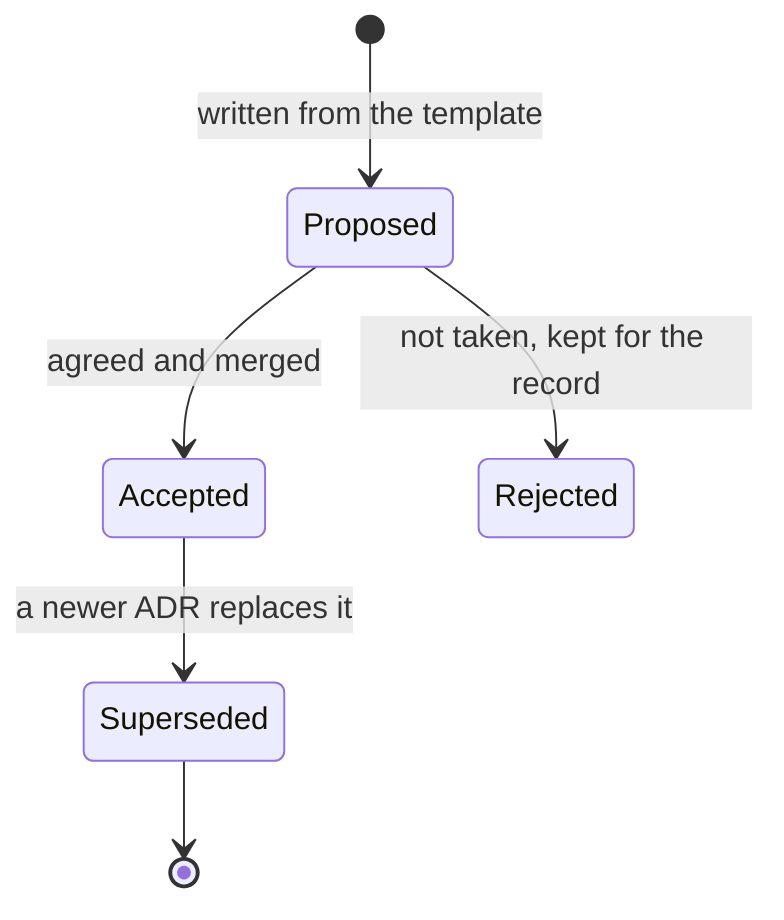

# Architecture decision records

> **Status:** current · **Audience:** anyone who wants to know why the app is built the way it is · **Last reviewed:** 2026-11-14

An architecture decision record (ADR) is a one-page note of a choice that is hard to reverse or that a newcomer would question:
what forced it, what was decided, and what it costs. This page lists them and says how to add one.

## Index

| No. | Decision | Status | Date |
| --- | --- | --- | --- |
| 0001 | [A Tauri shell around a Rust engine library](0001-tauri-shell-rust-engine.md) | accepted | 2026-11-12 |
| 0002 | [A plain JavaScript window with no build step](0002-plain-js-window-no-build-step.md) | accepted | 2026-11-12 |
| 0003 | [IMAP only, and the app never sends mail](0003-imap-only-never-send-mail.md) | accepted | 2026-11-12 |
| 0004 | [Secrets live in the OS keychain](0004-secrets-in-os-keychain.md) | accepted | 2026-11-12 |
| 0005 | [One SQLite file holds the app's data](0005-sqlite-single-file-store.md) | accepted | 2026-11-12 |
| 0006 | [Rules rank mail first; a model is optional](0006-rules-first-triage-optional-ai.md) | accepted | 2026-11-12 |
| 0007 | [Task ids encode the mailbox](0007-task-ids-encode-the-mailbox.md) | accepted | 2026-11-13 |
| 0008 | [Changing the mailbox is opt-in](0008-write-back-is-opt-in.md) | accepted | 2026-11-12 |
| 0009 | [The phone hub is plain HTTP with an access code](0009-phone-hub-plain-http-with-token.md) | accepted | 2026-11-12 |
| 0010 | [A backup is one JSON file, and restoring only adds](0010-backup-is-one-json-file-additive-restore.md) | accepted | 2026-11-14 |
| 0011 | [The window gets a bounded list on a big mailbox](0011-bounded-window-on-big-mailboxes.md) | accepted | 2026-11-14 |
| 0012 | [The window is tested in a real browser with no new dependency](0012-window-tests-in-a-real-browser.md) | accepted | 2026-11-14 |
| 0013 | [Documentation lives in the repository, with Mermaid diagrams](0013-documentation-as-code-with-mermaid.md) | accepted | 2026-11-14 |
| 0014 | [No paid services of any kind](0014-no-paid-services.md) | accepted | 2026-11-13 |

The date is when the decision was first recorded in the repository: the first commit (2026-11-12) for the founding choices, the
design document of the phase for the later ones. Every record was written up in Phase 10 and checked against the code then.

## Lifecycle

An ADR is never edited to say something else. It moves through these states; a changed decision is a new ADR that supersedes
the old one.

## Adding an ADR

1. Copy [the template](../templates/adr.md) to `docs/adr/NNNN-short-title.md`, with the next free number (no gaps: the
   documentation check fails on one). The first line must be `# ADR-NNNN: ...`.
2. Fill in the context with facts and links to the design or review that forced the decision, then the decision in one or two
   sentences, its consequences (including what would make us revisit it) and the alternatives that were real.
3. Set the status to `proposed`, the date, "Deciders: the owner and Claude" (or whoever decided), and `Last reviewed`.
4. Add a row to the index above in the same commit, and change the status to `accepted` when it is agreed.
5. To replace a decision, write a new ADR, and set the old one's status to `superseded by [ADR-NNNN](NNNN-title.md)`.
6. Run `python scripts/check_docs.py`.
