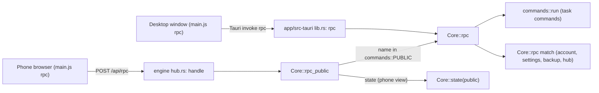
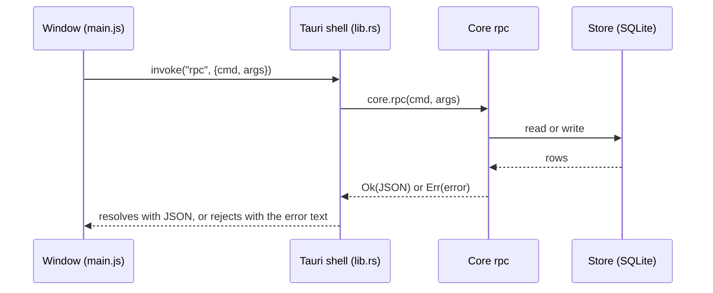
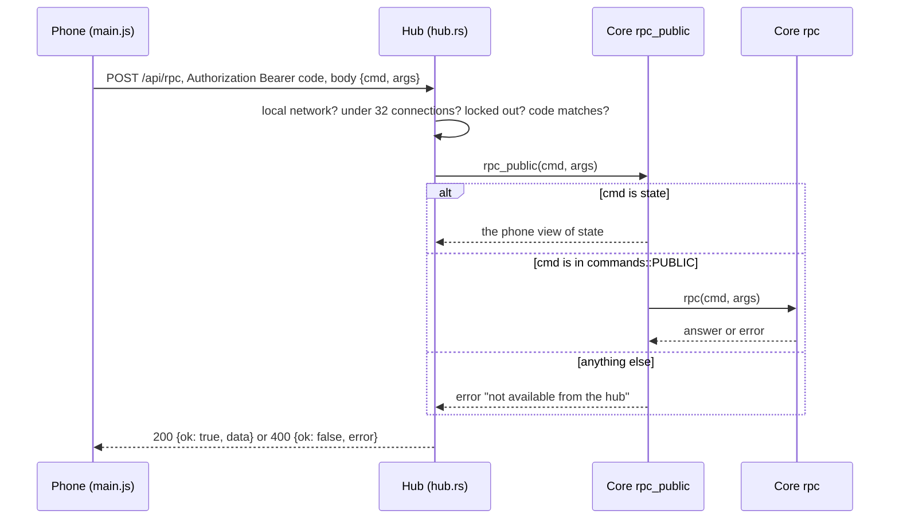

# Engine interfaces

> **Status:** current · **Audience:** developers who change the window, the engine or the phone hub · **Last reviewed:** 2026-11-14

The window has one way into the engine: a named command with a JSON argument object, answered with JSON. This page says
how a command gets there from the desktop window and from a phone, which commands a phone may not use, and where the
reference for each part lives.

| Document | What it covers |
| --- | --- |
| [rpc.md](rpc.md) | Every engine command: arguments, answer, errors, side effects, whether the hub allows it |
| [hub-http.md](hub-http.md) | The phone hub's HTTP interface: routes, access code, limits, status codes |
| [openapi.yaml](openapi.yaml) | The same hub interface as an OpenAPI 3.0.3 file |
| [../reference/state-shape.md](../reference/state-shape.md) | The answer to `state`, field by field |
| [../reference/settings.md](../reference/settings.md) | Every setting that `save_settings` accepts |

## Two ways in, one dispatcher

Both paths end in `Core::rpc` in [`engine/src/core.rs`](../../engine/src/core.rs). It first offers the command to
`commands::run` in [`engine/src/commands.rs`](../../engine/src/commands.rs) (the task commands), then handles the account,
settings, backup and hub commands itself. An unknown name fails with `unknown command: <name>`.

The window picks its path once, at load, in `app/ui/main.js`: inside the Tauri webview it calls the shell; opened from the
hub with an access code it calls `/api/rpc`; with `?demo` or `?mock` it calls the demo backend in `app/ui/mock.js` (not
served by the hub); with none of these it shows "Not connected" and calls nothing.

### Desktop window

The Tauri shell registers exactly one command, `rpc(cmd, args)`, in
[`app/src-tauri/src/lib.rs`](../../app/src-tauri/src/lib.rs). It passes `args` (an empty value when missing) to
`Core::rpc` and turns an error into its message string, which the window shows.

The window also calls two Tauri plugin commands directly, not through `rpc`: `plugin:autostart|enable` and
`plugin:autostart|disable`, when the setup wizard finishes ("Start with this computer"). Desktop notifications go the other
way: the engine calls the shell's notify callback, which uses the notification plugin. The capability file
`app/src-tauri/capabilities/default.json` grants `core:default`, `notification:default` and the three autostart permissions.

### Phone or tablet through the hub

See [hub-http.md](hub-http.md) for the access code, the lock-out and every status code.

## What is desktop-only

The hub allows `state` (a reduced view) and the twelve names in `commands::PUBLIC`. Everything else is refused with
`not available from the hub`.

| Allowed from the hub | Desktop only |
| --- | --- |
| `state` (phone view: no account details, rules, alert settings, key status or update notice) | Task commands that read message text, spend AI quota or write to the mailbox or disk: `read_body`, `search`, `draft_generate`, `draft_to_mailbox`, `save_event`, `export_markdown`, `diagnostics`, `rules_save`, `rules_apply` |
| `set_done`, `set_star`, `set_priority`, `set_snooze`, `set_pref`, `set_due`, `set_title`, `set_note`, `set_reminder`, `add_task`, `draft_update`, `draft_discard` | Account, settings, secrets and hub commands: `test_account`, `save_account`, `add_account`, `remove_account`, `save_settings`, `set_secret`, `detect_ollama`, `test_ai`, `finish_setup`, `sign_out`, `hub_info`, `rotate_hub_token`, `backup_export`, `backup_import` |

The window hides the matching controls on the phone (Settings, "Draft a reply", "Save to Drafts", "Read message",
"Save .ics"), but the engine's allow-list is what enforces it. Allowed commands can still change the mailbox later: a
phone's `set_done`, `set_star` or `set_priority` queues a write-back change exactly as the desktop's does, applied only when
write-back is on.

## Versioning and stability

There is none promised. The command set, the argument names and the answer shapes are internal to this app: the window and
the engine ship together in one installer and change in the same commit. Nothing outside this repository is expected to
call them, and no version number is sent or checked on either path. When you change a command, change its caller in
`app/ui`, the demo backend in `app/ui/mock.js`, and [rpc.md](rpc.md) in the same commit. `scripts/check_docs.py` checks that
every command in the code has an entry in the reference.

## Related

* [The security model](../architecture/security-model.md) and [SECURITY.md](../../SECURITY.md) for why the hub's
  allow-list looks the way it does.
* [Phone and tablet guide](../guides/phone-and-tablet.md) for setting the hub up.
* [docs/PSEUDOCODE.md](../PSEUDOCODE.md) for what each part of the engine does step by step.
