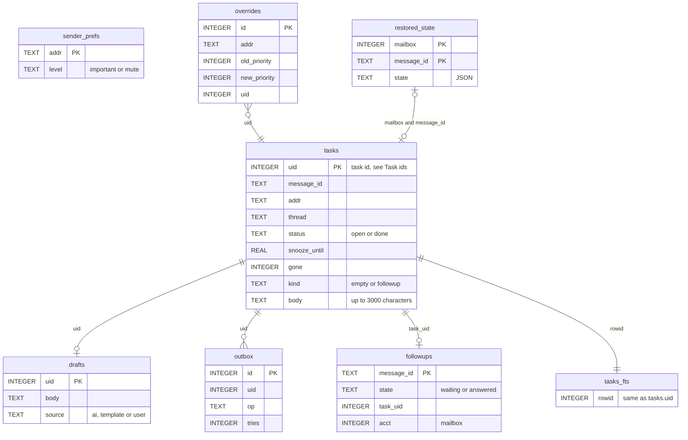
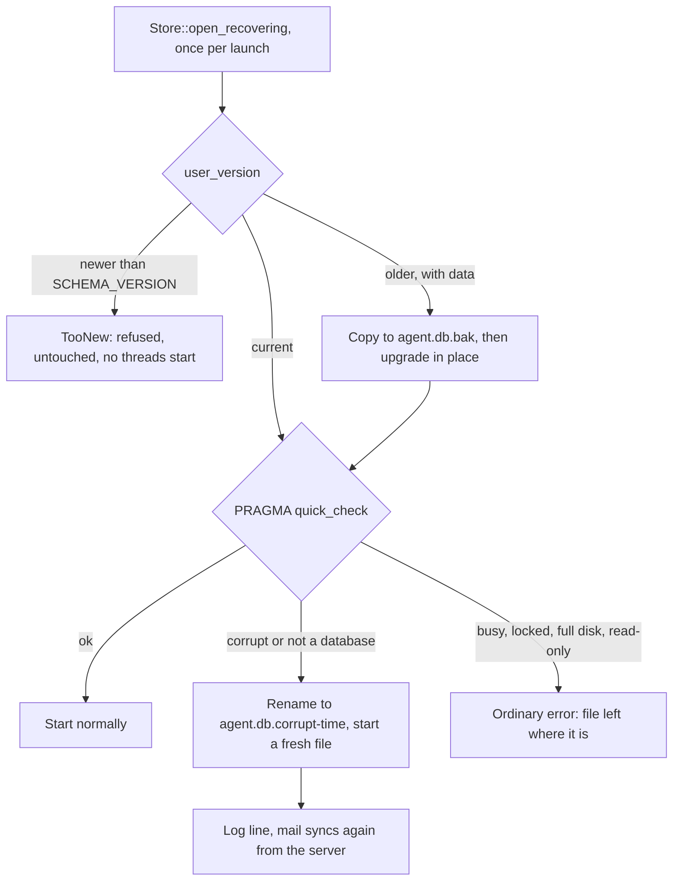

# Data model

> **Status:** current · **Audience:** developers changing what the app stores · **Last reviewed:** 2026-11-14

This page describes what the app keeps on disk: the SQLite tables, how task ids are built, how long things are kept, how the
database is upgraded and recovered, and what is never stored. The source of truth is the schema in `engine/src/store.rs`
(`SCHEMA`, `ADDED_COLUMNS`, `FTS_SCHEMA`); the user-facing statement is [PRIVACY.md](../../PRIVACY.md).

## Files in the data folder

| File | What it holds | Written by |
| --- | --- | --- |
| `agent.db` (with `-wal` and `-shm`) | Everything below | `store.rs` |
| `agent.db.bak` | A copy taken before a schema upgrade touches an existing database | `Store::open` |
| `agent.db.corrupt-<unix seconds>` | A damaged database that was set aside | `Store::open_recovering` |
| `settings.json` | Settings, including mailbox servers and addresses, the ntfy topic and the hub access code | `Settings::save` (write to `.tmp`, then rename) |
| `crash.log` | One line per panic: time, thread, code location, text cut to 300 characters; restarts past 100 KB | `diag::record` |

"Sign out and reset" empties every table, then removes `crash.log` and every `agent.db.*` file (`remove_leftover_files`).

## Tables

There are no declared foreign keys; the links below are by value, and the code keeps them in step. The diagram shows the main
columns only. `sender_prefs` and `overrides` are also matched to tasks by the sender's address (`addr`); `rules`, `log` and
`meta` stand alone and are left out of the diagram.

| Table | What it holds |
| --- | --- |
| `tasks` | One row per task: mail from a mailbox, a task you added, or a follow-up. Sender, subject, a 400-character excerpt, up to 3,000 characters of text (`body`, used for drafts, "Read message" and search; never sent to the window in `state`), the ranking and its reason, due date, snooze, star, note, attachment names, unsubscribe link, calendar event (JSON), conversation key, reminder and repeat. Columns added after the first release are in `ADDED_COLUMNS`. |
| `drafts` | At most one reply draft per task, with its source and whether a copy was saved to the mailbox's Drafts folder. |
| `outbox` | Changes waiting for the mailbox: `archive`, `unarchive`, `star`, `unstar`, `label`, `category`, `draft`. Filled whether or not write-back is on; drained only while it is. |
| `followups` | One row per sent message the follow-up check decided about, so it is never asked about twice. |
| `sender_prefs` | Your "always important" and "mute" choices, by address. |
| `overrides` | Your priority corrections, one per task (first and latest priority), used to shift later mail from that address and as hints in a model prompt. |
| `rules` | Your rules, in order (`ord`): field, text, and what they set. |
| `log` | The activity log shown in the window's Log tab. |
| `meta` | Key and value pairs: per mailbox `last_uid`, `uid_validity`, `attempt`, `no_content`, `followup_error` (the first mailbox uses the plain name, mailbox *n* adds `@n`); and app-wide `drafts_<date>`, `last_prune`, `last_digest`, `update_available`, `update_checked`, `update_next_try`. |
| `restored_state` | What a restored backup says you did with mail that has not been read yet, applied once when the message arrives. At most 5,000 rows. |
| `tasks_fts` | An FTS5 full-text index over subject, sender, address, body and note, kept in step by triggers. External content: the text lives only in `tasks`. `secure-delete` is on, so removed words are overwritten. |

Indexes: `tasks(message_id)` and `tasks(addr)`.

## Task ids

A task id is one `u32` that is the same in the database, the window and the phone. The layout is in `store.rs`
(`global_uid`, `mailbox_of`, `imap_uid`) and explained in [ADR-0007](../adr/0007-task-ids-encode-the-mailbox.md).

| Range | Meaning |
| --- | --- |
| `n * 400,000,000 + UID` for `n` from 0 to 4 | Mail in mailbox `n` (`MAILBOX_SPAN`). Mailbox 0's ids are its IMAP UIDs. A UID of 400,000,000 or more is skipped with a log line. |
| 2,000,000,000 and up (`LOCAL_UID_BASE`) | Tasks you added and follow-ups. The next id is the highest one plus one, chosen inside the `INSERT`. |

The `mailbox` field the window receives comes from the id for mail, from `followups.acct` for a follow-up, and is empty for a task
you added. An unlinked correction (its mailbox was renumbered) is parked on the first id of that mailbox's block, which no
message has.

## Retention and pruning

`Store::prune(90, 30)` runs when each mailbox's watcher starts and once a day from the scheduler (`jobs::tick`, keyed by
`meta.last_prune`). Open tasks are never pruned.

| What | Kept for |
| --- | --- |
| Finished tasks | 90 days after they were finished (`done_at`, else the time the mail arrived) |
| Drafts | As long as their task |
| Activity log lines | 30 days |
| Corrections (`overrides`) | 365 days |
| Follow-up records | 60 days, longer while their task exists |
| Restored state waiting for mail | 90 days |

Removing a mailbox (`Store::remove_mailbox`) deletes its block of tasks, drafts and outbox items, its `meta` counters, the
corrections made on its mail, its follow-up tasks and records and its restored state. A changed `UIDVALIDITY` deletes the
mailbox's tasks, drafts, outbox items and counters but keeps its corrections, unlinked.

## Transactions

Most writes are single statements in autocommit mode; each thread has its own connection (WAL, 5-second busy timeout), so
there is no shared lock in the engine. These run in one transaction:

| Operation | Why |
| --- | --- |
| `tasks_for_window` | One read: a sync saving mail between its three queries cannot make a task appear twice or not at all. |
| `set_rules` | The rule list is replaced whole or not at all. |
| `add_followup` | The task and its record are written together. |
| `delete_mail_rows` (a changed `UIDVALIDITY`, and the first half of `clear_mailbox`) | A mailbox's tasks, drafts, queued changes and counters go together. |
| `restore_apply` | A restore is applied whole or not at all. It takes the write lock at once (`IMMEDIATE`); a preview is the same code, rolled back. |

`clear_mailbox`, and so `remove_mailbox` and the clearing of a number before a new mailbox takes it, is two transactions in a row,
not one unit: first the mail rows and counters (`delete_mail_rows`), then the corrections, follow-ups and restored state. A crash
between them leaves the second set behind.

Opening a database (WAL, tables, columns, index) takes turns through a process-wide mutex in `Store::open`, because several
threads open connections at the same moment at start-up.

## Schema versions and a damaged database

The format version is SQLite's `user_version`, compared with `SCHEMA_VERSION` (2 today).

An upgrade only adds: `CREATE TABLE IF NOT EXISTS`, `ALTER TABLE ... ADD COLUMN` for each missing column, and a rebuild of
the search index if it did not exist. What a fresh file loses is what was only in the database: your rules, sender choices,
corrections, notes, drafts and tasks you added; mail comes back from the server. A [backup](../adr/0010-backup-is-one-json-file-additive-restore.md)
restores the rest. Recovery steps are in the [damaged database runbook](../runbooks/damaged-database-and-recovery.md).

## What is deliberately not stored

* **Passwords and the API key.** They are in the OS keychain only ([ADR-0004](../adr/0004-secrets-in-os-keychain.md)). The hub
  access code is the exception: it is in `settings.json`.
* **Whole messages.** Only the 400-character excerpt and the first 3,000 characters of text (`MAX_BODY_CHARS` in `mail.rs`) are
  kept; HTML past 256 KB is ignored, messages over 5 MB are not read at all.
* **Attachments.** Up to five names and a count; never the files.
* **Raw headers.** Only what the ranking and threading need: addresses, subject, date, Message-ID, up to ten references,
  Reply-To and whether the sender check failed.
* **Your sent mail.** The Sent folder is read for headers only, and the index built from it lives in memory (`SentIndex`). What
  reaches the database is the follow-up record (Message-ID and date) and, for an unanswered message, a follow-up task naming the
  recipient and subject.
