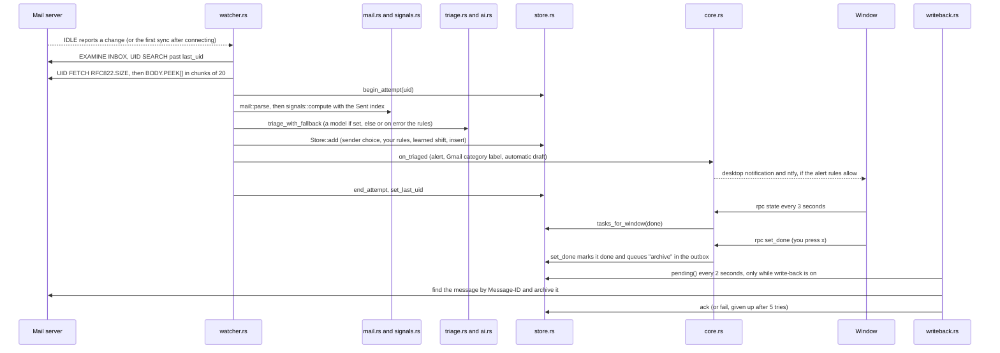
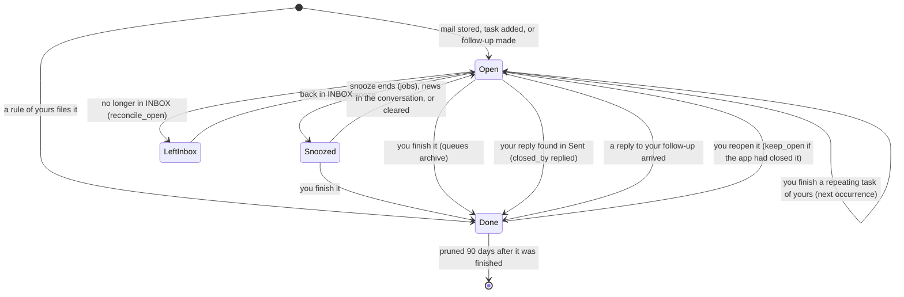
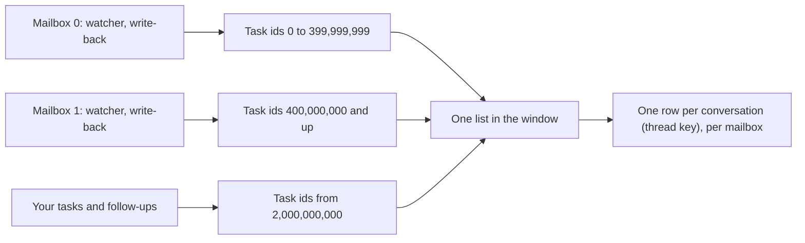

# Life of a message

> **Status:** current · **Audience:** developers changing the sync, ranking or task code · **Last reviewed:** 2026-11-14

This page follows one message from the mail server to a task in the window and back to the mailbox, then shows the states a
task can be in. The step-by-step rules and edge cases are in [the pseudocode](../PSEUDOCODE.md); this page is the map.

## From new mail to done

The sequence below is one mailbox. Every mailbox has its own watcher and write-back thread ([runtime](runtime.md)).

What each step adds or refuses:

1. **Fetch** (`watcher::process_new_until`). The first sync of a mailbox reads only the newest `first_run_limit` messages
   (50 by default). Messages over 5 MB are skipped with a log line. A changed inbox `UIDVALIDITY` resets that mailbox's tasks
   first (`Store::reconcile_uid_validity`). A message the server answers for without content is retried a few times before the
   cursor moves past it.
2. **Contain** (`begin_attempt`, `catch_unwind`). A message whose handling panicked twice is skipped on the next start, so one
   bad message cannot stop the sync for good.
3. **Parse** (`mail::parse`). Runs on its own large-stack thread. Keeps a 400-character excerpt and up to 3,000 characters of
   text, up to five attachment names, a safe unsubscribe link, the first calendar event, and the conversation key (`thread`).
4. **Rank** (`triage::triage_with_fallback`). The rules ranker always works; a configured model is tried first and any error falls
   back to it. A due date is found in the text even when the model found none.
5. **Store** (`Store::add`). A sender choice ("important" lifts to at least P4 unless the message failed its sender check,
   "mute" drops to P1) beats your rules; a rule beats what was learned from your corrections. A rule that files mail marks the
   task done straight away. A new message wakes a snoozed task in the same conversation of the same mailbox. State restored
   from a backup for this Message-ID is applied once.
6. **Alert** (`Core::on_triaged`, `Core::alert`). Only P4 and above or urgent mail alerts, never during the first backfill of a
   mailbox, and quiet hours and the category filter hold back everything that is not urgent.
7. **Show**. The window asks for `state` every 3 seconds while it is visible ([runtime](runtime.md#the-poll-loop)).
8. **Act**. Each command updates the database at once and, for done, star and priority, queues a change in the `outbox`.
   Tasks you added yourself never queue anything (`Store::queue`).
9. **Write back** (`writeback::drain`). Only while "Let Inbox Agent file mail" is on ([ADR-0008](../adr/0008-write-back-is-opt-in.md)).
   Gmail: archive removes the `\Inbox` label and adds `AI/Done`, priority is an `AI/P1` to `AI/P5` label, star is `\Flagged`.
   Other servers: archive moves to the Archive folder, star is `\Flagged`, no labels. A failure stops the queue to keep the order.

## States of a task

A task's `status` is `open` or `done`; snoozed and "left the inbox" are marks on an open task (`snooze_until`, `gone`). The
diagram shows how a task moves between them and who moves it.

* **Closed by a reply** (`Store::auto_close`, from `watcher::reconcile_open`). Your own message in Sent whose In-Reply-To is the
  task's Message-ID closes it with `closed_by = "replied"`. Nothing is queued for the mailbox. If you reopen it, `keep_open` is set
  and the app never closes it again.
* **Left the inbox** (`Store::set_gone`). The task stays open and shows in its own fold. An unclear answer from the server
  changes nothing.
* **Your own tasks** (ids from `LOCAL_UID_BASE`). They can have a reminder (`remind`, local "YYYY-MM-DD HH:MM") that the scheduler
  announces once (`Store::due_reminders`), and a repeat (`daily`, `weekly`, `monthly`). Finishing a repeating task moves its
  reminder and due date to the next occurrence and leaves it open (`Store::advance_repeat`).
* **Follow-ups** (`followup::check`, off until you choose a wait of 2, 3, 5 or 7 days). A conversation you started between that
  many days and 14 days ago with no reply becomes a task of `kind = "followup"`, at most 20 open at once. Before a task is made, the
  app looks for a reply among the mail it has read and then asks the server with a search; an answered message gets no task.
  An open follow-up closes itself when a reply to it is stored (`Store::has_local_reply`), unless you reopened it.
* **Removed outright** when its mailbox is removed, when that mailbox's `UIDVALIDITY` changes, or on "Sign out and reset".

## Conversations and several mailboxes

* **Conversations.** Each message carries a `thread` key (the first id in References, else In-Reply-To, else its own
  Message-ID); mail with no usable id and your own tasks get `uid:<id>` and are never grouped. The window shows one row per
  conversation. A conversation never spans two mailboxes: the same message in two mailboxes is two tasks.
* **Several mailboxes.** Up to five (`MAX_MAILBOXES`). Each one's task ids live in their own block
  ([ADR-0007](../adr/0007-task-ids-encode-the-mailbox.md), [data model](data-model.md#task-ids)), and its sync and write-back use a
  store scoped to it (`Store::scoped`). Rules, sender choices, corrections, your own tasks and every setting are shared by all.
  A follow-up closes when a reply is stored in any of your mailboxes, since a reply can reach another of your addresses.
