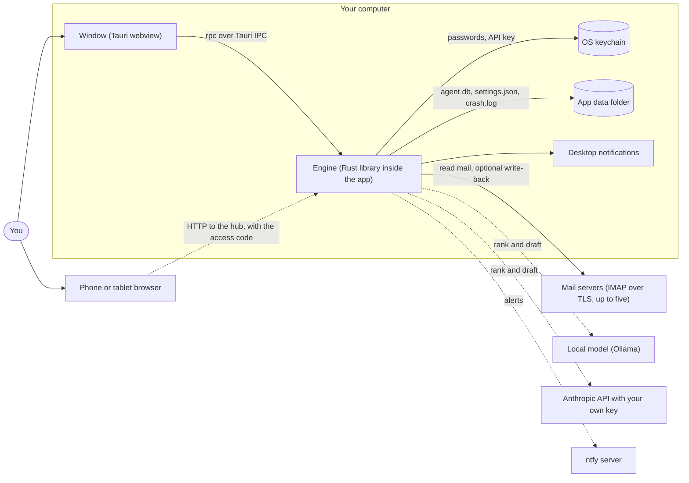
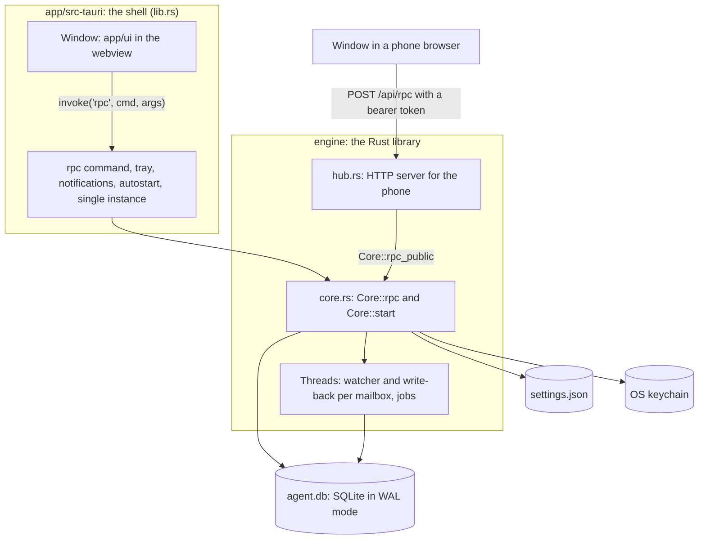
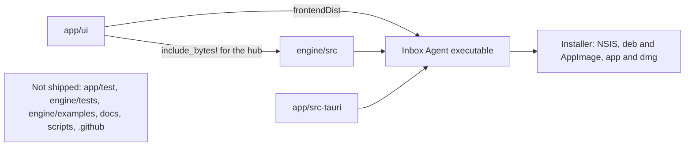

# Architecture overview

> **Status:** current · **Audience:** developers and reviewers new to the code · **Last reviewed:** 2026-11-14

This page shows Inbox Agent in pictures: what it talks to, what it is made of, what each engine module does and what ships in
the installer. Read it first, then follow the links to the [life of a message](message-lifecycle.md), the
[data model](data-model.md), the [runtime](runtime.md) and the [security model](security-model.md). Why it is built this way is
in the [decision records](../adr/README.md).

## Context: what the app talks to

Everything runs on your computer. There is no Inbox Agent server. This diagram shows every party the app exchanges data with;
the dotted lines are optional and off until you turn them on.

The update check (`engine/src/updates.rs`) would also call `api.github.com`, but `UPDATE_REPO` is empty, so today it makes no
network call at all.

## Containers: what it is made of

The app is one process: a Tauri 2 shell that links the engine as a library. The window is the same plain HTML, CSS and
JavaScript in the desktop webview and in a phone browser; only the way it reaches the engine differs
(`app/ui/main.js`, function `rpc`).

* **Shell** (`app/src-tauri/src/lib.rs`): registers one command, `rpc`, which hands every call to `Core::rpc`. It also owns the
  tray icon (Open, Quit), desktop notifications, start at login (`--minimized`) and the single-instance guard. Closing the
  window hides it; the engine keeps running in the tray.
* **Engine** (`engine/`): everything else. `Core` owns the settings, starts the background threads and answers commands. The
  command set is described in the [RPC reference](../api/rpc.md).
* **Hub** (`engine/src/hub.rs`): off by default. When on, it serves a fixed list of the window's files, compiled into the
  engine with `include_bytes!`, and one command endpoint. See the [hub HTTP reference](../api/hub-http.md).
* **Storage**: one SQLite file and one JSON file in the app's local data folder (`app_local_data_dir`, which is
  `%LOCALAPPDATA%\app.inboxagent.desktop` on Windows), and the OS keychain for secrets. See the [data model](data-model.md).

## Engine modules

One line per module, taken from its `//!` comment and checked against the code. The list is `engine/src/lib.rs`.

| Module | Responsibility |
| --- | --- |
| `ai.rs` | Optional model (Ollama or Anthropic) that ranks mail and drafts replies; email text is treated as untrusted and the output is validated; any failure falls back to the rules or a template. |
| `backup.rs` | The backup file: build, parse and validate, plan and apply a restore; the file is untrusted input. |
| `calendar.rs` | Reads a calendar invitation defensively (size limits, one event, plain-text fields) and builds the `.ics` file the app saves. |
| `commands.rs` | Task commands (done, star, priority, snooze, sender choice, drafts, notes, own tasks, search, rules, diagnostics); `PUBLIC` is the subset the phone may use. |
| `core.rs` | `Core`: settings, starting and restarting the threads, the `state` answer, account and settings commands, alerts. |
| `dates.rs` | Finds a due date in message text without AI, only after a cue word ("due", "by", "deadline"...). |
| `diag.rs` | The crash log (`crash.log`, panic text and location only) and the redacted support report. |
| `drafts.rs` | Reply drafting with a model or a quick-reply template; builds the hardened message saved to Drafts. Never sends. |
| `followup.rs` | Follow-ups: conversations you started that nobody answered; read-only searches, never a download. |
| `hub.rs` | The phone hub: a small HTTP/1.1 server with size and time limits, a connection cap, lockout and exact routes. |
| `jobs.rs` | The scheduler: wakes snoozed tasks, announces reminders, runs the daily clean-up and update check, sends the digest, decides quiet hours. |
| `lib.rs` | The crate root: declares the modules. |
| `mail.rs` | Parses one received message into an `Email`, dropping anything that could be abused downstream. |
| `reminders.rs` | Reminders and repeats for your own tasks, kept as local wall-clock text. |
| `rules.rs` | Your rules: case-insensitive text matches on sender, domain or subject; the first match wins. |
| `secrets.rs` | Secrets in the OS keychain (or in memory for the engine's tests). |
| `settings.rs` | `settings.json` in the app data folder, its defaults and its validation. No secrets. |
| `signals.rs` | Rule-based signals from the headers and your Sent history (known sender, reply, bulk). |
| `store.rs` | The SQLite store: tasks, drafts, corrections, sender choices, rules, follow-ups, the outbox, the log and the search index. |
| `store/transfer.rs` | The database side of backup and restore, applied in one transaction; the table of restored state waiting for unread mail. |
| `triage.rs` | The `Triager` trait, the always-available `RulesTriager`, and `triage_with_fallback`. |
| `updates.rs` | The "is there a newer version?" check (once a day after an answer, retried after an hour while the server gives none); off while `UPDATE_REPO` is empty; never downloads. |
| `watcher.rs` | One mailbox's IMAP connection: Sent index, backfill, IDLE loop and the "replied" and "left the inbox" checks. Read-only. |
| `writeback.rs` | Applies queued changes to the mailbox over a separate connection, finding messages by Message-ID. |

## Packaging and build

`npx tauri build` in `app/` builds the shell crate, which depends on the engine by path (`app/src-tauri/Cargo.toml`), so the
engine is compiled into the one executable. `frontendDist` in `app/src-tauri/tauri.conf.json` is `../ui`.

| In the installer | Outside it |
| --- | --- |
| The executable: the Tauri shell with the engine linked in | `app/test` (the window's browser tests) and `app/node_modules` |
| The window's files from `app/ui`, embedded through `frontendDist` | `engine/tests`, `engine/examples/probe.rs` (the read-only mailbox check) |
| A second copy of the files the hub serves, inside the engine (`hub.rs`, `FILES`) | `docs/`, `scripts/`, `.github/workflows/` |
| Icons from `app/src-tauri/icons` | Signing secrets, which exist only in CI (see [RELEASING.md](../../RELEASING.md)) |
| `LICENSE`, `THIRD_PARTY_NOTICES.md` and `THIRD_PARTY_LICENSES.txt` next to the program (`bundle.resources`), because MIT and Apache licences ask that the notices travel with it | |

Targets: NSIS for the current user on Windows (`tauri.conf.json`), deb and AppImage on Linux (`tauri.linux.conf.json`), app and
dmg on macOS 11 or later (`tauri.macos.conf.json`). Releases are built by `.github/workflows/release.yml` and are unsigned
until signing secrets are added. `demo.html` and `mock.js` sit in `app/ui`; the hub never serves them (they are not in `FILES`).
Whether the desktop bundle carries them was not checked against a built installer.
