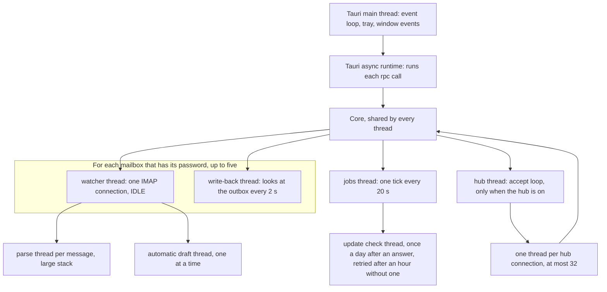
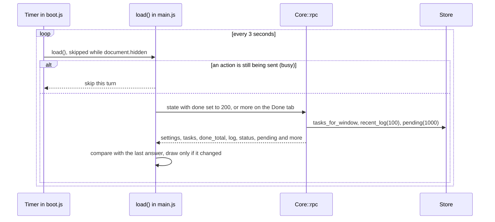

# Runtime

> **Status:** current · **Audience:** developers debugging a hang, a crash or a slow window · **Last reviewed:** 2026-11-14

This page describes what runs while the app is open: the threads, how the window and the engine talk, how errors are kept from
spreading, and the order of start-up and shutdown. Each claim names the function that does it.

## Threads and processes

The app is one process. There is no second process and no child process; the phone talks to it over the network. Every
background thread opens its own SQLite connection (`Store::open`), so threads share no database lock in the engine. SQLite still lets
one connection write at a time: a write transaction that may read first takes the write lock at once and waits for it, up to the
5-second busy timeout ([the transactions](data-model.md#transactions)).

| Thread | Started by | Does |
| --- | --- | --- |
| Main | Tauri | The window, the tray menu, hiding the window on close. |
| Async runtime | `#[tauri::command(async)] fn rpc` | Runs `Core::rpc` off the main thread, so a slow command (testing an account, writing a draft) does not freeze the window. |
| Watcher, one per mailbox | `Core::spawn_mailbox` | `watcher::run`: connect, read new mail, then IDLE in 60-second turns; the "replied", "left the inbox" and follow-up checks at most every 20 seconds while mail arrives and every 2 minutes when idle. |
| Write-back, one per mailbox | `Core::spawn_mailbox` | Every 2 seconds, if write-back is on and its outbox has items, `writeback::drain` over a fresh connection; 15 seconds after a failure. |
| Jobs | `Core::start` | `jobs::tick` every 20 seconds: wake snoozed tasks, announce reminders, the daily clean-up, the update check, the digest. |
| Hub | `Core::start`, when `hub.enabled` | `hub::serve`: binds `0.0.0.0` on the hub port (8787 by default), drops peers outside local ranges, one thread per connection. |
| Short-lived | as shown | `mail::parse` on a 64 MB-stack thread; `commands::auto_draft` (serialised by a mutex so the daily cap holds); the update check (`jobs::check_for_update`: once a day after the server answers, tried again after an hour while it gives no answer, never two at once; it cannot run today because `UPDATE_REPO` is empty). |

## The poll loop

The window does not get pushed updates. It asks for the whole `state` on a timer (`app/ui/boot.js`, `load` in `app/ui/main.js`).

* **What `state` returns** (`Core::state`): the settings, every task that is not finished plus the newest finished ones,
  `done_total`, the last 100 log lines, the sync status (the worst of the mailboxes), how many changes wait for the mailbox, and
  flags for the API key, Gmail and the update notice. The desktop also gets your rules and the list of mailboxes with each one's
  status. The phone gets a reduced copy: only `onboarded` and `writeback` from the settings, no rules, no mailboxes, and log
  lines with the login removed. The exact shape is in the [state reference](../reference/state-shape.md).
* **The bounded window of finished tasks.** `state` sends the newest 200 finished tasks (`DONE_SHOWN`), by when they were finished.
  The Done tab's "Show older" asks for 500 more at a time; the engine clamps the number between 200 and 20,000 (`done_asked`,
  `DONE_MAX`). The window draws 150 rows of each part of the list at a time (`ROW_PAGE`). Why: [ADR-0011](../adr/0011-bounded-window-on-big-mailboxes.md).
* **Hidden window.** The timer skips the call while the page reports `document.hidden`, and a `visibilitychange` to visible
  calls `load` at once. Closing the desktop window only hides it; the engine's threads keep running.
* **Optimistic actions.** A command updates the window's copy at once; the next poll confirms it. While an action is in flight
  (`busy`), polls are skipped so an old answer cannot undo it on screen. While you are typing (`editing()`), the new answer is
  kept and drawn afterwards.
* **The phone** runs the same files and the same loop over `POST /api/rpc` with its access code (`Core::rpc_public`).

## Error containment

| Failure | Contained by | What you see |
| --- | --- | --- |
| A panic while handling one message | `catch_unwind` in `process_new_until`; `begin_attempt` counts starts | That message is skipped; one that crashed the app twice is skipped on the next start. |
| A hostile message (deep MIME, huge HTML) | `mail::parse`: MIME-part cap, large-stack thread, 5 MB and 256 KB limits | A log line; the sync goes on. |
| A panic anywhere in one connection attempt | `catch_unwind` in `watcher::run` | Status "error", a log line, a reconnect after 30 seconds. |
| A refused sign-in | `watcher::SignInRefused` | A status asking for the password again; retried every 5 minutes, not every 30 seconds, so the provider does not lock the account. |
| The model fails or answers badly | `triage_with_fallback`, `ai::parse_reply` | The rules rank the message. |
| The Sent folder, the reply check or the follow-up check fails | `watcher::maintain` logs and goes on | New mail still arrives. |
| A mailbox change fails | `writeback::drain_session` stops at the first failure to keep the order | A log line; the item is retried and given up after 5 tries. |
| The keychain cannot be read | `Core::mailbox_account` | That mailbox's status names the keychain error; the other mailboxes carry on. |
| Any panic in the process | `diag::install_crash_log`, installed before the engine starts | A line in `crash.log` (time, thread, location, text cut to 300 characters). |

Not contained: the jobs thread has no panic guard of its own, so a panic in `jobs::tick` ends that thread until the next
`Core::start` (it is still written to `crash.log`). A command's error goes back to the window as text (`map_err(|e| e.to_string())`
in `lib.rs`), which shows it in a toast. How to read the crash log: [the crash log runbook](../runbooks/crash-log-and-diagnostics.md).

## Start-up and shutdown

Start-up, in the order of `app/src-tauri/src/lib.rs` and `Core::start`:

1. Tauri starts; the single-instance plugin hands a second launch to the first one (it shows the window).
2. `setup` finds the local data folder and installs the crash log.
3. `Core::new` creates the folder; `Core::start` begins a new generation of threads (a fresh stop flag; the previous one is set).
4. Once per launch, `Store::open_recovering` checks the database ([data model](data-model.md#schema-versions-and-a-damaged-database)).
   A database from a newer version stops here: status "error", no threads.
5. The hub thread (if on) and the jobs thread start.
6. If setup is not finished or no mailbox is set up, the status is "setup" or "no password" and nothing else starts.
7. For each mailbox, the password is read from the keychain; with it, a watcher and a write-back thread start. The watcher first
   prunes old data, builds its ranker from the current settings and reads new mail. Alerts stay off until the first backfill of
   a new mailbox is finished.
8. The tray icon is built; with `--minimized` (start at login) the window is hidden.

`Core::start` runs again after every settings save, an account change, adding or removing a mailbox, a restore with options,
finishing setup, rotating the hub code and signing out. Account changes and sign-out set the stop flag first and wait for
nothing. The write-back and jobs loops check the flag every second and the hub's accept loop every 30 milliseconds; a watcher
checks it between messages and chunks, and one waiting on the server (inside IDLE, or a read with its 60-second time limit)
notices it when that wait ends. Between a stop and the next check, the old and new threads can overlap briefly: the hub retries its port for up to
6 seconds, and a sync that was stopped writes no status and does not move its cursor.

Shutdown: **Quit** in the tray menu calls `app.exit(0)`. The stop flag is not set and nothing is flushed by hand; the threads end
with the process. What makes that safe is the database: every write is already committed (WAL), and a message that was being
handled is read again next time because its cursor was not moved.
