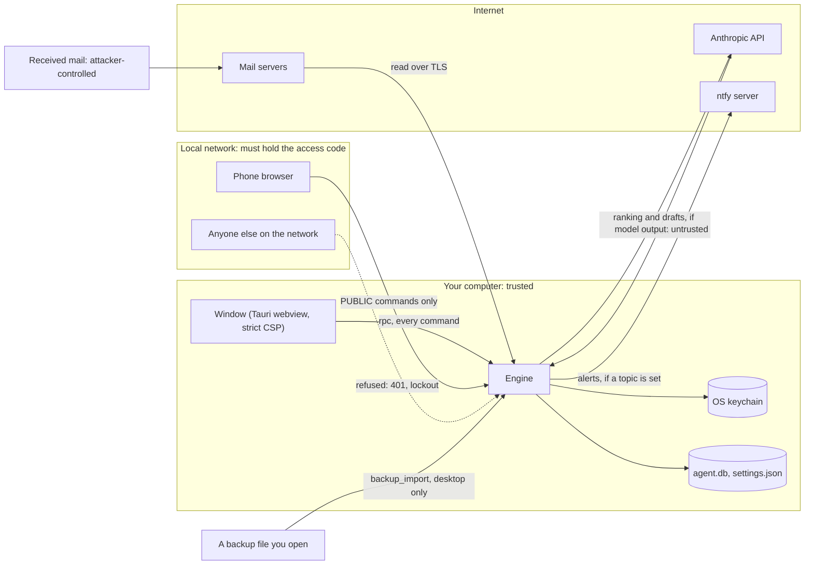

# Security model

> **Status:** current · **Audience:** developers and reviewers checking a change for security impact · **Last reviewed:** 2026-11-14

This page is the map of who is trusted, where each secret lives, what leaves the computer and how untrusted input is bounded.
The findings, fixes and residual risks are recorded in [SECURITY.md](../../SECURITY.md); the statement for users is
[PRIVACY.md](../../PRIVACY.md). This page does not repeat them.

## Trust boundaries

Everything inside "your computer" is trusted; every arrow that crosses a box edge carries data that is checked on the way in.

The window reaches the engine only through the one Tauri command `rpc` (`app/src-tauri/src/lib.rs`), with the content
security policy in `tauri.conf.json` and the permissions in `app/src-tauri/capabilities/default.json` (core, notifications,
autostart). The phone reaches it only through the hub, which allows `state` and the commands in `commands::PUBLIC`
(`Core::rpc_public`); accounts, settings, secrets, backup, search, reading message text, AI drafting and saving to the mailbox
are desktop-only. A local model reached at a non-local address would be a fourth outside party: see the next section.

## Where each secret lives

| Secret | Lives in | Reaches | Never in |
| --- | --- | --- | --- |
| Mail app password, one per mailbox | OS keychain, service `InboxAgent`, entry `imap-password` or `imap-password-<n>` (`secrets::imap_key`) | Memory of that mailbox's watcher and write-back threads; the TLS login to its own server | `settings.json`, `agent.db`, `state`, a backup, the log |
| Anthropic API key | OS keychain, entry `anthropic-key` | The `x-api-key` header of requests to `https://api.anthropic.com/v1/messages` only | Every file; `state` carries only `has_anthropic_key` (desktop) |
| Hub access code | `settings.json`, `hub.token`, 32 characters from `rand::rng` (`core::new_token`) | The desktop `state` (settings), the QR code and URL from `hub_info`, the phone's `localStorage`; compared in constant time (`hub::ct_eq`) | A backup; the phone's address bar (removed after the first load) |
| ntfy topic | `settings.json`, `alerts.ntfy_topic` | The URL of each alert | A backup |

The code is cleared when the hub is switched off, and a new one is made when it is switched on again and by "Rotate access
code". "Sign out and reset" switches the hub off, clears the code and deletes every keychain entry (`secrets::delete_all`). The engine's tests use an in-memory
keychain (`secrets::in_memory`), so they never touch a real password.

## What leaves the computer, by ranking mode

The ranking mode is `ai.mode` in the settings (`settings::AiCfg`); `ai::make_triager` falls back to the rules when the chosen
model has no model name or no key.

| | Rules only (default) | Local model (Ollama) | Anthropic with your own key |
| --- | --- | --- | --- |
| Ranking a new message | Nothing | To `ai.ollama_url` (default `http://127.0.0.1:11434`): the signals, sender name and address, subject, the 400-character excerpt, and your ten most recent corrections (sender name, subject, old and new priority) | The same, to Anthropic |
| Writing a reply draft | Nothing (a template) | Up to 3,000 characters of the message, its sender and subject, your tone, signature and instruction | The same, to Anthropic |
| Other calls | None | `detect_ollama` lists the models at the address you enter, or `ai.ollama_url`; the address must be `http` or `https` | None |

`ai.ollama_url` accepts any `http` or `https` address (`settings::valid_http_url`), so mail stays on the computer only while
it points at this computer. A restore never changes it, and never turns on the Anthropic mode.

In every mode: IMAP to each mailbox's own server; follow-up searches carrying a Message-ID and your own address, to that
server only; ntfy alerts when a topic is set (sender name and action text for alerts, counts for the digest, titles for
snooze and reminder notices). The update check makes no call while `UPDATE_REPO` is empty. Model calls and alerts never follow
redirects (`ai::http_agent`).

## Untrusted inputs and their bounds

| Input | Bounded by |
| --- | --- |
| **Received mail**, every header and body (`mail.rs`) | Messages over 5 MB not fetched; at most 200 MIME-part markers; parsed on a 64 MB-stack thread; HTML past 256 KB ignored; text cut to 3,000 characters and the excerpt to 400; at most 10 references; a Message-ID kept only if it is a plain `<token>` that is safe in an IMAP command; a failed DKIM, SPF or DMARC result cancels sender trust; calendar invitations read with size limits and rebuilt, never copied (`calendar.rs`). |
| **Model output** (`ai.rs`) | Only the first JSON object with a priority is used; priority clamped to 1 to 5; category from a fixed list, else `other`; dates must be valid; text cut; drafts stripped of control and invisible characters and capped. Email text in a prompt has `<` and `>` replaced so it cannot close its `<email>` wrapper. |
| **Write-back targets** (`writeback.rs`) | A message is acted on only when a Message-ID search returns at most 50 hits and its own header matches exactly, at most 3 messages; labels must be `AI/` plus up to 24 letters or digits. |
| **A backup file** (`backup.rs`, `store/transfer.rs`) | 8 MB before parsing; this app's format and no newer version; per-list limits (50 rules, 5,000 sender choices, 2,000 corrections, 2,000 own tasks, 5,000 mail entries, 5 mailboxes); every value checked as if typed; one transaction, so one bad value changes nothing. The hub, write-back, ntfy, the Ollama address and the paid ranking are never read from it. A mailbox's server is the one network name it can supply, so the preview lists it. |
| **The hub's callers** (`hub.rs`) | Answers only loopback, private, link-local, `100.64.0.0/10` and IPv6 local peers; at most 32 connections; one request per connection; a 5-second limit on each read and each write (not on the whole request); 16 KB of headers, 64 KB of body; 10 bad codes in a minute lock an address out; exact routes, files from a compiled-in list only; `PUBLIC` commands only; a reduced `state`; hardening headers and a CSP on every response. It speaks plain HTTP ([ADR-0009](../adr/0009-phone-hub-plain-http-with-token.md)). |
| **Settings typed in the window** (`settings.rs`) | Validated before every save: host names, ports, URLs, the ntfy topic, the ranking mode, model names, clock times. `save_settings` cannot change a mailbox, `onboarded` or the hub's access code (`hub.token`). `test_account` checks the host name and the port, and `detect_ollama` the address, before they connect; a number too big for its type is refused, not cut to fit. |

The app has no code that sends mail ([ADR-0003](../adr/0003-imap-only-never-send-mail.md)): a draft reaches only the Drafts
folder, by an explicit click, with write-back on.
