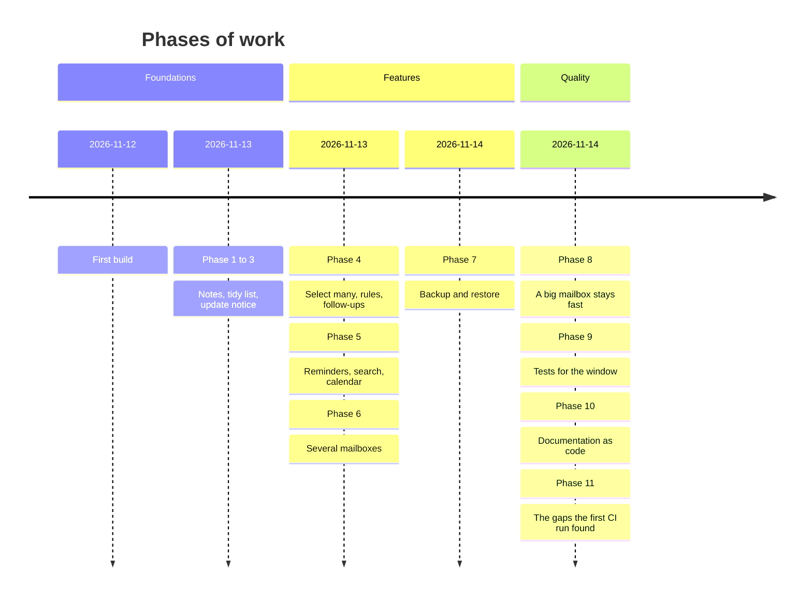

# Design documents

> **Status:** current · **Audience:** maintainers · **Last reviewed:** 2026-11-14

One design document for each phase of work from Phase 2 (the first build and Phase 1 were not written up beforehand), written before the code (see [the template](../templates/design-doc.md)). They say what the
phase set out to do and why. For what was built and how it was reviewed, see the [version history](../VERSION_HISTORY.md) and the
review records in the [documentation map](../README.md). The decisions that outlived a phase are in the [ADRs](../adr/README.md).

| Phase | Design | What it set out to do |
| --- | --- | --- |
| 2 | [phase2.md](phase2.md) | A list that tidies itself: replies close tasks, conversations are one row, the ranking learns |
| 3 | [phase3.md](phase3.md) | An update notice and "Copy diagnostics" |
| 4 | [phase4.md](phase4.md) | Select many, your own rules, follow-up reminders |
| 5 | [phase5.md](phase5.md) | Reminders and repeats, search inside messages, calendar invitations |
| 6 | [phase6.md](phase6.md) | Several mailboxes in one list |
| 7 | [phase7.md](phase7.md) | Backup and restore |
| 8 | [phase8.md](phase8.md) | A big mailbox stays fast |
| 9 | [phase9.md](phase9.md) | Tests for the window |
| 10 | [phase10.md](phase10.md) | Documentation as code |
| 11 | [phase11.md](phase11.md) | Close the gaps the documentation and the first CI run found |
