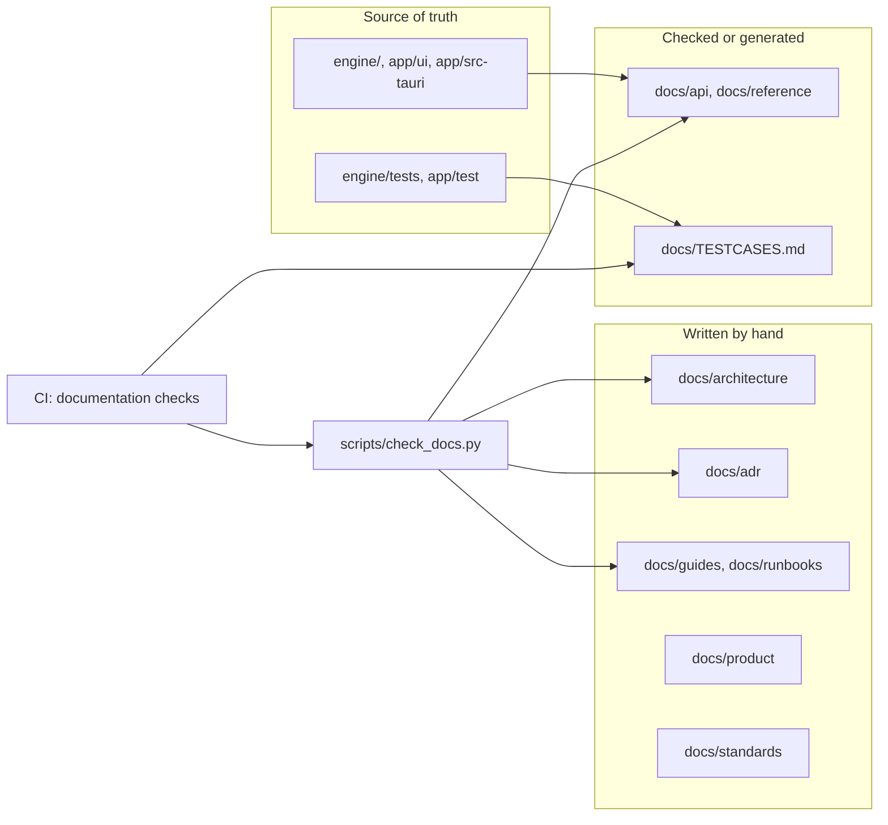

# Phase 10: documentation as code

> **Status:** current (built in Run 7) · **Audience:** maintainers · **Last reviewed:** 2026-11-14

Not a feature. The project has a README, a security review, a privacy statement, release instructions, a step-by-step description of
the engine and one design document for each phase. It has no architecture overview, no records of the decisions behind it, no
reference for the engine's commands or the phone hub, no guides for the services it connects to, no runbooks, no product
requirements, no coding standards, no troubleshooting page, and nothing that checks the documents are still true. This phase adds
them, in the repository, in the way the owner asked on 2026-11-14.

## What the owner asked for

README; code comments and docstrings; coding standards and style guides; system architecture with diagrams; architecture decision
records; API specifications; integration guides; product requirements and user stories; runbooks and playbooks; release notes and
changelogs; test plans and strategies; troubleshooting and FAQs; templates; as many visuals as possible; docs stored with the source
and updated in the same change; concise and current; automated where possible; a documentation style guide.

## Design

* **One map.** `docs/README.md` lists every document, its kind, its audience and who owns the topic; a script checks that no
  document is missing from it.
* **Architecture** (`docs/architecture/`): the system in one picture, the containers, the life of a message, the task states, the
  stored data, the threads, the trust boundaries. Mermaid diagrams, so they are reviewed in a diff.
* **Decisions** (`docs/adr/`): about a dozen short records of the choices a newcomer would question, each linking to the design or
  review that made it, with a template for the next.
* **API** (`docs/api/`, `docs/reference/`): the engine's command set (the window's only way to reach it), the phone hub's HTTP
  interface as an OpenAPI 3 file, the shape of the answer to `state`, and the settings. A script checks that every command in the
  code has an entry in the reference.
* **Guides and runbooks**: the services the app connects to (mail providers, a local model, phone alerts, the phone hub, backups) and
  the things that go wrong (a refused password, an empty list, a damaged database, a failed release), each with a diagram or a table.
* **Product** (`docs/product/`): requirements and user stories with acceptance criteria that point at the tests that check them.
* **Standards** (`docs/standards/`): coding standards for Rust and for the window, and the documentation style guide (the Google
  developer documentation style guide plus this project's rules).
* **Testing** (`docs/testing/`): the strategy (what is tested where, with what, and how a run is reviewed) and a test plan for a release.
* **Troubleshooting and FAQ**, a glossary, and **templates** for every kind of document.
* **Code comments**: every module of the engine already has a module comment; the public items are documented and `cargo doc` must
  build without warnings, which CI checks. The window's scripts keep a header comment saying what each file owns.
* **Automation**: `scripts/check_docs.py` (links and anchors, Mermaid blocks, the map, the command reference, ADR numbering,
  required header lines, review dates not older than 180 days) runs in CI and in the commit checklist; `scripts/gen_testcases.py`
  already keeps the test catalogue true.

## Acceptance

* Every kind of document the owner listed exists, follows the style guide, and has at least one diagram where a diagram helps.
* `python scripts/check_docs.py` passes, and fails when a link is broken, a command is undocumented, or a document is missing from the map.
* `cargo doc --no-deps` builds with warnings denied.
* Nothing in a new document contradicts the code (checked by two drift passes), and no new document claims what the code does not do.

## Out of scope

A documentation website (a static site generator would be a dependency; GitHub renders the Markdown and Mermaid as it is); translated
documents; screenshots of the window (the app's appearance is covered by the design documents and changes often); generated API
clients; a hosted wiki (the owner has no budget for paid services, and the repository is the home).

## Test plan

* The checker is tested: a broken link, a missing command, a missing map entry, a bad Mermaid block and a stale review date each make
  it fail (`scripts/test_check_docs.py`).
* The documents are checked against the code by a Sonnet pass over the architecture, the API and the standards, and a Haiku pass over
  what the guides and the FAQ promise.
* The three-seat council (Opus, Sonnet, Fable) is asked whether a newcomer could build, run, test and release the project from the
  documents alone.
