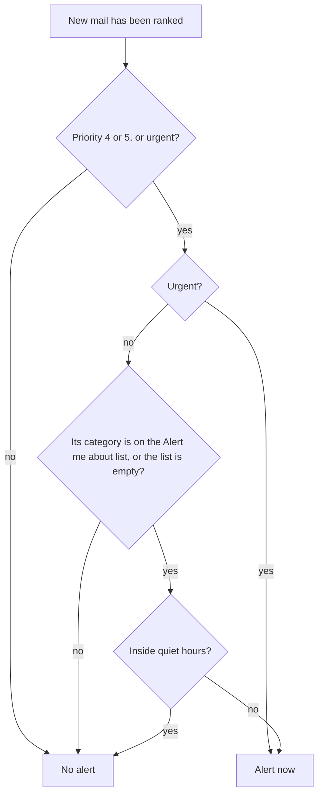

# Alerts and reminders

> **Status:** current · **Audience:** anyone who wants to be told about important mail, or reminded about their own tasks · **Last reviewed:** 2026-11-14

By the end of this guide you will have chosen where alerts go (desktop notifications, ntfy on your phone or both), set quiet hours and a
daily digest, and made a task that reminds you and repeats. It takes about ten minutes.

## What you need

* Nothing for desktop notifications and reminders.
* For alerts on a phone: the free ntfy app on the phone, and a topic name.

## What makes a notification

| Event | Title and text | Quiet hours hold it back? | Needs |
| --- | --- | --- | --- |
| Important mail arrives: priority 4 or 5, or marked urgent | Title: the sender's name (`URGENT · ` first when urgent). Text: the short action, or the subject | Yes, unless it is urgent | Desktop notifications and/or an ntfy topic |
| A snoozed conversation comes back | **Back from snooze**, with the task's title | No | The same |
| The daily digest | **Inbox digest**, for example `12 open · 3 high · 2 due · 1 draft ready` | No | A digest time |
| A reminder you set on your own task | **Reminder** with the task's title; more than three at once give one **Reminders** notice, "N reminders are due" | No: you chose the time | The same |

New mail raises an alert only for mail that arrives after a mailbox's first read finishes. Only a model can mark mail urgent, so
under **Rules only** quiet hours hold back every alert about mail. See [choose how mail is ranked](choose-how-mail-is-ranked.md).

An alert held back by quiet hours or by the category list is dropped, not delivered later. The mail is still in your list.

## Desktop notifications

**Settings**, section **Alerts**: tick **Desktop notifications**. It is on by default: setup turns it on and offers no choice. The
app uses your system's notification service. What your system does with them (do-not-disturb, per-app permission) is outside the app
and not checked here.

## Alerts on your phone with ntfy

ntfy is a free notification service. The app posts to an address made from the server and a topic name; your phone's ntfy app
subscribed to the same topic shows it.

1. Install the ntfy app on your phone.
2. Type a name into **ntfy topic** in Settings, section **Alerts** (the first-run screens no longer ask for it). Choose a long name nobody
   would guess: it works like a password. A name such as `inbox-` followed by 16 random letters and digits is a good one.
3. Subscribe to the same topic in the ntfy app.

The topic may use letters, digits, `-` and `_` (up to 64 characters), or the window says "Alert topic can only use letters, digits, - and
_". **Treat the topic like a password:** anyone who knows it can read what is sent to it. The server is `https://ntfy.sh` unless you
change `alerts.ntfy_server` in `settings.json` (the window has no field for it).

What goes to ntfy is the same title and text as the desktop notification, ASCII only in the title (other characters show as `?`). Mail
alerts go with ntfy's priority 5 when urgent and 4 otherwise. The digest, snooze and reminder notices go to ntfy too. See
[Privacy](../../PRIVACY.md).

## Quiet hours, categories and the digest

In **Settings**, section **Alert schedule**:

* **Quiet from** and **Quiet until**: set both, or the window says "Set both a start and an end for quiet hours". The quiet period may cross
  midnight (22:00 to 07:00). The start is inside the quiet time and the end is outside. "Urgent mail still gets through during quiet
  hours."
* **Alert me about**: eight chips (`work`, `personal`, `finance`, `travel`, `notification`, `promo`, `reading`, `other`). All are on
  when none is chosen: "Urgent mail always alerts. Choose none to hear about every category."
* **Daily digest at**: a time. The digest is sent once a day, at or after that time, if the app is running and at least one task is
  open. It counts conversations, not messages, and leaves out snoozed tasks and ones that left your inbox. Leave the time empty for no
  digest.

## Your own reminders and repeats

Reminders are for tasks you add yourself, not for mail (for mail, snooze it).

1. Press `a` or **Add task**. Give it a title, a priority and, if you like, a due date.
2. Open the task. Set **Remind** to a date and time, and choose a repeat: **Doesn’t repeat**, **Every day**, **Every week** or
   **Every month**. The window says "Reminder set" or "Repeat set".
3. At that time the notification appears, once, within about 20 seconds (the app looks every 20 seconds). **Clear** removes the reminder.

A reminder time must not have passed ("Pick a time that has not passed") and must be between the years 2000 and 2100. A repeat needs a
reminder time or a due date ("A repeat needs a reminder time or a due date"). Times are the computer's local clock and stay at the same
hour when the clocks change. A monthly repeat counts from the first date: a task set for the 31st lands on the 28th in February and on
the 31st again in March.

Finishing a repeating task (press `x`) does not close it. It moves to its next time and the window says, for example, "Done for now.
Next: 2026-11-20 at 09:00". There is no undo for that. On the phone you can set a reminder too; the field is labelled "Remind (computer’s
time)" and the notification still appears on the computer (and on ntfy).

## Snooze

Open a task and use **Snooze**: **3 hours**, **Tomorrow** (09:00), **Next week** (the next Monday, 09:00), or **or until** a date (09:00
that day, up to a year ahead; the date box starts at tomorrow, and the engine also takes today while it is before 09:00. A day outside that
range gives "Pick a day from today (only before 09:00) to a year ahead"). **Bring back** ends it. New mail in a snoozed
conversation wakes it. When a snooze ends you get **Back from snooze**.

## Check that it worked

Add a task of your own with a reminder two minutes ahead: the notification appears at that minute, on the desktop and, if you set a topic,
on the phone.

## If something goes wrong

| What you see | Why | What to do |
| --- | --- | --- |
| No notification for important mail | Quiet hours, the category list, priority below 4, or it was in the first read of a mailbox | Check **Alert schedule**; look at the task's priority |
| No ntfy message | Topic empty or different from the phone's, or the ntfy server could not be reached (the app does not retry) | Compare the topics; check the phone's subscription |
| No digest today | The app was not running at or after the digest time, or no task was open | Open the app; the digest is sent once a day when it is |
| "Couldn't save: Alert topic can only use letters, digits, - and _" | A space or other character in the topic | Remove it |

## Next steps

* [Settings reference](../reference/settings.md)
* [Phone and tablet](phone-and-tablet.md)
* [Troubleshooting](../troubleshooting.md)
