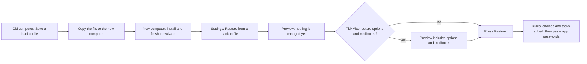

# Backup and restore

> **Status:** current · **Audience:** anyone moving to a new computer, starting afresh, or keeping their choices safe · **Last reviewed:** 2026-11-14

By the end of this guide you will have saved your rules, sender choices, corrections and tasks into one file, and know how to put them
back. It takes about three minutes.

## What you need

* Inbox Agent with your first mailbox set up.
* A place to keep the file: it is not encrypted.

## What a backup holds and leaves out

| A backup holds | A backup never holds |
| --- | --- |
| Your rules (up to 50) | A password or API key |
| Sender choices: "Always important" and "Mute" (up to 5,000) | The phone hub's access code, or whether the hub is on |
| Corrections you made to the ranking (up to 2,000), each with the sender and subject of the mail you corrected: the only place any mail's sender or subject appears | The setting "Let Inbox Agent file mail" |
| Tasks you added yourself (up to 2,000) with their notes, reminders, repeats, stars and done or open state | The ntfy topic or server, or an Ollama address |
| What you did with mail (up to 5,000 entries): finished, starred, snoozed, your note, a reply draft you edited yourself. Each is tied to the message's ID and its mailbox, never to its text | Any message's text, excerpt, sender or subject (apart from the corrections) |
| Your mailboxes: server, port and address | Reply drafts written by the AI or from a template |
| A short list of options: ranking mode and local model name, desktop alerts, alert categories, quiet hours, digest time, reply-draft options, follow-up days, the update check | The ranking mode "Claude with your own key": a file can never choose it |

The file is plain JSON named `inbox-agent-backup-YYYYMMDD-HHMMSS.json`, at most 8 MB. It is **not encrypted**. Keep it as you would any
private document and delete it when you no longer need it. It is saved as a new file in your Downloads folder (your user folder if there
is none), never over an existing one: a second file the same second gets `-2` and so on. Where the system has owner-only file
permissions, the file gets them. See [Privacy](../../PRIVACY.md).

## Save a backup

1. Open **Settings** and find **Backup**.
2. Press **Save a backup file**. The line under the buttons reads "Saved" followed by the file's path, and the window says "Backup
   saved".
3. If you have more than a file can hold, the line adds "A backup file holds at most 5,000 sender choices, 2,000 corrections, 2,000
   tasks of yours and 5,000 entries about mail; left out: …" with how many it left out. If the data is over 8 MB the app says "Your data
   is too large for one backup file (over 8 MB)".

## Restore from a backup

You need your first mailbox set up first ("Finish setting up your first mailbox before restoring a backup"). On a new computer, run the
wizard, then restore.

1. In **Backup** press **Restore from a backup file** and choose the file. If you have unsaved rule changes the window says "You have
   rule changes that are not saved. Save the rules first, then restore."
2. The dialog **Restore from a backup** shows a preview and changes nothing yet. It lists what would be added ("1 rule will be added",
   "2 tasks of yours will be added", "3 messages already here will get what you did with them", and so on), the new rules in words,
   and what was already there.
3. Optionally tick **Also restore options and mailboxes**. The preview changes to include them. Check each mailbox's server in the
   preview before you go on, and restore only a file you made yourself.
4. Press **Restore**. **Cancel** has the focus when the dialog opens, so pressing Enter by reflex restores nothing. The window says
   "Restored: …" with what was added.
5. If the file brought mailboxes, each one shows **Needs a new app password** in Settings. Paste its app password to connect it.

## What a restore never does

* It never removes anything you already have. Restoring the same file twice changes nothing.
* It never restores a password, a key, the phone hub, "Let Inbox Agent file mail", the ntfy topic or server, or the ranking mode "Claude
  with your own key" (the preview says "The file asks for ranking with Claude and your own key. That is not restored: choose it in
  Settings if you want it.").
* It never changes your mailbox: nothing is queued for it. What you did with a message (done, star, a note) is laid over the task here.
* It never changes a mailbox you already have, and adds at most five mailboxes in all. A mailbox it adds has no password.
* Two things replace what you have: a later snooze, and the options, if you ticked the box. Choosing a sender "Always important" or "Mute"
  changes that sender's open mail, as choosing it yourself does.
* What you did with mail the app has not read yet waits (up to 5,000 entries, forgotten after 90 days) and is applied when that message
  is read. The first read of a mailbox takes only its newest 50 messages, so entries about older messages are never applied and are
  forgotten after 90 days. Entries about a mailbox not set up here are skipped: "Add that mailbox, then restore again."

## Check that it worked

After a restore, **Settings**, **Your rules** lists your rules, your own tasks are in the list, and a second restore of the same file
says "Nothing in this file is new to this computer."

## If something goes wrong

| What you see | Why | What to do |
| --- | --- | --- |
| "This is not a backup made by Inbox Agent: it could not be read" | The file is not JSON, or is damaged | Use the file the app saved |
| "This is not a backup made by Inbox Agent" | JSON of another kind | The same |
| "This backup was made by a newer version of Inbox Agent. Update the app, then restore it" | The file's version is newer than the app's | Update the app |
| "That file is too large to be one of this app's backups (the limit is 8 MB)" | Over 8 MB | Choose the right file |
| "The file has more rules than a backup of this app can hold (the limit is 50)" | A limit is passed (the same wording for sender choices, corrections, tasks and entries about mail) | The file was changed by hand or comes from elsewhere |
| "Nothing in this file is new to this computer." | Everything in it is here already | Nothing to do |
| `Could not save the backup file: …` or "The app could not find your Downloads folder" | The folder is not writable or missing | Free space or fix the folder's permissions |

## Next steps

* [Rules and sender choices](rules-and-sender-choices.md)
* [Connect a mailbox](connect-a-mailbox.md)
* [Decision record: one JSON file, additive restore](../adr/0010-backup-is-one-json-file-additive-restore.md)
* [Design of backup and restore](../designs/phase7.md)
