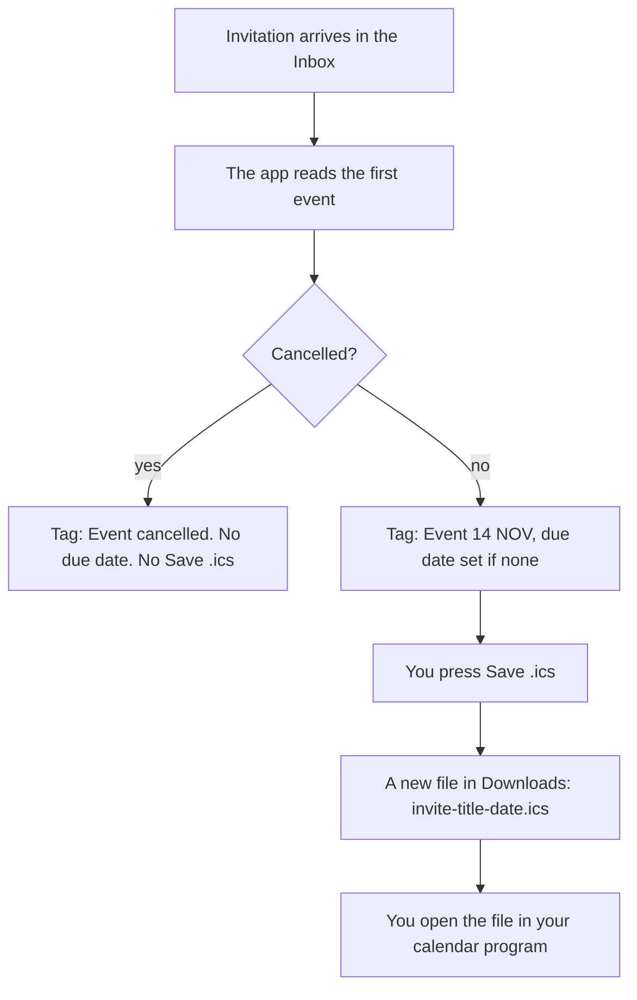

# Calendar invitations

> **Status:** current · **Audience:** anyone who receives meeting invitations by email · **Last reviewed:** 2026-11-14

By the end of this guide you will know what Inbox Agent shows for an invitation, what it does with the date, and how to get the event
into your calendar with **Save .ics**. It takes about three minutes.

## What you need

A message that holds an invitation, on the computer (the phone shows the event but cannot save the file), and a calendar program that
opens `.ics` files.

## What the app does with an invitation

When a message carries an invitation (a calendar part of the message, or an attached `.ics` file) the app reads its **first event** and
keeps four things: the title, the time, the place and whether it is cancelled. Everything is treated as untrusted text: a calendar part
over 64 KB is ignored, control characters and invisible or direction-changing characters are removed, and each field is cut to 200
characters (the name of a time zone the app does not know, to 64).

| Where | What you see |
| --- | --- |
| The task's tag line | `Event 14 NOV`, or `Event cancelled` in red |
| An open task, **Event** row | The title, then the time, then the place. A time in UTC is shown in your computer's time; any other time is shown as written, followed by its zone name. A cancelled event shows "· cancelled" |
| The task's due date | If the message states no date of its own and the event is today or later, the task's due date becomes the event's day. A cancelled event gives none |
| An open task | **Save .ics**, with the note "into Downloads (or your user folder if there is none); you open it" |

## Save the event

1. Open the task. The **Event** row shows what the app understood.
2. Press **Save .ics**. The window says "Saved" followed by the file's path.
3. Open that file yourself in your calendar program. The app never opens it, and never replies to the sender.

The file is built by the app from the event's fields, not copied from the message. Its name is `invite-` followed by up to 40 characters
of the title (letters and digits, words joined by hyphens), then the start date, then `.ics`, for example `invite-team-meeting-20261120.ics`. If the name is taken, the app adds `-2`,
`-3` and so on and never replaces a file. The folder is Downloads, or your user folder if there is no Downloads folder. The file holds
the title, the start and end (or the whole day), the time zone, and the place, marked as a published event. It holds no guest list,
no description and no alarms.

## What the app does not do

* **It never accepts or declines.** The app sends no mail, so it cannot answer an invitation. Reply from your own mail program.
* **It does not add the event to a calendar for you.** You open the saved file.
* **It keeps only the first event** of a message, and for a repeating invitation only its first time. The window says "This invitation
  repeats; only the first time is kept".
* **It does not know every time zone name.** Outlook's own zone names (such as "W. Europe Standard Time") are converted from a built-in
  list. A name it does not know is shown as written, with "Time zone “…” is not one this app knows, so the time is shown as written",
  and the saved file then carries a floating local time.
* **The phone shows the event but cannot save the file.** **Save .ics** is on the computer only.

## Check that it worked

A file named `invite-….ics` is in your Downloads folder, and your calendar program shows the event when you open it.

## If something goes wrong

| What you see | Why | What to do |
| --- | --- | --- |
| No **Save .ics** button | The event is cancelled, or you are on the phone | Use the computer |
| "This message has no event to save" | The task has no event (the message was an ordinary mail) | Nothing to save |
| "This event was cancelled, so there is nothing to add to a calendar" | The invitation is a cancellation | Remove the old event from your calendar yourself |
| "The app could not find your Downloads folder" | No Downloads folder and no user folder were found | Create the folder, or check your system's user profile |
| "Could not save the file: …" | The folder is not writable, or there are 99 files of that name already | Free the name or fix the permissions |
| The time looks wrong by some hours | The invitation names a zone the app does not know | Check the zone note under the time |

## Next steps

* [Privacy](../../PRIVACY.md): what is kept from an invitation
* [Design of calendar invitations](../designs/phase5.md)
* [Engine step by step, section 5g](../PSEUDOCODE.md)
