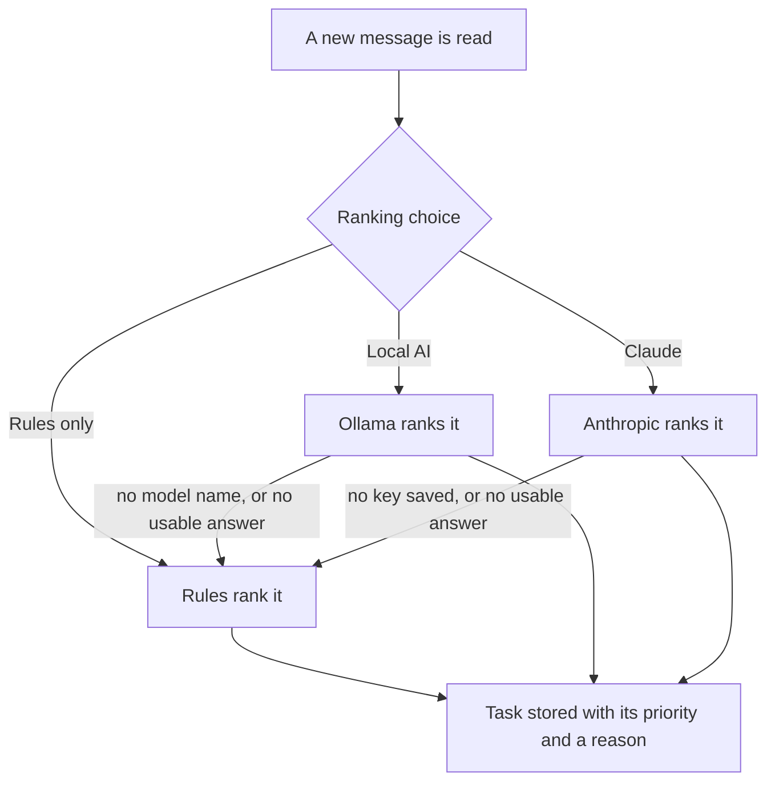

# Choose how mail is ranked

> **Status:** current · **Audience:** anyone choosing between rules, a local model and a cloud key · **Last reviewed:** 2026-11-15

By the end of this guide you will have picked how new mail gets its priority, and you will know exactly what each choice sends and where.
It takes about five minutes, plus the time to install a local model if you choose one.

## What you need

* Nothing for **Rules only**.
* For a local model: Ollama running on your computer, with at least one model pulled.
* For Claude: an Anthropic API key with credit on your own account.

## The three choices

| Choice in the window | What ranks the mail | What leaves your computer for ranking | What you need |
| --- | --- | --- | --- |
| **Rules only** (the default) | Fixed rules: who you write to, replies to your mail, bulk-mail headers, keywords for the category, dates in the text | Nothing | Nothing |
| **Local AI (Ollama)** | A model that runs on your computer | Nothing, as long as Ollama's address is on your computer (see the warning below) | [Ollama](https://ollama.com) installed, and a model pulled, for example `ollama pull llama3.2` |
| **Claude with your own API key** (**Claude (own API key)** in Settings) | Anthropic's model, through your own API key | Details of each new message go to `api.anthropic.com` (see the next table) | An Anthropic API key. Anthropic bills it to your API account |

The window has no sign-in with a Claude subscription: Anthropic does not permit it in third-party apps, so only an API key works.

Whichever you pick, the priority is 1 to 5 (5 needs attention within the hour, 1 means ignore), plus a category from eight
(`work`, `personal`, `finance`, `travel`, `notification`, `promo`, `reading`, `other`), a short action, whether a reply is needed, and
a due date if the text states one. A model's answer is checked: an unknown category becomes `other`, and a date that is not a real day
is dropped.

## What each choice sends

Nothing leaves your computer under **Rules only** or under a local model. Under **Claude with your own API key**:

| When | What is sent to Anthropic |
| --- | --- |
| Each new message is ranked | The sender's name and address, the subject, the first 400 characters of the text, three yes/no signals (someone you write to, a reply to you, bulk mail) and a prior score. With them, your ten most recent corrections: the sender name and subject of those other messages, and the priority before and after |
| A reply draft is written (by you, or automatically if you turned that on) | The sender, the subject, up to 3,000 characters of the message, the tone, your signature and the short request you typed (for example "decline politely") |
| You press **Test** in Settings | An invented sample message ("Contract needs your signature today"), never your mail |

The key lives in the system keychain (name `anthropic-key`), never in a file, and is sent only to Anthropic's fixed address. The full
list of what is stored and sent is in [Privacy](../../PRIVACY.md); the trust boundaries are in the
[security model](../architecture/security-model.md).

A local model is called at `http://127.0.0.1:11434` by default. The window has no field for that address; it can only be changed in
`settings.json` (`ai.ollama_url`, see the [settings reference](../reference/settings.md)). **If you point it at another computer, mail
text goes to that computer.**

## Steps

1. **At first run** nothing is asked: setup starts with **Rules only**, which is instant and fully private.
2. **To change it:** open **Settings** (or press `,`), press **More options** if you are in the simple view (the default for a new install), and use the dropdown in the **Ranking** section.
3. For **Local AI (Ollama)**: type the **Ollama model** name (Settings, placeholder `llama3.2`).
4. For **Claude**: paste the key into **API key** (placeholder `sk-ant-…`). In Settings, once the key is saved, the window says "Key saved to
   keychain" and the label reads "(saved — enter a new one to replace)".
5. Press **Test**. A green "Works · P… · …" with the sample message's priority and action means the model you chose answered. A red
   message means it did not: "No model is chosen" (**Local AI** with an empty model name), "No API key is saved" (**Claude** with no
   key in the keychain), or the model's own error. Under **Rules only** the test always passes, with the sample ranked by the rules, so it says nothing about a model.

## Check that it worked

In **Settings**, **Ranking** shows your choice. With a model chosen, **Test** answers "Works · P… · …" for the sample message once the
model has answered. A task's **Why** row, once open,
says "Rule-based: …" when the rules ranked it, and gives the model's own sentence otherwise.

## What happens when the model fails

A model that is not running, a key that is wrong, a slow answer (120 seconds for a local model, 60 for Anthropic) or a reply that cannot
be read does not lose any mail: that message is ranked by the rules instead. If you chose **Local AI** but left the model name empty,
or chose **Claude** but saved no key, the rules rank everything, and **Test** says "No model is chosen" or "No API key is saved". Reply
drafts fall back to a quick-reply template, and the window says "The AI didn’t answer, so a quick reply was used".

A change of choice applies to mail read after the change. Tasks already in your list keep their ranking.

## How the rules rank

Without a model, a message starts at priority 4 if it replies to something you sent, or comes from someone you have written to and is
not bulk mail; 3 if the sender is unknown; 2 if it is bulk mail from someone you write to; 1 if it is other bulk mail. "Someone you
write to" and "replying to you" come from your Sent folder. Priority 5 is given only when the message is not bulk mail, comes from
someone you write to or replies to you, asks a question (a question mark in the text), passes the sender check, and names a due date
that is today, tomorrow or past. Rules-only never marks mail urgent, because the words "URGENT"
and "ASAP" cost nothing to write. A message that fails the provider's sender check (DKIM, SPF or DMARC) gets no "someone you write to"
trust.

Your own [rules, sender choices and corrections](rules-and-sender-choices.md) apply on top, with any choice.

## Cost and limits

* Each new message is one request to Anthropic. The first read of a new mailbox ranks its newest 50 messages.
* The **Daily limit** in **Reply drafts** (default 25, at most 200) caps automatic drafts per day. Ranking has no cap.
* The model name Anthropic is asked for is `ai.anthropic_model` in `settings.json`. The window has no field for it.
* Reply drafts need a model for AI text; **Write drafts automatically** does nothing under **Rules only**.

## If something goes wrong

| What you see | Why | What to do |
| --- | --- | --- |
| Red text after **Test**: "No model is chosen", "No API key is saved", or a connection or key error | No model name or key is set, Ollama is not running, the model name is wrong, or the key is wrong or has no credit | Type a model name or paste the key; start Ollama, check the model name under **Ranking**, and press **Test**, or paste the key again |
| Everything is ranked "Rule-based: …" in the reason | **Rules only** is chosen, or the model is not configured or keeps failing | Press **Test** with a model chosen and read the message. A green **Test** under **Rules only** only shows that the rules ran |
| "The AI didn’t answer, so a quick reply was used" | The model failed when a draft was asked for | Check the same things, then press **Draft a reply** again |

## Next steps

* [Privacy](../../PRIVACY.md) for the full list of what is stored and sent
* [Rules and sender choices](rules-and-sender-choices.md)
* [Decision record: rules first, AI optional](../adr/0006-rules-first-triage-optional-ai.md)
* [Engine step by step, section 5](../PSEUDOCODE.md)
