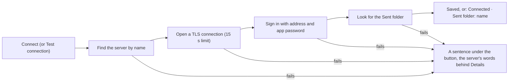

# Connect a mailbox

> **Status:** current · **Audience:** anyone setting up Inbox Agent or adding a second mailbox · **Last reviewed:** 2026-11-15

By the end of this guide you will have one mailbox connected and know how to add up to four more. It takes about five minutes, most of
it spent making an app password at your provider. The first-run screens are written to be done by anyone: you type your email address, the
app opens the right page at your provider, you copy a code from it and paste it back, and press one button.

## What you need

* An email address at a provider that offers IMAP with a password: Gmail, iCloud Mail, Yahoo, Fastmail, or another IMAP server.
* An **app password** for that address. It is a password your provider makes for one program, so that you do not give the program your
  main password. Your usual password is not what the app asks for.
* An internet connection. The app connects with TLS from the first byte (usually port 993). STARTTLS on port 143 and unencrypted
  connections are not supported.

## What each provider needs

The app reads the provider from the part of your address after the `@`. The button on the code screen opens the page in your web browser
where the provider makes the code (the app opens only a short list of provider pages, and only over `https`: see
[`open_page`](../api/rpc.md#open_page)).

| Your address ends in | Provider | Server (filled in for you) | The page the button opens, and what to do there |
| --- | --- | --- | --- |
| `gmail.com`, `googlemail.com` | Gmail | `imap.gmail.com` | `myaccount.google.com/apppasswords`: type Inbox Agent as the name and press Create. Google shows 16 letters. If Google says it cannot make one, "2-Step Verification" has to be turned on first |
| `icloud.com`, `me.com`, `mac.com` | iCloud Mail | `imap.mail.me.com` | `account.apple.com/account/manage`: Sign-In and Security, App-Specific Passwords, the + button, the name Inbox Agent |
| `yahoo.com` and the other Yahoo country domains (not `yahoo.co.jp`), `ymail.com`, `rocketmail.com` | Yahoo Mail | `imap.mail.yahoo.com` | `login.yahoo.com/account/security`: "Generate app password" (or "App passwords"), the name Inbox Agent |
| `fastmail.com`, `fastmail.fm`, `messagingengine.com` | Fastmail | `imap.fastmail.com` | `app.fastmail.com/settings/security/integrations`: "New app password", the name Inbox Agent, "Mail (IMAP/SMTP)" |
| `outlook.*`, `hotmail.*`, `live.*`, `msn.com` | Outlook, Hotmail or Live | not connected, or **Sign in with Microsoft** when the build offers it | The window says, in a sentence, that Microsoft does not let an app like this one sign in with a code, so it cannot read this mailbox yet. A small button sets it up by hand for the rare mailbox that still takes a password. See [what is not supported](#what-is-not-supported) |
| Any other domain | Other IMAP server | You type the **Mail server** (`imap.` and the domain are filled in as a guess) and the **Port** (993) | Your provider's help pages list "IMAP settings". Use an app password if the provider offers one |

The wording of a provider's own page changes from time to time; the page the button opens does not. Spaces in a pasted code are removed for you (the
engine does it), so you can paste Google's 16 letters as they are shown. The **Add a mailbox** dialog in Settings is the older form: a provider menu,
the steps above under "Making a code" with the same button, and **Test connection**.

## Steps

### The first mailbox (first run)

1. Start Inbox Agent. The first time, the window opens **Set up Inbox Agent**: three screens ("Step 1 of 3" and so on) and a last one.
2. **Welcome.** Three sentences: what the app does, that it never sends email and never changes your mailbox unless you ask, and that your
   password is kept in your computer's password safe. Press **Get started**.
3. **What is your email address?** Type it. Under the box the app says what it made of it ("That looks like a Gmail address."). **Continue**
   waits for something that looks like `name@example.com`. Enter does what **Continue** does.
4. **Make a code for Inbox Agent** (a known provider). Press **Open Google's page** (or Apple's, Yahoo's, Fastmail's): your web browser opens
   at the page where the code is made, and three plain steps are written below the button. Copy the code, come back, and press **Paste**
   (the app reads what you copied and connects at once), or click in the box, paste or type the code, and press **Connect** or Enter. The
   box hides the code unless you tick **Show the code**. If the browser cannot be opened, the window says the address to type.
   For an address the app does not know, this screen is **Your mail server**: the server (guessed as `imap.` and the domain), the port and the
   password. For an Outlook, Hotmail or Live address it is a sentence that this cannot be connected yet, and a way back.
5. **Connect** does everything: it tests the details, saves the mailbox (the password goes to your system keychain) and finishes setup with
   safe settings: ranked by rules only, desktop alerts on, your mailbox left untouched, the phone hub off. While it works the message says
   "Connecting to Gmail. This can take up to half a minute." and nothing else can be pressed. If it fails you stay on the screen, the code is
   still in the box, and a sentence says what to do (see [If something goes wrong](#if-something-goes-wrong)); the server's own words are behind
   **Details for a helper**.
6. **You're connected.** Says that the first read can take a few minutes, that closing the window leaves Inbox Agent running (its icon near the
   clock brings it back), and offers **Open Inbox Agent when I turn on this computer**, on by default. **Open my list** closes the screen and
   applies that choice.

Everything the old setup asked beyond this (how to rank mail, phone alerts, filing mail, the phone hub) is still in Settings, with the same
defaults; see [choose how mail is ranked](choose-how-mail-is-ranked.md), [alerts](alerts-and-reminders.md),
[let the app file mail](let-the-app-file-mail.md) and [phone and tablet](phone-and-tablet.md).

The first read takes the newest 50 messages. The list says "Reading your latest mail…" and "The first sync can take a minute." While it
runs, the alerts stay quiet: the app alerts only for mail that arrives after that first read.

### Sign in with Google or Microsoft instead of a code

When the build of the app has been registered with Google or Microsoft ([the runbook](../runbooks/register-sign-in.md)), two more buttons appear.
The app tells you nothing about this when they are not there: it works as above.

1. **Google (a Gmail address).** On the code screen the first button is **Sign in with Google**. Press it: your web browser opens Google's page. Sign in
   and allow Inbox Agent to read your email. Until the app has been verified by Google (it has not: that costs money), Google first says "Google hasn't verified
   this app": press **Advanced**, then **Go to Inbox Agent**. When Google says you can close the tab, go back to the app: it connects by itself.
2. **Microsoft (Outlook, Hotmail, Live).** The screen is **Sign in with Microsoft**. Press it: the window shows a short code such as `ABCD-EFGH` and
   opens Microsoft's page (or say where to go). Type the code there and sign in. Work and school accounts are not covered.
3. **Cancel** stops the wait. Nothing is saved until the mail server has accepted the sign-in; no password is kept: the sign-in is held in your system
   keychain and removed with the mailbox (Google is told to cancel it, too).
4. In Settings such a mailbox says "Signed in with Google. No password is kept." and has **Sign in again**. The **Add a mailbox** dialog has the same button for a Gmail or
   Outlook address (type the address first).

Google limits an app it has not verified to 100 people, so for most people the code is still the way. The code costs nothing and works for everyone.

### Another mailbox

1. Press **Settings** (or `,`). In the **Mail** section press **Add another mailbox**. The button is greyed out when five are in use.
2. The dialog **Add a mailbox** says "Its mail joins the same list. A small tag on each task says which mailbox it came to." and how many
   of 5 are in use. Choose the provider, fill in the fields and press **Test connection**.
3. When the test shows **Connected**, press **Add mailbox**. The window says "Mailbox added. Its mail is being read."

Every mailbox has its own connection, its own password in the keychain and its own Sent-mail learning. A task shows a small tag with the
part of the address before the `@` (hover for the full address), and the filter bar gets one chip per mailbox. The phone hub never sees
mailbox names. To remove one, press **Remove** beside it, then press again when the button asks "Click again: removes this mailbox, its
tasks and its saved password from the app". Nothing in the mailbox itself is touched. **Remove** is not offered when only one mailbox is
left: use **Sign out and reset** instead.

## Check that it worked

In **Settings**, under **Mail**, the mailbox says **Connected**, and the bottom bar of the window says "Watching your inbox". Mail
arrives in the list within seconds of reaching your provider.

## What Connect and "Test connection" check

| It does | It does not |
| --- | --- |
| Checks first that you gave a server, an address and a password, that the server name uses only letters, digits, dots and hyphens, and that the port is a whole number from 1 to 65535. Nothing connects until they pass | Read, move or change any mail |
| Finds the server by name (the name lookup has no time limit of its own) and connects, giving up after 15 seconds on the connection | Save the server or the address |
| Opens a TLS connection and checks the server's certificate against the name you typed | Save the password (that happens when **Connect** saves the mailbox, or at **Add mailbox**, and neither saves an empty one) |
| Signs in with your address and password | Check that the Inbox, Archive or Drafts folders exist |
| Looks for your Sent folder: the one the server flags as Sent, else one named `[Gmail]/Sent Mail`, `Sent`, `Sent Items`, `Sent Messages` or `INBOX.Sent` | Prove the mailbox will keep working: providers can cancel an app password later |
| Signs out | |

## Where your details go

The password goes to the system keychain (Windows Credential Manager, macOS Keychain or the Secret Service), under the name
`InboxAgent`, never into a file. The server, port and address go into `settings.json` in the app's data folder. See
[Privacy](../../PRIVACY.md) and the [settings reference](../reference/settings.md).

## Change a password later

Providers cancel app passwords when you change your account password. Open **Settings**, find the mailbox in the **Mail** section,
paste the new password into **New app password** and press **Save password**. The app checks it first ("Checking…"), then says "Saved.
Your list is untouched." and reconnects every mailbox. Your list, notes and tasks stay.

## What is not supported

**Outlook, Hotmail, Live and Microsoft 365 mailboxes.** Type such an address and the window shows a screen of its own: "Microsoft does not let an
app like this one sign in to these addresses with a code, so Inbox Agent cannot read this mailbox yet." It offers a way back, and a small button
for the rare mailbox that still takes a password (it opens the server form with `outlook.office365.com`). The reason in the code is that the app signs
in only with an address and a password over IMAP; it has no "Sign in with Microsoft" (OAuth) flow yet. If you try by hand, the server is expected to
refuse the password (not tested against a live Microsoft server). The [Phase 12 design](../designs/phase12.md) plans that sign-in, and one for
Google, as buttons that appear only when the person who builds the app has registered the app with Microsoft or Google.

Also not supported: sending mail (the app has no SMTP at all), servers that need STARTTLS or a plain connection, and more than five
mailboxes. The app reads only the Inbox of each mailbox. Mail your provider files into Spam or another folder is never read.

The sign-in and write-back code is tested against a scripted mock IMAP server, not against every provider. A real server can differ
in details; see [Security](../../SECURITY.md#residual-risks-and-limits).

## If something goes wrong

Sign in with an account:

| What you see | Why | What to do |
| --- | --- | --- |
| "You chose not to allow Inbox Agent, so nothing was connected." | You pressed Cancel or No on the provider's page | Press **Sign in** again |
| "Mail access was not allowed. Sign in again and keep the box that lets Inbox Agent read your email ticked." | The permission to read mail was unticked on Google's page | Sign in again and leave it ticked |
| "Google did not give Inbox Agent lasting access. Remove Inbox Agent at myaccount.google.com/permissions, then sign in again." | Google had already allowed the app once and gave no new lasting sign-in | Do as it says |
| "The sign-in took too long. Try again." | Five minutes passed, or the code ran out | Press **Sign in** again |
| "Google did not let Inbox Agent in with that account. Make sure you signed in with the address you typed, then try again." (**Details for a helper**: `sign-in refused`) | You signed in on Google's page as another account than the address typed | Sign in again with the address you typed |
| "Google says this sign-in is no longer valid. Sign in again." (a mailbox in Settings) | You changed the password, removed the app at Google, or it had been unused for six months | **Settings**, **Sign in again** |
| "… did not accept this app's sign-in settings, so this copy of Inbox Agent cannot sign in with …. Use an app password instead." | The app's registration is wrong or has been withdrawn | Use a code; the owner follows [the runbook](../runbooks/register-sign-in.md) |
| "Couldn't open your web browser" | The system has no default browser | Open one and use the code way |

Codes and the rest:

| What you see | Why | What to do |
| --- | --- | --- |
| "That code didn't work. Make a new one with the button above and paste it here. Your usual Google password won't work." (behind **Details for a helper**: `sign-in refused: …`, the server's own words) | Wrong or cancelled app password, or IMAP is switched off in the provider's settings | Press the button above the box, make a new code and paste it. A provider that is not one of the four says "The server didn't accept that sign-in. Check the email address and the password" |
| "Gmail wants you to sign in on its website first." (`Web login required`) | The provider blocked the sign-in until you have signed in once in a browser | Open the provider's website, sign in, then press **Connect** again |
| "Gmail says other mail programs are switched off for this account." (`IMAP access is disabled`) | IMAP is off in the provider's settings | Turn on "IMAP" in the provider's mail settings, then press **Connect** |
| "A safe connection to Gmail couldn't be made. This can happen on a work or school network, or when the date or time on this computer is wrong." (`secure connection failed: …`) | The certificate was refused (a wrong clock or a network that inspects traffic), or the wrong server or port | Check the clock, try another network, or check the server and port (usually 993) |
| "Couldn't reach Gmail. Check that this computer is online" or, for an unknown server, "Couldn't find a mail server called …" (a system lookup error) | There is no network, or the server name is misspelt | Check your connection, or the spelling (letters, digits, dots and hyphens only) |
| "Gmail took too long to answer" / "Couldn't connect to …. Check the server name and the port" / "This computer doesn't seem to be online" / "Gmail asks you to wait a little" | A timeout, a refused connection, no route to the network, or the provider's own rate limit | Check the connection and try again in a few minutes |
| "Something went wrong while connecting. Wait a minute and try again." | An error the window has no sentence for | Open **Details for a helper** and see [mailbox will not connect](../runbooks/mailbox-wont-connect.md) |
| "Connected · no Sent folder found, so replies you send will not close tasks and there are no follow-up reminders" (shown in green: the test passed) | The provider's Sent folder has no Sent flag and none of the common names above | **Continue** and **Add mailbox** work. The mailbox lists and ranks mail as usual; replies you send do not close tasks, and there are no follow-up reminders for it. Report the folder names if you want those |
| `That mailbox is already in the app` | The same server and address (ignoring letter case; `googlemail.com` counts as `gmail.com`) is already added | Nothing to do |
| `You can read at most five mailboxes at once` | Five are in use | Remove one first |
| `Enter the mail server and the email address` | The server or the address was empty when you pressed **Test connection** | Fill in both and test again |
| `That mail server name isn't valid` | The server name has a space or a character other than letters, digits, `.` and `-` (for example a pasted web address) | Type the name only, such as `imap.example.com` |
| `That mail server port isn't valid` | The **Port** box is empty, 0, above 65535 or not a whole number. The app refuses it and does not shorten it to fit | Type the port your provider names for IMAP over TLS (usually 993) |
| "Paste the code first." (**Connect**), `Enter the app password` (**Test connection**), or "Setup failed: Enter the app password for this mailbox" | The code box was empty. Nothing was saved | Paste the code and try again |
| `Paste the new password first` | **Save password** in Settings with the box empty. Nothing was sent | Paste the new app password and press **Save password** |
| `Enter the mail server and the email address` after **Connect** | The server form was left without a server | Fill in the **Mail server** and press **Connect** again |

More in [mailbox will not connect](../runbooks/mailbox-wont-connect.md) and the [troubleshooting page](../troubleshooting.md).

## Next steps

* [Choose how mail is ranked](choose-how-mail-is-ranked.md)
* [Let the app file mail](let-the-app-file-mail.md): off until you switch it on
* [Phone and tablet](phone-and-tablet.md)
* [FAQ: why does it ask for an app password?](../faq.md)
