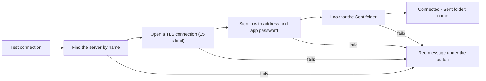

# Connect a mailbox

> **Status:** current · **Audience:** anyone setting up Inbox Agent or adding a second mailbox · **Last reviewed:** 2026-11-14

By the end of this guide you will have one mailbox connected and know how to add up to four more. It takes about five minutes, most of
it spent making an app password at your provider.

## What you need

* An email address at a provider that offers IMAP with a password: Gmail, iCloud Mail, Yahoo, Fastmail, or another IMAP server.
* An **app password** for that address. It is a password your provider makes for one program, so that you do not give the program your
  main password. Your usual password is not what the app asks for.
* An internet connection. The app connects with TLS from the first byte (usually port 993). STARTTLS on port 143 and unencrypted
  connections are not supported.

## What each provider needs

The window lists these providers. The "What the window tells you" column is the text it shows under **Getting an app password**.

| Provider in the list | Server (filled in for you) | What the window tells you |
| --- | --- | --- |
| Gmail | `imap.gmail.com` | Turn on 2-Step Verification in your Google account. In Security, open App passwords and create one called Inbox Agent. Paste the 16 characters below. IMAP must be on in Gmail settings. |
| iCloud Mail | `imap.mail.me.com` | Sign in at account.apple.com. Create an app-specific password for Inbox Agent and paste it below. |
| Yahoo | `imap.mail.yahoo.com` | In Account security, generate an app password and paste it below. |
| Fastmail | `imap.fastmail.com` | Settings, Privacy & Security, App passwords. Choose IMAP access. |
| Other IMAP server | You type the **IMAP server** and the **Port** (993 is filled in) | Enter your server and an app password if your provider offers one. |
| Outlook / Microsoft 365 (not supported yet) | `outlook.office365.com` | Not supported. See [what is not supported](#what-is-not-supported). |

Spaces in a pasted password are removed for you, so you can paste Google's 16 characters as they are shown.

## Steps

### The first mailbox (first run)

1. Start Inbox Agent. The first time, the window opens **Set up Inbox Agent**, a wizard of five steps ("Step 1 of 5" and so on).
2. Step 1 says **Welcome.** Press **Continue**.
3. Step 2, **Connect your mail**: choose your **Provider**, make the app password as the table above says, then fill in **Email address**
   and **App password**. For **Other IMAP server** also fill in **IMAP server** and **Port**.
4. Press **Test connection**. The button says "Testing…" while it works. A green line reads **Connected · Sent folder:** followed by the
   folder's name. **Continue** stays greyed out until the test passes, and changing the address, password, server or port clears the
   result so you test again.
5. Steps 3 to 5 choose how mail is ranked, the alerts, and two optional switches. Press **Finish** at the end. Only now is the password
   saved, in your system keychain, and the first read of the mailbox starts.

The first read takes the newest 50 messages. The list says "Reading your latest mail…" and "The first sync can take a minute." While it
runs, the alerts stay quiet: the app alerts only for mail that arrives after that first read.

### Another mailbox

1. Press **Settings** (or `,`). In the **Mail** section press **Add another mailbox**. The button is greyed out when five are in use.
2. The dialog **Add a mailbox** says "Its mail joins the same list. A small tag on each task says which mailbox it came to." and how many
   of 5 are in use. Choose the provider, fill in the fields and press **Test connection**.
3. When the test shows **Connected**, press **Add mailbox**. The window says "Mailbox added. Its mail is being read."

Every mailbox has its own connection, its own password in the keychain and its own Sent-mail learning. A task shows a small tag with the
part of the address before the `@` (hover for the full address), and the filter bar gets one chip per mailbox. The phone hub never sees
mailbox names. To remove one, press **Remove** beside it, then press again when the button asks "Click again: removes this mailbox, its
tasks and its saved password from the app". Nothing in the mailbox itself is touched. **Remove** is not offered when only one mailbox is
left: use **Sign out and reset** instead.

## Check that it worked

In **Settings**, under **Mail**, the mailbox says **Connected**, and the bottom bar of the window says "Watching your inbox". Mail
arrives in the list within seconds of reaching your provider.

## What "Test connection" checks

| It does | It does not |
| --- | --- |
| Checks first that you gave a server, an address and a password, that the server name uses only letters, digits, dots and hyphens, and that the port is a whole number from 1 to 65535. Nothing connects until they pass | Read, move or change any mail |
| Finds the server by name (the name lookup has no time limit of its own) and connects, giving up after 15 seconds on the connection | Save the server or the address |
| Opens a TLS connection and checks the server's certificate against the name you typed | Save the password (that happens at **Finish** or **Add mailbox**, and neither saves an empty one) |
| Signs in with your address and password | Check that the Inbox, Archive or Drafts folders exist |
| Looks for your Sent folder: the one the server flags as Sent, else one named `[Gmail]/Sent Mail`, `Sent`, `Sent Items`, `Sent Messages` or `INBOX.Sent` | Prove the mailbox will keep working: providers can cancel an app password later |
| Signs out | |

## Where your details go

The password goes to the system keychain (Windows Credential Manager, macOS Keychain or the Secret Service), under the name
`InboxAgent`, never into a file. The server, port and address go into `settings.json` in the app's data folder. See
[Privacy](../../PRIVACY.md) and the [settings reference](../reference/settings.md).

## Change a password later

Providers cancel app passwords when you change your account password. Open **Settings**, find the mailbox in the **Mail** section,
paste the new password into **New app password** and press **Save password**. The app checks it first ("Checking…"), then says "Saved.
Your list is untouched." and reconnects every mailbox. Your list, notes and tasks stay.

## What is not supported

**Outlook and Microsoft 365 mailboxes.** The list shows the entry as "not supported yet", and the window explains: "Microsoft has turned
off password sign-in for IMAP, so a password or app password will be refused. Sign-in with Microsoft is not supported in this version."
The reason in the code is that the app signs in only with an address and a password over IMAP. It has no "sign in with Microsoft"
(OAuth) flow. If you try, the server is expected to refuse the password and the test shows a message beginning "sign-in refused" (not
tested against a live Microsoft server).

Also not supported: sending mail (the app has no SMTP at all), servers that need STARTTLS or a plain connection, and more than five
mailboxes. The app reads only the Inbox of each mailbox. Mail your provider files into Spam or another folder is never read.

The sign-in and write-back code is tested against a scripted mock IMAP server, not against every provider. A real server can differ
in details; see [Security](../../SECURITY.md#residual-risks-and-limits).

## If something goes wrong

| What you see | Why | What to do |
| --- | --- | --- |
| `sign-in refused: …` (the server's own words follow) | Wrong or cancelled app password, or IMAP is switched off in the provider's settings | Make a new app password and test again. On Gmail check that IMAP is on |
| `secure connection failed: …` | Wrong server name or port, or the server does not start TLS at once | Check the server and use the port your provider names for IMAP over TLS (usually 993) |
| A message about looking up the address (the wording depends on your system) | The server name is misspelt, or there is no network | Check the spelling (letters, digits, dots and hyphens only) and your connection |
| `no Sent folder found among N folders` | The provider's Sent folder has no Sent flag and none of the common names above | The window cannot add this mailbox, because **Continue** and **Add mailbox** need a passed test. Report it with the folder names |
| `That mailbox is already in the app` | The same server and address (ignoring letter case; `googlemail.com` counts as `gmail.com`) is already added | Nothing to do |
| `You can read at most five mailboxes at once` | Five are in use | Remove one first |
| `Enter the mail server and the email address` | The server or the address was empty when you pressed **Test connection** | Fill in both and test again |
| `That mail server name isn't valid` | The server name has a space or a character other than letters, digits, `.` and `-` (for example a pasted web address) | Type the name only, such as `imap.example.com` |
| `That mail server port isn't valid` | The **Port** box is empty, 0, above 65535 or not a whole number. The app refuses it and does not shorten it to fit | Type the port your provider names for IMAP over TLS (usually 993) |
| `Enter the app password` (**Test connection**), or "Setup failed: Enter the app password for this mailbox" (**Finish**) | The password box was empty. Nothing was saved | Paste the password and test again |
| `Paste the new password first` | **Save password** in Settings with the box empty. Nothing was sent | Paste the new app password and press **Save password** |
| "Setup failed: Enter the mail server and the email address" | **Finish** saves the first mailbox first, and its server or address was empty | Go back to **Connect your mail**, fill it in, test, and press **Finish** again |

More in [mailbox will not connect](../runbooks/mailbox-wont-connect.md) and the [troubleshooting page](../troubleshooting.md).

## Next steps

* [Choose how mail is ranked](choose-how-mail-is-ranked.md)
* [Let the app file mail](let-the-app-file-mail.md): off until you switch it on
* [Phone and tablet](phone-and-tablet.md)
* [FAQ: why does it ask for an app password?](../faq.md)
