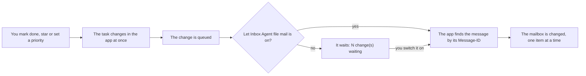

# Let the app file mail

> **Status:** current · **Audience:** anyone deciding whether to switch on write-back · **Last reviewed:** 2026-11-15

By the end of this guide you will know what the setting **Let Inbox Agent file mail** does to your mailbox, what it never does, and how
to switch it on and off safely. It is called write-back in the documents. It takes about five minutes to read.

## What you need

A connected mailbox. The switch is in **Settings**, section **Mailbox**.

## The short version

It is **off by default**. While it is off the app only reads: nothing in your mailbox changes, and no message is marked read. The things
you do (done, star, priority) are remembered by the app and queued. When you switch it on, the queued changes are applied, in order.
The app never sends mail, with write-back on or off.

## What it does to your mailbox

| You do this in the window | Gmail | Other IMAP providers |
| --- | --- | --- |
| Mark a task **done** (`x`) | Removes the Inbox label and adds the label `AI/Done`. The message stays in All Mail | Moves the message to the Archive folder (the one the server flags as Archive, else `Archive`). If the server cannot move, the app copies it there and removes the original |
| Reopen it (undo, or `x` again) | Puts it back in the Inbox and removes `AI/Done` | Moves it from Archive back to the Inbox |
| **Star** a task (`s`), or give it priority 4 or 5 (which stars it) | Sets the star flag | Sets the flag (`\Flagged`) |
| Set a **priority** (1 to 5) | Adds the label `AI/P1` to `AI/P5` and removes the other four | Nothing: labels exist only on Gmail |
| New mail is ranked | Adds a category label such as `AI/Work`, for mail that arrives while it is on | Nothing |
| **Save to Drafts** on a reply draft | Appends the draft to the Drafts folder, flagged as a draft | The same, to the folder the server flags as Drafts, else `Drafts` |

The Settings text says the same in short: "Done archives, star flags, priorities label (Gmail)." It agrees with the table: a priority becomes a
label on Gmail and nothing elsewhere.

What it never does: send mail, delete a message you have not archived (if the server cannot move a message, the app copies it to
Archive and then removes the original from the inbox), mark a message read or unread, change a message's text, or touch anything for
a task you added yourself. Snoozes, notes, due dates and reminders stay in the app.

## How it finds the right message

The queue is applied in the order you made the changes, to the mailbox each message came from, over one connection for each batch of up
to 50 changes. The app searches by
Message-ID, which the server matches loosely, then reads the real header of every hit and acts only on exact matches. It does nothing
if there are more than 50 hits, no exact match, or more than three. A message with no usable Message-ID is skipped, and the **Log**
tab says "“…” has no usable Message-ID, so your mailbox could not be updated for archive".

If a change fails, the app stops there to keep the order, waits, and tries again. After five tries it drops that item and logs
"gave up on “archive” for message N". Other lines you may see in the **Log**: "mailbox update “archive” failed: …", "message “…” not found for archive" (it was moved or deleted
by something else) and "could not reach mailbox for updates: …".

## Switch it on

1. **Settings** (press **More options** first in the simple view), section **Mailbox**, tick **Let Inbox Agent file mail**. It is off after setup, which no longer asks. It shows "N change(s) waiting" while changes are queued.
2. The queued changes start applying within seconds. This includes changes made by your rules (a rule that files mail marks it done; a
   rule that sets a priority queues its label).

Switching it on applies everything that is waiting. If you do not want that, use **Sign out and reset** first (see
[Privacy](../../PRIVACY.md)). The count of waiting changes also shows on the list as a "to file" figure.

## Switch it off

Untick the box. New changes queue and wait again. What the app already did stays done in your mailbox: the app does not undo it. To undo
one, reopen the task, remove its star or set the old priority while the box is on, and the opposite change is queued.

## Reply drafts

**Save to Drafts** needs write-back on. Without it the window says "Turn on “Let Inbox Agent file mail” in Settings to save drafts to
your mailbox". The draft is built by one function: the reply goes to the sender (or the Reply-To address), it comes from your login
address, it threads under the original message, and it is flagged as a draft. Your login must be an email address ("Your login name isn't
an email address, so drafts can't be saved to your mailbox" otherwise). If the reply address differs from the sender's or the
message failed its sender check, the draft shows a warning and **Save to Drafts** asks you to click again ("Address differs. Click
again to save"). Once saved, the draft's header says "in your Drafts folder". You send it from your own mail program; the app cannot.
The phone cannot write or save drafts.

## What else stays off until you choose it

| Setting | Default | Where |
| --- | --- | --- |
| **Let Inbox Agent file mail** | Off | Settings, **Mailbox** |
| **Write drafts automatically** | Off | Settings, **Reply drafts** |
| **Remind me when nobody has answered** (follow-ups) | **Off** | Settings, **Follow-ups** |
| **Phone hub** | Off | Settings, **Phone and tablet** |
| ntfy topic, quiet hours, **Daily digest at** | Empty | Settings, **Alerts** and **Alert schedule** |

Desktop notifications start on. See the [settings reference](../reference/settings.md) for every default.

## Check that it worked

Switch it on, mark one throwaway message done, and look in your mail program: on Gmail the message has left the Inbox and has the label
`AI/Done`; elsewhere it is in the Archive folder. The count "N change(s) waiting" is zero.

## If something goes wrong

| What you see | Why | What to do |
| --- | --- | --- |
| "N change(s) waiting" does not go down | Write-back is off, or the mailbox cannot be reached | Check the box and the status bar; read the **Log** |
| A message was not archived | Not found by an exact Message-ID, or it has none | Archive it yourself; the log line names the message |
| Priority labels do not appear | The provider is not Gmail | By design: labels exist only on Gmail |

## Next steps

* [Decision record: write-back is opt-in](../adr/0008-write-back-is-opt-in.md)
* [Engine step by step, section 6](../PSEUDOCODE.md)
* [Connect a mailbox](connect-a-mailbox.md)
