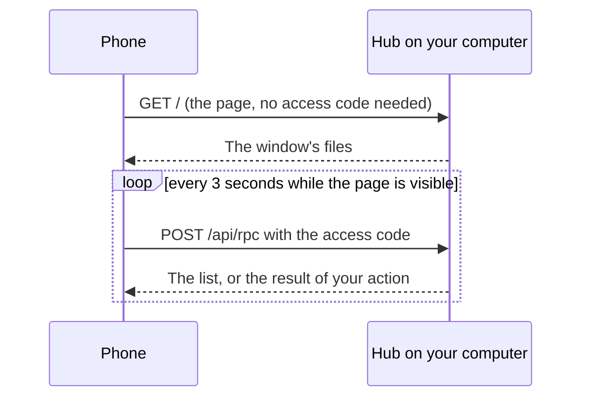

# Phone and tablet

> **Status:** current · **Audience:** anyone who wants the list on a phone or tablet · **Last reviewed:** 2026-11-15

By the end of this guide you will have your list open on a phone or tablet, with an icon on its home screen, served by your own
computer through the **phone hub**. It takes about five minutes.

## What you need

* The computer that holds your mail, switched on and awake, with Inbox Agent running. Closing the window is fine: the app keeps running
  from the tray until you choose **Quit** there.
* The phone and the computer on the same private network: your home Wi-Fi, or a private VPN such as Tailscale that joins them.
* A phone browser that can add a page to the home screen.

## Steps

1. Open **Settings** (press `,`), press **More options** if you are in the simple view, and go to **Phone and tablet**. Tick **Phone hub**. It is off after setup.
2. The window shows a QR code and, under it, the address it stands for. The address looks like
   `http://192.168.1.20:8787/?token=…`: your computer's address on its network, port 8787, and a 32-character access code.
3. Scan the QR code with the phone's camera and open the link. The list appears. The page keeps the access code in the browser's own
   storage and removes it from the address bar, so it is not left in the history.
4. In the phone browser's menu choose **Add to Home Screen**. The page is named "Inbox Agent" and opens like an app, without the browser's address bar.

## Home Wi-Fi or a private VPN

The hub speaks plain HTTP. Nothing between the phone and the computer is encrypted, so the access code and your list can be read by
anyone who can watch that network.

| Where you are | What to do |
| --- | --- |
| Your own home Wi-Fi | Fine. The hub answers only devices on private addresses |
| A shared or public Wi-Fi (café, hotel, office guest network) | Do not use the hub there. Use a VPN that joins your devices, or wait |
| Away from home | Use a private VPN such as Tailscale on both devices. A phone on mobile data without a VPN cannot reach the hub |
| The address under the QR code is not one the phone can reach (for example you reach the computer by its VPN address) | Replace the host part of the address by the computer's address on that network and keep `:8787/?token=…` unchanged. Not verified with every VPN |

The hub listens on all of the computer's interfaces but drops any connection that does not come from a loopback, private, link-local,
VPN-range (`100.64.0.0/10`, which Tailscale uses) or IPv6 local address. A computer on a public network is not reachable from the
wider internet through it.

## Rotate the access code

Press **Rotate access code** (under the QR code) when a phone is lost, when you shared the link by mistake, or after using a network you
do not trust. The window says "New access code. Scan the code again on your phone." The old link stops working at once, on every
device. Switching the hub off and on gives a new code too, and **Sign out and reset** turns the hub off and forgets the code.

## What the phone can and cannot do

| The phone can | The phone cannot (use the computer) |
| --- | --- |
| Show the list, the **Log** tab and each task's details | Open **Settings**, rules, backup, diagnostics or the Markdown export |
| Mark done, star, set priority, snooze, select several | Read the message text (**Read message**), or search inside it: phone search covers sender, address, subject, action, excerpt and note |
| Choose **Normal**, **Always important** or **Mute** for a sender | Write a reply draft ("Open the desktop app to write a draft for this message."), or save one to your Drafts folder |
| Edit, copy or discard a reply draft that exists | Save an invitation as `.ics` (it still shows the event) |
| Add tasks, edit notes, due dates and the titles of your own tasks | See mailbox tags or the mailbox filter chips: the phone is never told mailbox names |
| Set a reminder and a repeat (the time is on the computer's clock) | Sign in to a mailbox again ("Open the desktop app to sign in again") |

The phone gets no push alerts from the hub. For alerts on the phone use ntfy; see [alerts and reminders](alerts-and-reminders.md).

The hub's protections: ten wrong access codes from one address within a minute lock that address out for up to a minute (HTTP 429,
"too many attempts"); at most 32 connections at once; requests have size and time limits; and only reading the list plus twelve task
commands on a fixed list are accepted. See the [hub HTTP reference](../api/hub-http.md) and [Security](../../SECURITY.md#residual-risks-and-limits).
The port (8787) can only be changed in `settings.json`; see the [settings reference](../reference/settings.md).

## Check that it worked

Mark a task done on the phone. Within a few seconds the computer's list shows it done, and the phone shows what you change on the
computer.

## If something goes wrong

| What you see | Why | What to do |
| --- | --- | --- |
| The page does not load at all | The computer is asleep or Inbox Agent is not running, the hub is off, the networks differ, or a firewall blocks port 8787 | Follow [phone hub unreachable](../runbooks/phone-hub-unreachable.md) |
| "Not connected", with "This page needs the access code from your computer" under it | The phone has no access code stored (new browser, cleared storage) | Scan the QR code again |
| The status bar says `error: unauthorized` | The code was rotated, or the hub was switched off and on | Scan the new QR code |
| The status bar says `error: too many attempts` | Ten wrong codes in a minute from this address | Wait a minute, then scan a fresh code |
| The Log tab says "phone hub could not listen on port 8787" | Another program holds the port | See the runbook above |

## Next steps

* [Alerts and reminders](alerts-and-reminders.md)
* [Decision record: plain HTTP with a token](../adr/0009-phone-hub-plain-http-with-token.md)
* [Troubleshooting](../troubleshooting.md)
