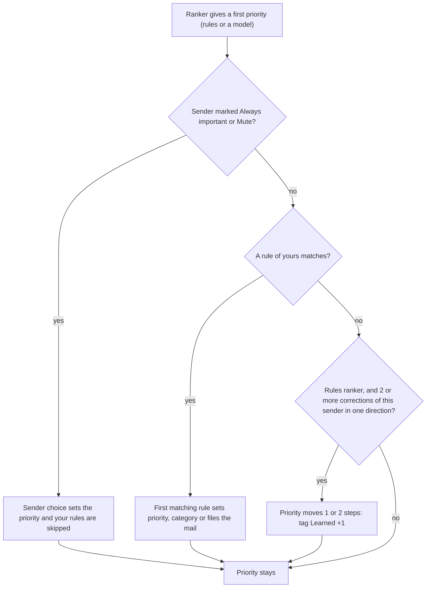

# Rules and sender choices

> **Status:** current · **Audience:** anyone teaching the list what matters · **Last reviewed:** 2026-11-14

By the end of this guide you will know the three ways to steer the ranking (a choice about one sender, a rule you write, and the
corrections you make by changing a priority), in what order they apply, and how each one is undone. It takes about ten minutes.

## What you need

A few tasks in your list. Everything here is in the window; nothing needs a model.

## Which one decides

Each new message goes through these steps in order. The first three can each stop the later ones from changing the priority.

The learned step happens only when the ranker is the built-in rules, when no sender choice and no rule of yours set the priority, when
the mail was not filed, and when the message passed its sender check. A model already sees your corrections in its prompt.

## Sender choices

Open a task and look at the **Sender** row: **Normal**, **Always important**, **Mute**. The phone has the same row.

| Choice | New mail from that address | Mail already in the list | Tag |
| --- | --- | --- | --- |
| **Always important** | Priority at least 4. Not applied to mail that failed its sender check | Open mail from the address rises to at least 4 at once | `★ Sender` |
| **Mute** | Priority 1, never urgent, never "needs a reply", reason "Sender is muted." No alerts follow | Open mail from the address drops to priority 1 at once | `Muted` |
| **Normal** | Back to the ranker | Forgets the choice, and **also forgets the corrections you made for that sender**: "Sender → Normal starts over" | none |

The window says "Mail from this sender will rank high", "This sender is muted" or "Back to normal". A choice is by the sender's address
and lasts until you change it. In select mode, **Mute senders** mutes the senders of every selected task after a second click ("Click
again: mute 2 senders"); it has no undo of its own, so open a task and choose **Normal**. Choices are in your [backup](backup-and-restore.md).

## Your rules

Open **Settings** and find **Your rules**. A rule reads: "If the address, domain or subject matches, then set the priority or category,
or file the mail."

1. Press **Add a rule**. In the first drop-down choose **Address is**, **Domain is** or **Subject contains**, and type the text (up to
   100 characters, not case-sensitive, plain text with no patterns).
2. After "then", choose what happens: **Keep priority**, **Priority 1** to **Priority 5**, or **File away (mark done)**, and **Keep
   category** or one of the eight categories.
3. Order matters: the first rule that matches is used. Use **Up** and **Down**; **Remove** deletes one. You can have 50.
4. Press **Save rules**. Edits wait as "Not saved yet" until then. The window says "Saved. New mail follows these rules."

How a rule matches: **Address is** needs the whole address (any letter case); **Domain is** matches that domain and its sub-domains
(`example.com` matches `news.example.com`); **Subject contains** looks for the text inside the subject. The sender's display name is
never matched, because anyone can write any name.

Safeguards, written into the Settings text and the code:

* A sender you marked **Always important** or **Mute** skips the rules.
* A rule can always lower a priority. It can raise one only if the mail passed its sender check, and a **Subject contains** rule can raise
  only mail from people you write to or who reply to you, so a stranger cannot climb by choosing a subject.
* **File away** sets the priority to 2 at most, marks the task done as it arrives, and prevents alerts and automatic drafts. With
  [write-back](let-the-app-file-mail.md) on, the message is archived in your mailbox.
* A rule that sets a priority of 3 or lower also removes the urgent flag.

Rules run on new mail and on the mail read when you first connect a mailbox. They apply to every mailbox, stay when you remove one, and
go with **Sign out and reset**.

### Apply to my list

New rules do not touch tasks already in the list until you press **Apply to my list**. If you have unsaved edits the window says "Save the
rules first". It then counts what would change: "3 of 4 matching tasks would change; 1 would be marked done." Press the button again
(it reads "Click again: change 3, file 1") and the window says "Changed 3, filed 1." If nothing would change it says "No open task
would change." This pass skips tasks with a sender choice, tasks whose priority you corrected by hand, and tasks you added yourself, and
it is never recorded as a correction, so rules never teach the ranker.

## Corrections

Every time you change a mail task's priority (keys `1` to `5`, the five dots on the row, or the priority buttons in select mode) the app
records one **correction**: the sender's address, the subject, and the priority before and after. Priority 4 or 5 also stars the task.

* Changing the same task again updates its correction; setting it back to the priority it started with removes it, so **Undo** leaves
  nothing behind.
* Corrections of mail that failed its sender check are not recorded.
* They are kept 365 days. They are in your [backup](backup-and-restore.md), with the sender and subject of the mail you corrected.
* With the built-in rules, the last three corrections of a sender decide: at least two, all in the same direction. The shift is their
  average, one or two steps. Later mail from that address shows a tag such as `Learned +1` or `Learned −2`, and its reason ends with
  "Adjusted from your corrections." It never makes mail urgent.
* With a model, your ten most recent corrections are added to each request, so the model can follow them. Under Claude that means the
  senders and subjects of those messages go to Anthropic; see [choose how mail is ranked](choose-how-mail-is-ranked.md).

To forget what the app learned about one sender, open one of their tasks and choose **Normal**.

## Check that it worked

Open a task from a sender you changed: the tag says `★ Sender`, `Muted` or `Learned +1`, and **Why** names the rule ("A rule of yours
set the priority to 2.") or the choice ("Sender is muted."). The **Log** tab shows each correction as "P3→P5 “…” saved as a correction".

## If something goes wrong

| What you see | Why | What to do |
| --- | --- | --- |
| "At most 50 rules" | The limit | Remove one, or make a rule cover a domain |
| "A rule needs text of 1 to 100 characters" | An empty or long text | Fix the text |
| "A rule has to do something: set a priority, set a category, or file the mail" | Both lists are on **Keep** | Choose an outcome |
| "Save the rules first" | **Apply to my list** with unsaved edits | Press **Save rules** |
| A rule did not raise a message | The mail failed its sender check, or the rule looks at the subject of a stranger, or a sender choice exists | See the safeguards above |
| Mail from a muted sender still shows | It is kept at priority 1, not hidden | Choose **Normal**, or use a rule to file it |

## Next steps

* [Keyboard shortcuts](../reference/keyboard-shortcuts.md)
* [Design of rules and follow-ups](../designs/phase4.md)
* [Engine step by step, sections 5 and 5c](../PSEUDOCODE.md)
