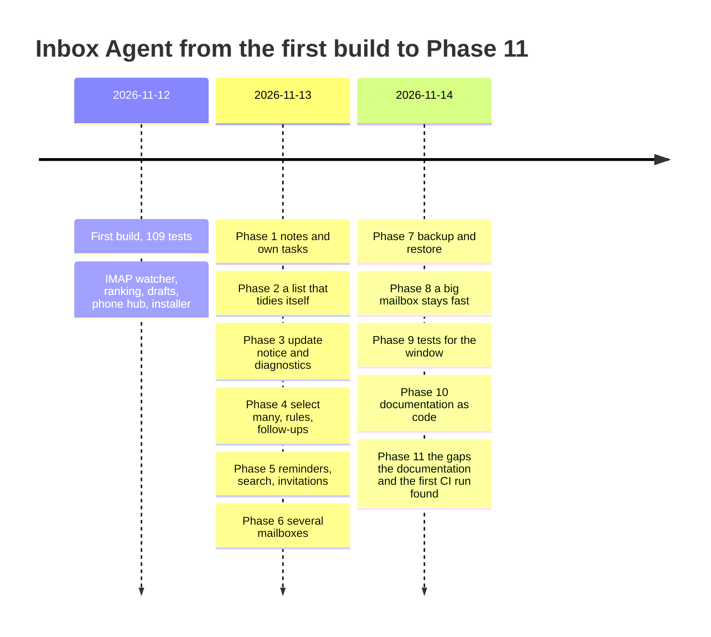

# Product requirements

> **Status:** current · **Audience:** the owner, maintainers and reviewers · **Last reviewed:** 2026-11-14

What Inbox Agent is for, who it serves, what it must do and must never do, how far it has got, and what the owner still has to
decide. Every requirement has an id and a status; the [user stories](user-stories.md) turn them into acceptance criteria that
point at tests.

## Vision

Email is the to-do list nobody wrote. Inbox Agent is a desktop app that reads your mailbox, ranks every message by how much it
needs you, and shows one focused list that tidies itself and alerts you only when something matters. It runs on your computer,
keeps your mail there, never sends a message for you, and costs nothing to run.

## Who it is for

These personas are illustrative composites written for this document, not interview data.

| Persona | Situation | What they need from the app |
| --- | --- | --- |
| **Mira, the overloaded professional** | Hundreds of messages a week in one Gmail mailbox; deadlines hide in threads | One ranked list, due dates found in the text, "needs a reply" marked, alerts only for what is important, keys instead of a mouse |
| **Tomas, the careful reader** | Does not want mail text to leave his computer or an account with another company | Rules-only ranking by default, a local model if he wants one, no server of ours, a visible list of what leaves the computer, a backup he controls |
| **Dana, who runs two mailboxes and a phone** | Work and personal mail at different providers; reads the list on a tablet at home | Several mailboxes in one list, the same list on the phone, drafts she can save but never an app that sends |

## The problem

* Important messages sit among newsletters, and the mailbox sorts by time, not by need.
* A task outlives its mail: you answered from your phone, the app still shows it open.
* A to-do list kept apart from the mailbox goes stale, and a second tool means a second place to look.
* Most tools that rank mail send it to a company's server, and many charge for it.

## Goals

1. One installer, and all setup inside the app: an app password, a ranking choice, alerts.
2. One list that ranks, groups conversations, closes tasks you have dealt with, and learns from your corrections.
3. Mail stays on the computer. What leaves it is listed, optional and chosen by you ([PRIVACY.md](../../PRIVACY.md)).
4. Works with any IMAP provider that offers app passwords, up to five mailboxes at once.
5. Keyboard first, with a pure black window that is also served to a phone.
6. Stays fast with thousands of tasks.
7. Costs nothing: no paid service, certificate or account is required to build, run or test it.

## Non-goals

| Not this | Why |
| --- | --- |
| Sending mail | The app never sends mail and has no SMTP code. A reply is a draft you can save to the Drafts folder; sending is your mail program's job ([ADR-0003](../adr/0003-imap-only-never-send-mail.md)) |
| Any paid service | The owner has no budget for one: no paid API, certificate, assessment or hosting ([ADR-0014](../adr/0014-no-paid-services.md)). Free options (a local model, your own API key, a free signing programme) are allowed |
| Microsoft (Outlook, Microsoft 365) accounts | Microsoft turned off password sign-in for IMAP; the wizard says so. Sign-in with Microsoft would need a different design |
| A hosted component | There is no Inbox Agent server, account or telemetry. The phone hub runs on your own computer |
| A mail client | It does not compose, send, organise folders or replace your mail program; it adds a list on top |
| A calendar | It saves a `.ics` file for you to open and never writes to a calendar |
| A phone app | The phone uses the hub in its browser; nothing is installed on it |

## Scope by phase

The work was done in phases, each one a commit with its own review. Dates and commits are in
[the version history](../VERSION_HISTORY.md). Nothing has been published: all of it is development towards `0.1.0`.

| Phase | Added | Requirements |
| --- | --- | --- |
| First build | Reading, ranking, drafts, write-back, alerts, the phone hub, the installer | FR-01 to FR-05, FR-09 to FR-11, FR-20, FR-21, FR-25 |
| 1 | Notes, own tasks, due dates, attachments, the unsubscribe link, hardening | FR-12, FR-26 |
| 2 | A list that tidies itself ([design](../designs/phase2.md)) | FR-06, FR-07 |
| 3 | Update notice and diagnostics ([design](../designs/phase3.md)) | FR-23, FR-24 |
| 4 | Select many, your rules, follow-ups ([design](../designs/phase4.md)) | FR-08, FR-14, FR-15 |
| 5 | Reminders, search inside messages, invitations ([design](../designs/phase5.md)) | FR-13, FR-16, FR-17 |
| 6 | Several mailboxes ([design](../designs/phase6.md)) | FR-18 |
| 7 | Backup and restore ([design](../designs/phase7.md)) | FR-19 |
| 8 | A big mailbox stays fast ([design](../designs/phase8.md)) | NFR-05 |
| 9 | Tests for the window ([design](../designs/phase9.md)) | NFR-10 |
| 10 | Documentation as code ([design](../designs/phase10.md)) | none: a maintenance phase |
| 11 | The gaps the documentation and the first CI run found ([design](../designs/phase11.md)) | none: a maintenance phase |

## Functional requirements

Status: **built** means the code and its tests exist; **partly** means some of it exists, and the note says what is missing;
**not built** means it does not exist. Every row that reads or changes a mailbox has been tested against a scripted server only:
the live cases are still owed (see [the test plan](../testing/test-plan.md)).

| Id | Requirement | Status | Stories |
| --- | --- | --- | --- |
| FR-01 | First-run setup connects any IMAP mailbox with an app password, and tests the connection before it is saved | built | US-01 |
| FR-02 | The app reads the mailbox without changing it: the first read takes the latest 50 messages, later reads only new mail | built | US-02 |
| FR-03 | Every message gets a priority from 1 to 5, a category, a due date if one is stated, and whether it needs a reply, by rules with no AI | built | US-03 |
| FR-04 | Ranking and drafting may use a local Ollama model or your own Anthropic API key, and fall back to rules on any failure | built | US-04 |
| FR-05 | Words in a message cannot raise its priority, and mail that failed its sender check is not trusted | built | US-05 |
| FR-06 | A conversation is one row; a task closes when you reply; mail that left the inbox is folded away, not closed | built | US-06 |
| FR-07 | The ranking learns from your corrections, and a sender can be marked "always important" or muted | built | US-07, US-08 |
| FR-08 | Your own rules (address, domain or subject) set a priority or category or file mail away, on new mail and on request on the list | built | US-09 |
| FR-09 | Desktop notifications, optional ntfy push, quiet hours, a daily digest and a choice of categories | built | US-11 |
| FR-10 | Reply drafts (AI or a template) are stored in the task, editable and copyable; saving one to Drafts is a separate click; none is ever sent | built | US-15 |
| FR-11 | Optional write-back archives, stars and labels mail in the mailbox; off until you switch it on | built | US-16 |
| FR-12 | Your own tasks, with notes and due dates (dates in message text are found without AI) | built | US-18 |
| FR-13 | Reminders and repeats (daily, weekly, monthly) on your own tasks | built | US-19 |
| FR-14 | Follow-up reminders turn a conversation you started that nobody answered into a task that closes itself; off by default | built | US-20 |
| FR-15 | Select several tasks and act on all of them, with one undo | built | US-13, US-14 |
| FR-16 | Search covers sender, subject, excerpt, note and, on the desktop, words inside the stored message text | built | US-10 |
| FR-17 | A calendar invitation shows its event; "Save .ics" writes a file you open yourself | built | US-17 |
| FR-18 | Up to five mailboxes are read into one list, each with its own password and write-back | built | US-21 to US-24 |
| FR-19 | Backup and restore: one file, a preview, restore only adds | built | US-25 to US-27 |
| FR-20 | The phone and tablet use the same list through the hub, set up with a QR code | built | US-28, US-29 |
| FR-21 | Keyboard first: every action on the list has a key | built | US-12 |
| FR-22 | "Sign out and reset" removes everything the app stored, passwords included | built | US-32 |
| FR-23 | "Copy diagnostics" produces a report with names, subjects and addresses removed | built | US-34 |
| FR-24 | The app tells you when a newer version exists | partly: built, but off until `UPDATE_REPO` names a repository | US-36 |
| FR-25 | One installer each for Windows, macOS and Linux | partly: the Windows installer is built and has been run on the author's machine, not yet on a clean one; macOS and Linux are configured and never built | US-37 |
| FR-26 | Each task shows its attachment names and a copy-only unsubscribe link | built | US-03 |
| FR-27 | Sign in with Google without an app password | not built: deferred ([phase 3](../designs/phase3.md)) | US-38 |
| FR-28 | Automatic updates | not built: needs a repository and signing keys | US-39 |
| FR-29 | Microsoft (Outlook) accounts | not built, and not planned (see the non-goals) | US-40 |

## Non-functional requirements

| Id | Requirement | Status | Stories |
| --- | --- | --- | --- |
| NFR-01 | Mail and data stay on the computer; no Inbox Agent server; no telemetry; what leaves is listed in `PRIVACY.md` | built | US-30 |
| NFR-02 | Passwords and keys live only in the operating system's keychain | built | US-31 |
| NFR-03 | The app never sends mail: no SMTP code or dependency | built | US-30 |
| NFR-04 | No paid service is needed to build, run or release | built (a rule of the project, not code) | |
| NFR-05 | A big mailbox stays fast (the targets below) | partly: one target missed by a hair | US-35 |
| NFR-06 | Hostile mail, a damaged database or newer data never crashes the app or loses the list | built | US-33 |
| NFR-07 | The phone hub needs an access code, locks out guessers, serves only private networks and allows only a safe set of commands | built; plain HTTP is a documented residual risk | US-29 |
| NFR-08 | Keyboard and screen-reader support: roles, labels, focus handling, announcements, reduced motion | partly: attributes in place; no screen-reader test has been run | US-12 |
| NFR-09 | Behaviour verified against real mail servers, calendars and clean machines | not built: the manual cases are owed | the test plan |
| NFR-10 | Automated tests: the engine against a scripted server, the window in a real browser | built: 514 engine tests, 123 window tests | all |
| NFR-11 | A pure black window with greys, white and one red accent, in the same files on desktop and phone | built | US-12 |

## Measurable targets

The targets of [phase 8](../designs/phase8.md), measured with the packaged app, 3,000 open and 5,000 finished tasks
(`scripts/scale_check/scale.py 3000 5000`). The scale check fails the poll answer only above 250 ms or 3 MB; the original
figure stays as the aim.

| Measure | Target | Measured | Met |
| --- | --- | --- | --- |
| The list drawn after a poll | under 500 ms | 246 ms (was 2,155) | yes |
| One cursor key press | under 80 ms | 2 ms (was 951) | yes |
| The Done tab | under 300 ms | 13 ms (was 1,657) | yes |
| Elements in the page | under 25,000 | 2,945 (was 107,000) | yes |
| The engine's answer to a poll, time | under 120 ms | 127 ms (was 250 to 420) | **no**, by 7 ms |
| The engine's answer to a poll, size | under 2.5 MB | 2.6 MB (was 6.4) | **no**, by 0.1 MB |

Limits the code enforces, which a person can rely on:

| What | Limit |
| --- | --- |
| Mailboxes read at once | 5 |
| First read of a new mailbox | the latest 50 messages (the `first_run_limit` setting, 1 to 1,000) |
| Finished tasks sent to the window | the newest 200, up to 20,000 on request; kept 90 days |
| Activity log, corrections, follow-up records | 30 days, 365 days, 60 days |
| Rows drawn at a time | 150 for each part of the list |
| Mail server connection | 15 s to connect, 60 s to read or write; a failed connection retries after 30 s, a refused password after 5 minutes |
| Phone hub | 10 wrong access codes lock an address out for 60 seconds |
| A backup file | at most 8 MB, 50 rules, 5,000 sender choices, 2,000 corrections, 2,000 tasks of yours, 5,000 entries about mail |

## Risks

| Risk | Effect | What reduces it | Status |
| --- | --- | --- | --- |
| Real servers differ from the scripted one (Gmail's labels, TLS, number reuse) | A feature works in tests and not for a person | The manual cases A to D and the live probe example | Open: none run |
| Unsigned installers | Windows SmartScreen and macOS Gatekeeper warn or block | Free signing for open-source projects (see [RELEASING.md](../../RELEASING.md)); the release notes say so | Open |
| The phone hub is plain HTTP | An access code can be read on a shared network | Private networks only, a rotatable code, a lockout; use a trusted Wi-Fi or a VPN | Accepted ([SECURITY.md](../../SECURITY.md)) |
| Data and backups are not encrypted | Another person on the computer can read them | Full-disk encryption; the privacy statement says so | Accepted |
| AI-written drafts can be wrong or persuasive | A person sends a bad reply | Always shown for review, labelled by source, never sent | Accepted |
| The macOS and Linux installers were built by rehearsals of the release workflow (three runs, unsigned), and the app has never been run by hand there | A release that fails there | CI runs the tests on all three systems at every push and builds all three installers on a tag; the manual cases on clean machines | Open |
| The release workflow (`release.yml`) was rehearsed five times on throwaway tags: the first two failed (and found two real problems, fixed), the last three ran to the end | A broken release workflow is found on release day | Rehearse again on a pre-release tag after any change to it (RELEASING.md) | Open |
| An IMAP parser dependency has an advisory (`lexical-core`) | A soundness bug in a parser of server replies | Accepted until a stable `imap` 3.x; revisit then | Accepted |

## Open items the owner holds

None of these is code. [RELEASING.md](../../RELEASING.md) lists them in order.

| Item | What it needs | Where it is described |
| --- | --- | --- |
| A GitHub repository | The code is on a public GitHub repository and CI passes on Windows, Linux and macOS; still to do: turn on Actions write permission and branch protection, review the pull requests Dependabot opened, then set `UPDATE_REPO` to switch on the update notice | RELEASING.md "One-time setup" and "Switching on the update notice" |
| Code signing | A Windows certificate, or the SignPath Foundation's free signing for open-source projects (RELEASING.md says to check its current terms); macOS notarisation needs a paid Apple account, so macOS users open the app with right-click and Open | RELEASING.md "Free code signing" |
| A security contact | An address in `SECURITY.md`, "Reporting a vulnerability" | [SECURITY.md](../../SECURITY.md) |
| Live-mailbox and real-calendar manual tests | Run [the manual cases](../TESTCASES.manual.md) on clean machines with real mailboxes; record which passed | [the test plan](../testing/test-plan.md) |
| The Google sign-in decision | Sign-in with Google reads Gmail with a restricted scope, which for a shared client ID needs a paid yearly assessment; the free path is each person's own Google client ID. Decide whether to build it | [phase 3](../designs/phase3.md), `SECURITY.md` |

## Related

* [User stories](user-stories.md): the acceptance criteria and the tests that check them.
* [The testing strategy](../testing/strategy.md) and [the test plan](../testing/test-plan.md).
* [The architecture overview](../architecture/overview.md) and [the decision records](../adr/README.md).
