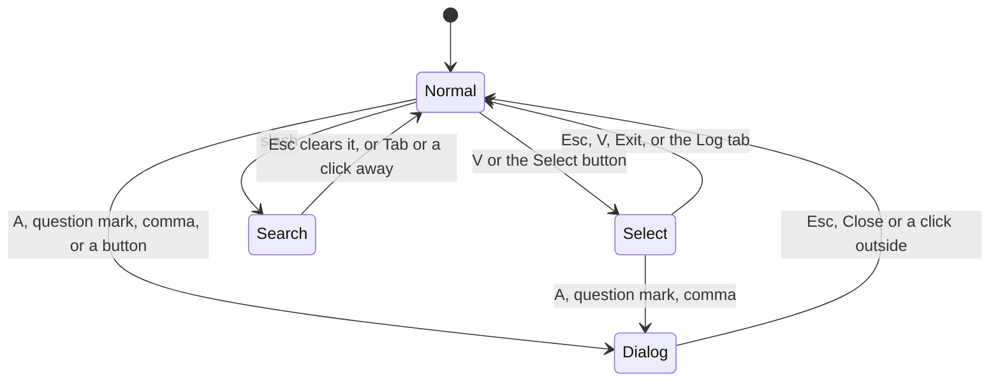

# Keyboard shortcuts

> **Status:** current · **Audience:** users who work from the keyboard, and developers who change a key · **Last reviewed:** 2026-11-14

Every key the window handles, by mode, as the code handles it (`keydown` listeners in `app/ui/main.js` and
`app/ui/drafts.js`). The `?` card in the window shows the short version.

## Rules that apply everywhere

* Letter keys work in either case, so Caps Lock or Shift does not turn them off.
* No shortcut fires while Ctrl, Alt or the Command key is held, or while you are typing in a text box, a date box or a
  drop-down (search, note, draft, title, due date). The keys then do what the box does.
* While a dialog is open, the list keys are off (see [Dialogs](#dialogs)).
* `Enter` or `Space` on a focused button or link presses that button; it does not open the row.
* The [simple view](../guides/the-simple-view.md) hides the key caps, the circles and the stars, not the keys: every key below still works there
  (`X` and `E` do what **Done** does, `H` what **Later** does), except that the Starred and Log tabs, search and the filter bar are not drawn.

## Modes

The window is in one of four modes. This shows which keys move between them.

A dialog opened from select mode returns to select mode when it closes. The setup wizard is a dialog that `Esc` does not close.

## Normal mode (the list)

The current row is the highlighted one (the cursor). A row you reach with `Tab` becomes the current row.

| Key | What it does |
| --- | --- |
| `J` or `↓` | Move to the next row (draws more rows when you pass the last one drawn) |
| `K` or `↑` | Move to the previous row |
| `Enter` or `Space` | Open or close the current task |
| `X` or `E` | Mark the current task done (every message of its conversation in this tab); on the Done tab, reopen it. A repeating task of yours moves to its next time instead |
| `1` to `5` | Set the priority; 4 or 5 also stars it |
| `S` | Star or unstar (the whole conversation) |
| `R` | Reply: opens a mail task and, on the desktop, writes a draft if there is none, else puts the cursor in the draft. Does nothing for a task you added |
| `H` | Snooze until tomorrow at 09:00 |
| `V` | Enter select mode with the current row selected (not on the Log tab) |
| `/` | Go to the search box (it is shown on the To-do and Starred tabs) |
| `A` | Add a task |
| `Z` | Undo the last change made in this window |
| `,` | Open Settings (desktop only; the phone has no Settings) |
| `?` | Show the keyboard card |

## Select mode

Select mode acts on several rows at once. Keys not listed here work as in normal mode (`J`, `K`, `/`, `A`, `Z`, `,`, `?`).

| Key | What it does |
| --- | --- |
| `Space` or `Enter` | Select or unselect the current row |
| `Shift`+`J` or `Shift`+`↓` | Select the current row, move down and select that row too |
| `Shift`+`K` or `Shift`+`↑` | The same, moving up |
| `X` or `E` | Mark the selected rows done; on the Done tab, reopen them |
| `1` to `5` | Set the priority of the selected rows (the newest message of each conversation); not on the Done tab |
| `S` | Star them all, or unstar them all if every one is starred; not on the Done tab |
| `H` | Snooze them until tomorrow at 09:00; not on the Done or Snoozed tab |
| `R` | Nothing (a reply draft is for one task) |
| `V` or `Esc` | Leave select mode |

With the mouse: a click selects or unselects a row, `Shift`+click selects every drawn row between it and the last row you
clicked, and the bar offers All, None, Mute senders and Exit. One `Z` undoes the whole batch (Mute senders and Bring back
cannot be undone).

## Search

| Key | What it does |
| --- | --- |
| any text | Filters the list as you type (every word must appear); on the desktop the engine also searches the stored message text |
| `Esc` | Clear the search and leave the box |
| `Tab` | Leave the box and keep the search |

## Dialogs

Add a task, the keyboard card, Settings, Add a mailbox, Restore from a backup and the setup wizard.

| Key | Where | What it does |
| --- | --- | --- |
| `Tab`, `Shift`+`Tab` | every dialog | Move between the dialog's controls; focus stays inside the dialog |
| `Esc` | Add a task, keyboard card, Settings | Close |
| `Esc` | Add a mailbox, Restore from a backup | Back to Settings (not while a restore is running) |
| `Enter` | Add a task, in "What needs doing" | Add the task |

The setup wizard has no `Esc`: you leave it by finishing it. A click outside the panel also closes Add a task, the keyboard
card and Settings.

## The `?` card and the footer

The card lists `J K`, `Enter`, `X`, `1–5`, `S`, `R`, `H`, `V`, `A`, `/`, `Z`, `,` and `?`; the footer shows `J K`, `X`, `1–5`,
`S`, `R`, `H`, `V`, `/`, `A`, `Z` and `?`. Neither shows the arrow keys, `E`, `Space`, the `Shift` selection keys or `Esc`;
this page is the full list. The card's text is `HELP` in `app/ui/drafts.js`: change it in the same commit as a key.
