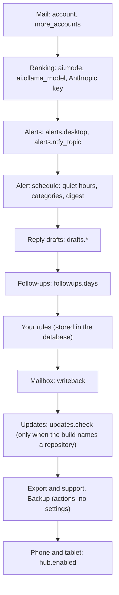

# Settings reference

> **Status:** current · **Audience:** developers and support; anyone who reads `settings.json` · **Last reviewed:** 2026-11-14

Every setting the engine keeps, with its type, default, allowed values and where you change it in the window. The source of
truth is [`engine/src/settings.rs`](../../engine/src/settings.rs) (defaults and `Settings::validate`) and the Settings dialog in
`app/ui/setup.js`.

## Where settings live

The settings are one JSON file, `settings.json`, in the app's local data folder (`app_local_data_dir`, not roaming), next to
`agent.db`. It is written whole, through a temporary file and a rename. Passwords and the Anthropic key are never in it: they
are in the system keychain (`engine/src/secrets.rs`). A file that cannot be read gives the defaults.

The window changes settings only through [`save_settings`](../api/rpc.md#save_settings), which merges a patch, validates the
result and restarts the background threads. Mailboxes change only through `save_account`, `add_account` and
`remove_account`, and `onboarded` only through `finish_setup` and `sign_out`; a patch that would change them is refused.

This shows how the Settings dialog is grouped, top to bottom, and which settings each group holds.

## Settings by dialog group

### Mail

| Path | Type | Default | Allowed values | In the window |
| --- | --- | --- | --- | --- |
| `account.host` | string | `""` | letters, digits, `.` and `-`, at most 253; empty until set up | setup wizard (provider or "IMAP server"); "Add a mailbox" |
| `account.port` | integer | `993` | 1 to 65535 (0 refused) | wizard "Port" for "Other IMAP server" only |
| `account.user` | string | `""` | at most 320 bytes, no control characters | "Email address" |
| `account.id` | integer | `0` | always 0 for the first mailbox | none |
| `more_accounts` | array of `{id, host, port, user}` | `[]` | at most 4; ids 1 to 4, each once; each needs a valid server and a non-empty login; no mailbox (server and login, ignoring case, `googlemail.com` read as `gmail.com`) twice | "Add another mailbox", "Remove" |

The app password of each mailbox is in the keychain (`imap-password`, `imap-password-1` … `-4`), changed with "Save
password". "Sign out and reset" clears the mailboxes.

### Ranking

| Path | Type | Default | Allowed values | In the window |
| --- | --- | --- | --- | --- |
| `ai.mode` | string | `rules` | `rules`, `ollama`, `anthropic` (not validated: any other value ranks with rules) | "Ranking" drop-down; wizard step 3 |
| `ai.ollama_model` | string | `""` | at most 100 bytes, no spaces or control characters | "Ollama model" text box; wizard drop-down filled by `detect_ollama`. Empty means Ollama mode ranks with rules |
| `ai.ollama_url` | string | `http://127.0.0.1:11434` | `http://` or `https://`, at most 200, no spaces | none |
| `ai.anthropic_model` | string | `claude-haiku-5-5` | as `ollama_model` | none |

The Anthropic key itself is a secret (`set_secret`, keychain entry `anthropic-key`), entered in the "API key" box.

### Alerts

| Path | Type | Default | Allowed values | In the window |
| --- | --- | --- | --- | --- |
| `alerts.desktop` | boolean | `true` | | "Desktop notifications"; wizard step 4 |
| `alerts.ntfy_topic` | string | `""` (off) | at most 64 letters, digits, `-` and `_` | "ntfy topic" (trimmed); wizard "Generate" makes `inbox-` and 16 random characters |
| `alerts.ntfy_server` | string | `https://ntfy.sh` | `http://` or `https://`, at most 200, no spaces | none |

### Alert schedule

| Path | Type | Default | Allowed values | In the window |
| --- | --- | --- | --- | --- |
| `alerts.quiet_start` | string | `""` | `HH:MM` 24-hour, or empty; set together with `quiet_end` | "Quiet from" (the window refuses one without the other) |
| `alerts.quiet_end` | string | `""` | as `quiet_start` | "Quiet until" |
| `alerts.categories` | array of string | `[]` (every category) | at most 8, each one of `work`, `personal`, `finance`, `travel`, `notification`, `promo`, `reading`, `other` | "Alert me about" chips; choosing all or none saves `[]` |
| `alerts.digest_time` | string | `""` (off) | `HH:MM` or empty | "Daily digest at" |

Urgent mail alerts whatever the quiet hours and categories; your reminders are announced whatever the quiet hours.

### Reply drafts

| Path | Type | Default | Allowed values | In the window |
| --- | --- | --- | --- | --- |
| `drafts.auto` | boolean | `false` | needs Ollama or Claude to have any effect | "Write drafts automatically" |
| `drafts.tone` | string | `friendly` | `friendly`, `concise`, `formal` | "Tone" |
| `drafts.signature` | string | `""` | at most 500 characters; line breaks allowed, no other control characters | "Signature" |
| `drafts.min_priority` | integer | `3` | 1 to 5 | "Only for priority … and up" |
| `drafts.daily_cap` | integer | `25` | 0 to 200 automatic drafts per day | "Daily limit" (empty saves 0) |

### Follow-ups

| Path | Type | Default | Allowed values | In the window |
| --- | --- | --- | --- | --- |
| `followups.days` | integer | `0` (off) | `0`, `2`, `3`, `5`, `7` | "Remind me when nobody has answered" |

### Mailbox

| Path | Type | Default | Allowed values | In the window |
| --- | --- | --- | --- | --- |
| `writeback` | boolean | `false` | | "Let Inbox Agent file mail"; wizard step 5 "Let Inbox Agent file mail for me" |

### Updates

| Path | Type | Default | Allowed values | In the window |
| --- | --- | --- | --- | --- |
| `updates.check` | boolean | `true` | | "Check for a newer version", shown only when `state.update_feature` is `true`. The build names no repository today, so the group is hidden and the check never runs |

### Phone and tablet

| Path | Type | Default | Allowed values | In the window |
| --- | --- | --- | --- | --- |
| `hub.enabled` | boolean | `false` | | "Phone hub"; wizard step 5 "Use on phone or tablet" |
| `hub.port` | integer | `8787` | 1024 to 65535 | none |
| `hub.token` | string | `""` | made by the engine: 32 letters and digits | the QR code and "Rotate access code". `save_settings` clears it when it saves with the hub off and makes one when it saves with the hub on and none; `rotate_hub_token` makes a new one whether or not the hub is on |

### Not shown in the window

| Path | Type | Default | Allowed values | Set by |
| --- | --- | --- | --- | --- |
| `onboarded` | boolean | `false` | | `finish_setup` (true); `sign_out` and removing the last mailbox (false) |
| `first_run_limit` | integer | `50` | 1 to 1000 | how many recent messages the first sync of a mailbox reads; only a patch or the file changes it |

## Validation

`Settings::validate` runs before every save (and on a restore with options). The first failing rule's message is the error:

| Message | Rule |
| --- | --- |
| `That mail server name isn't valid` | a server name with anything but letters, digits, `.` and `-`, or longer than 253; an extra mailbox with no server |
| `That mail server port isn't valid` | port 0 |
| `That email address isn't valid` | a login over 320 bytes or with control characters; an extra mailbox with an empty login |
| `Alert topic can only use letters, digits, - and _` | `alerts.ntfy_topic` |
| `Alert server must be an http(s) address` | `alerts.ntfy_server` |
| `Ollama address must be an http(s) address` | `ai.ollama_url` |
| `Model name isn't valid` | `ai.ollama_model` or `ai.anthropic_model` |
| `At most five mailboxes can be read at once` | more than 4 in `more_accounts` |
| `Every extra mailbox needs its own number from 1 to 4` | an id outside 1 to 4, or used twice |
| `That mailbox is already in the app` | the same server and login twice |
| `Times must look like 22:30, and quiet hours need both a start and an end` | `quiet_start`, `quiet_end`, `digest_time` |
| `Unknown alert category` | `alerts.categories` |
| `Draft tone must be friendly, concise or formal` | `drafts.tone` |
| `Signature is too long or contains control characters` | `drafts.signature` |
| `Draft limits are out of range` | `drafts.min_priority`, `drafts.daily_cap` |
| `Follow-up reminders can wait 2, 3, 5 or 7 days, or be off` | `followups.days` |
| `Phone hub port must be 1024 or higher` | `hub.port` |
| `First-run limit must be between 1 and 1000` | `first_run_limit` |

A value of the wrong JSON type (for example a string for `drafts.daily_cap`) fails before validation with the reader's own
message. Not validated: `ai.mode` (any other value ranks with rules) and `hub.token` (a patch can set any string).

## What a backup restores

"Also restore options and mailboxes" on a restore brings back `ai.mode` (never `anthropic`) and `ai.ollama_model`;
`alerts.desktop`, `categories`, `quiet_start`, `quiet_end` and `digest_time`; every `drafts.*`; `followups.days`;
`updates.check`; and adds the file's mailboxes without passwords. The ntfy topic and server, the Ollama address, the hub,
`writeback` and every secret are never in a backup. The allow-list is `backup::Options` in
[`engine/src/backup.rs`](../../engine/src/backup.rs).
