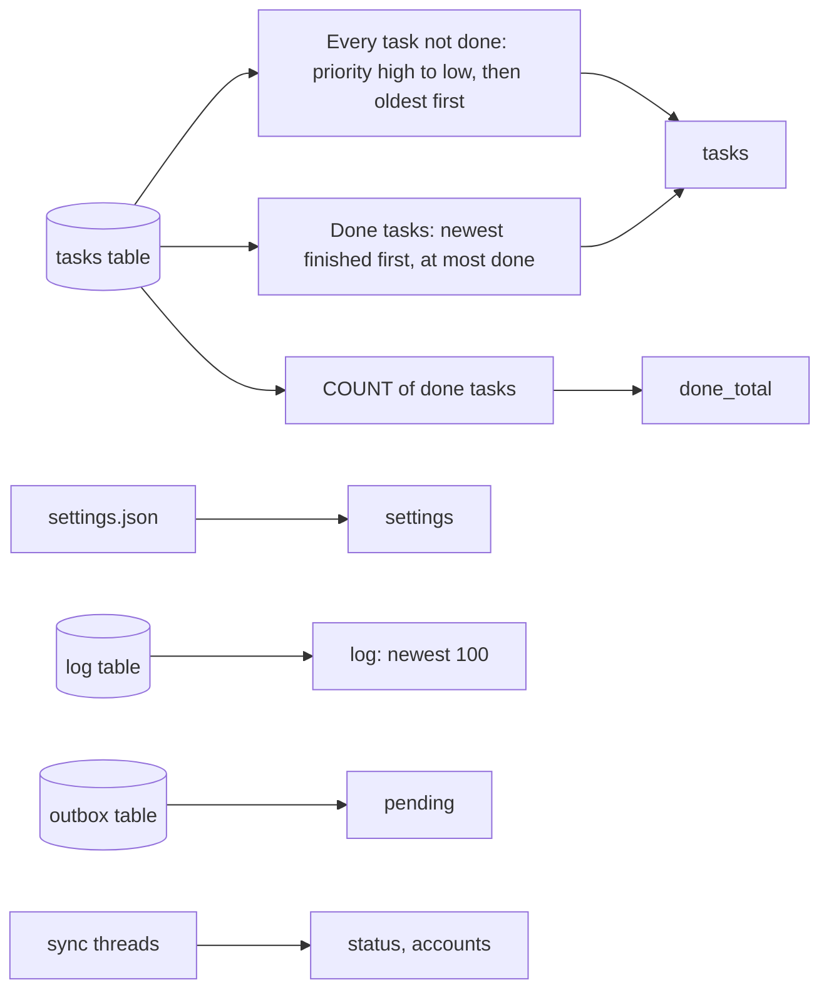

# The answer to `state`

> **Status:** current · **Audience:** developers who change the window or what the engine sends it · **Last reviewed:** 2026-11-14

`state` is the one read the window makes: it polls it every 3 seconds and draws everything from the answer. This page lists
every field of the answer and of a task. The source of truth is `Core::state` in [`engine/src/core.rs`](../../engine/src/core.rs)
and `Task` in [`engine/src/store.rs`](../../engine/src/store.rs).

## The request

```json
{"cmd": "state", "args": {"done": 200}}
```

`done` (optional) is how many finished tasks to include. The engine clamps it to 200…20,000 (`DONE_SHOWN`, `DONE_MAX`);
anything that is not a non-negative integer means 200. The window sends 200, except on the Done tab, where "Show older"
raises it 500 at a time.

## What is in the answer

The task list is every unfinished task plus only the newest finished ones, so a mailbox with thousands of finished tasks
does not slow the poll. This shows how the list is put together.



The three reads of the tasks table run in one transaction, so a sync saving mail in between cannot make a task appear twice
or not at all.

## Top-level fields

| Field | Type | Meaning | Phone (hub) |
| --- | --- | --- | --- |
| `settings` | object | The whole settings object (see [settings](settings.md)), including `hub.token` | only `{"onboarded", "writeback"}` |
| `tasks` | array of task | Every task whose `status` is not `done`, then the newest finished ones (see above) | same |
| `done_total` | integer | How many finished tasks exist in all (the Done tab's count) | same |
| `log` | array of `{at, msg}` | The newest 100 activity lines, newest first. `at` is Unix seconds (a number), `msg` the text | a `connected as <login>; ...` line loses the login |
| `status` | string | The sync status, the worst of all mailboxes: an `error: ...` first, then `no password`, `connecting`, `syncing`, any other value, else `idle`. `starting` before any mailbox reports; `setup` before setup is finished | same |
| `pending` | integer | Mailbox changes waiting to be written back, at most 1,000 counted. Grows while write-back is off | same |
| `has_anthropic_key` | boolean | An Anthropic key is in the keychain | always `false` |
| `gmail` | boolean | At least one mailbox is on Gmail (offers "Copy Gmail link") | same |
| `update_feature` | boolean | The build names a repository to check for updates (`updates::UPDATE_REPO`). It is empty today, so `false` | same |
| `update` | object or `null` | `{"version", "url"}` of a newer release when one was found and the check is on; `null` otherwise (always `null` today) | always `null` |
| `rules` | array of rule | Your rules, in order (shape in [the command reference](../api/rpc.md#rules_save)) | absent |
| `accounts` | array | One `{"id", "user", "host", "gmail", "status"}` per mailbox: its number 0 to 4, login, server, whether it is Gmail, and its own status | absent |

## The task object

Every task, from mail or added by you, has every field. Strings are empty and numbers 0 when there is nothing to say.

| Field | Type | Meaning |
| --- | --- | --- |
| `uid` | integer | The task id. Mail: `mailbox × 400,000,000 + IMAP UID`. Yours and follow-ups: 2,000,000,000 or above |
| `message_id` | string | The message's `Message-ID` when it is a plain token, else empty. Empty for tasks you added |
| `sender` | string | The sender's display name (`You` for tasks you added) |
| `addr` | string | The sender's address, lower case. Empty for tasks you added |
| `subject` | string | The subject, or the title of a task you added |
| `received` | number | When it arrived (or was added), Unix seconds |
| `priority` | integer | 1 (lowest) to 5 (highest) |
| `category` | string | `work`, `personal`, `finance`, `travel`, `notification`, `promo`, `reading` or `other` |
| `action` | string | What you need to do, in a few words; the row's title when not empty |
| `urgent` | boolean | Marked urgent; alerts even in quiet hours |
| `status` | string | `open` or `done` |
| `star` | boolean | Starred |
| `excerpt` | string | The first 400 characters of the message text, whitespace folded |
| `why` | string | Why it got its priority, in words |
| `signals` | object | `{"known", "reply", "bulk"}` booleans: from someone you write to, a reply to your mail, automated or bulk |
| `needs_reply` | boolean | The sender is waiting for an answer |
| `due` | string | `YYYY-MM-DD` found in the message or set by you; empty for none |
| `snooze_until` | number | Unix seconds until which it is hidden; 0 for not snoozed |
| `reply_to` | string | Where a reply would go |
| `reply_warn` | boolean | The reply address is on another domain than the sender's, or the message failed its sender check |
| `attachments` | array of string | Up to five file names |
| `attachment_count` | integer | How many files the message carries in all |
| `unsubscribe` | string | A safe `https:` or `mailto:` unsubscribe link, or empty |
| `note` | string | Your note, up to 2,000 characters |
| `thread` | string | The conversation key; `uid:<id>` for mail with no usable id and for your tasks, so they group with nothing |
| `closed_by` | string | `replied` when the app closed it because it found the reply; empty otherwise |
| `gone` | boolean | The message is no longer in the inbox (it left the inbox) |
| `learned` | integer | Priority steps added (positive) or removed (negative) because of your corrections of this sender; 0 for none |
| `draft` | object or `null` | `{"body", "source", "saved", "updated"}`: the text, `ai` / `template` / `user`, whether a copy is in the Drafts folder, Unix seconds of the last change |
| `pref` | string | The sender choice: `important`, `mute`, or empty for normal |
| `kind` | string | `followup` for a task the app made because nobody answered your message; empty otherwise |
| `remind` | string | Local `YYYY-MM-DD HH:MM` reminder of a task you added; empty for none |
| `repeat` | string | `daily`, `weekly`, `monthly`, or empty |
| `event` | object or `null` | The invitation's event: `{"summary", "start", "end", "tzid", "location", "all_day", "cancelled", "zone_name", "recurring"}`. `start` and `end` are `YYYYMMDD`, `YYYYMMDDTHHMMSS` or `YYYYMMDDTHHMMSSZ` |
| `mailbox` | integer or `null` | The mailbox (0 to 4) of a mail task or a follow-up; `null` for a task you added |

The stored message text is not in the task; the desktop reads it with `read_body`.

## Example

Invented data, cut to two tasks and two log lines.

```json
{
  "settings": {"onboarded": true, "writeback": false, "ai": {"mode": "rules", "ollama_url": "http://127.0.0.1:11434", "ollama_model": "", "anthropic_model": "claude-haiku-5-5"}, "...": "see settings.md"},
  "tasks": [
    {
      "uid": 4812, "message_id": "<a1b2@example.com>", "sender": "Alex Moreno", "addr": "alex@example.com",
      "subject": "Re: venue contract", "received": 1794650400.0, "priority": 5, "category": "work",
      "action": "Sign the venue contract", "urgent": true, "status": "open", "star": true,
      "excerpt": "Can you sign by Friday? The venue holds the date until then.", "why": "A reply to your mail; a deadline.",
      "signals": {"known": true, "reply": true, "bulk": false}, "needs_reply": true, "due": "2026-11-20",
      "snooze_until": 0.0, "reply_to": "alex@example.com", "reply_warn": false, "attachments": ["contract.pdf"],
      "attachment_count": 1, "unsubscribe": "", "note": "", "thread": "<venue-thread@example.com>", "closed_by": "",
      "gone": false, "learned": 0, "draft": null, "pref": "", "kind": "", "remind": "", "repeat": "", "event": null,
      "mailbox": 0
    },
    {
      "uid": 2000000003, "message_id": "", "sender": "You", "addr": "", "subject": "Put the bins out",
      "received": 1794560000.0, "priority": 3, "category": "personal", "action": "Put the bins out", "urgent": false,
      "status": "open", "star": false, "excerpt": "", "why": "Added by you",
      "signals": {"known": false, "reply": false, "bulk": false}, "needs_reply": false, "due": "", "snooze_until": 0.0,
      "reply_to": "", "reply_warn": false, "attachments": [], "attachment_count": 0, "unsubscribe": "", "note": "",
      "thread": "uid:2000000003", "closed_by": "", "gone": false, "learned": 0, "draft": null, "pref": "", "kind": "",
      "remind": "2026-11-17 07:00", "repeat": "weekly", "event": null, "mailbox": null
    }
  ],
  "done_total": 1250,
  "log": [{"at": 1794650460.0, "msg": "starred “Sign the venue contract”"}, {"at": 1794650400.0, "msg": "connected as you@example.com; Sent folder “Sent”"}],
  "status": "idle",
  "pending": 1,
  "has_anthropic_key": false,
  "gmail": false,
  "update_feature": false,
  "update": null,
  "rules": [],
  "accounts": [{"id": 0, "user": "you@example.com", "host": "imap.example.com", "gmail": false, "status": "idle"}]
}
```

## How the window uses it

* **Polling.** `load()` in `app/ui/main.js` asks for `state` every 3 seconds while the page is visible, and at once when it
  becomes visible. It skips a poll while one of its own commands is in flight, and redraws only when tasks, log, status,
  pending, settings, update, accounts or `done_total` changed. It never redraws under a box you are typing in; it waits.
* **Tabs.** To-do, Starred and Snoozed are drawn from the unfinished tasks; Done from the finished ones it was sent, with
  `done_total` for the count and a "Show older" button while fewer were sent than exist.
* **Optimistic changes.** A click changes the task in the window's copy at once and sends the command; the next poll
  replaces the copy with what the engine holds.
* **Setup.** `settings.onboarded` `false` opens the setup wizard on the desktop (never on the phone).
* **Mailboxes.** `accounts` gives the mailbox tags, the mailbox filter chips and the per-mailbox status in the title of the
  status dot; the phone has none of these.
* **Status line.** `status` drives the dot and the footer text (`Watching your inbox`, `Connecting…`, `Setup needed`, or the
  error); `no password` asks you to sign in again.
