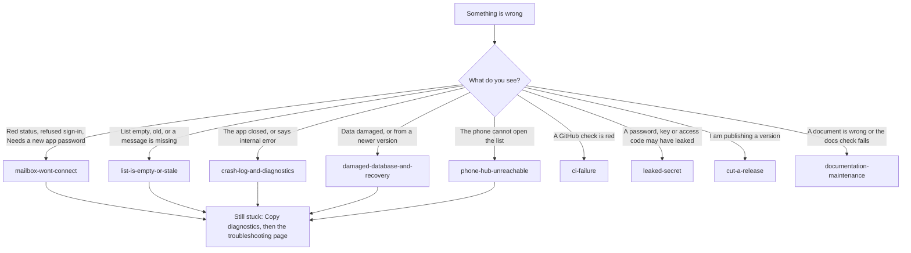

# Runbooks

> **Status:** current · **Audience:** users with a problem, maintainers who run the project · **Last reviewed:** 2026-11-14

A runbook is a list of steps that works when you are stressed: short sentences, commands you can copy, and a way out at every step. Start
with the picture below, then open the runbook it leads to. The [troubleshooting page](../troubleshooting.md) maps exact messages to
causes if you would rather search by what the window says.

## Something is wrong: where do I start?

This flowchart sends you from what you see to the runbook that fixes it.

## The runbooks

| Runbook | Use it when | For |
| --- | --- | --- |
| [Mailbox will not connect](mailbox-wont-connect.md) | The status bar is red, **Test connection** fails, or Settings says "Needs a new app password" | A user |
| [List is empty or stale](list-is-empty-or-stale.md) | The list says "All clear" or "Waiting for mail" when you expect mail, or new mail does not arrive | A user |
| [Crash log and diagnostics](crash-log-and-diagnostics.md) | The app closed on its own, the status says `internal error`, or you need to send a bug report | A user, a maintainer |
| [Damaged database and recovery](damaged-database-and-recovery.md) | The Log says the database was set aside and rebuilt, or the status says the data is from a newer version | A user |
| [Phone hub unreachable](phone-hub-unreachable.md) | The phone cannot load the list, or shows "Not connected" | A user |
| [A password, key or code may have leaked](leaked-secret.md) | You pasted an app password, your Anthropic key, the phone access code or the ntfy topic where others could see it, or a computer was lost | A user |
| [Register the app for sign-in](register-sign-in.md) | You want "Sign in with Google" and "Sign in with Microsoft" to appear | The owner |
| [Cut a release](cut-a-release.md) | You are publishing a version | A release manager |
| [CI failure](ci-failure.md) | A check on a push or pull request is red | A maintainer |
| [Documentation maintenance](documentation-maintenance.md) | You changed code and need to know which documents to update, or `scripts/check_docs.py` fails | A maintainer |

## Writing a new runbook

Copy [the runbook template](../templates/runbook.md) to this folder, fill it in, and add it to the table above and to the
[documentation map](../README.md). A runbook needs a diagram or a decision table, the exact text the window or the engine shows, and a
"Verify" step.

## Related

* [Troubleshooting](../troubleshooting.md)
* [FAQ](../faq.md)
* [Architecture overview](../architecture/overview.md)
