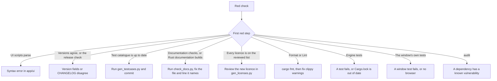

# Runbook: a CI check is red

> **Status:** current · **Audience:** maintainers and contributors · **Last reviewed:** 2026-11-14

Use this when a push to `main` or a pull request shows a red check. It lists each step of `.github/workflows/ci.yml` in the order it
runs, what failing means, how to reproduce it on your machine, and the usual fix.

## When to use this

The `CI` workflow has two jobs. `test` runs on Linux (`ubuntu-22.04`), Windows and macOS, and does not stop the other two when one
fails. `audit` runs once, on Linux. The release workflow has its own checks: see [cut a release](cut-a-release.md).

## Before you start

* Open the failed run on GitHub, choose the failed job and system, and find the first red step. The steps after it were skipped, except the "Say which … failed" steps and the window's tests, which run
  after a failure so that one problem does not hide another.
* With the GitHub command line: `gh run list --branch main --limit 5`, then `gh run view <id> --log-failed`.
* On Linux you need the system libraries the workflow installs (`libwebkit2gtk-4.1-dev`, `libayatana-appindicator3-dev`,
  `librsvg2-dev`, `libdbus-1-dev`, `libssl-dev`, `pkg-config`) to build the engine. Windows and macOS need nothing extra.

## Diagnose

## Steps

Each step of the `test` job, in order. Run the command from the repository root.

| Step | What failing means | Reproduce | Fix |
| --- | --- | --- | --- |
| Linux system libraries (Linux only) | `apt-get` could not install a package | Re-run the job | Usually a mirror problem: re-run |
| UI scripts parse | A script in `app/ui` has a syntax error | `for f in app/ui/*.js; do node --check "$f"; done` | Fix the line Node names |
| Versions agree across the project | The version differs between `app/package.json`, `tauri.conf.json`, the two `Cargo.toml` and the two `Cargo.lock`, or `CHANGELOG.md` has no heading for it, or a history document is missing | `python scripts/bump_version.py --check` | `python scripts/bump_version.py <version>`; add the changelog heading |
| The release check itself works | The release check's own tests fail | `python scripts/test_bump_version.py` | Fix the change to `bump_version.py` or its tests |
| Test catalogue is up to date | `docs/TESTCASES.md` is stale: a test was added, renamed or removed | `python scripts/gen_testcases.py`, then `git diff docs/TESTCASES.md` | Commit the regenerated file |
| Documentation checks | A document has a broken link or anchor, a bad Mermaid block, a missing header line, an old review date, a command missing from `docs/api/rpc.md`, or a public Rust item without a doc comment; or the checker's own tests fail (`test_check_docs.py`, or `test_gen_licenses.py` for the licence rule) | `python scripts/test_check_docs.py`, then `python scripts/check_docs.py` | Fix what the output names, with its file and line. See [documentation maintenance](documentation-maintenance.md) |
| Every licence is on the reviewed list (Linux only) | A crate has a licence that is not on the reviewed list (a dependency was added or updated) | `cd app/src-tauri && cargo fetch --locked`, then `python scripts/gen_licenses.py --policy` | Read the licence, then add it to `ALLOWED` in the script with the reason (a crate that is only GPL, AGPL or LGPL means choosing another crate); for MPL-2.0, name the crate in `MPL_REVIEWED`. The release workflow's `--check` also needs `python scripts/gen_licenses.py` run and the file committed |
| Format | `cargo fmt --check` found unformatted code | `cd engine && cargo fmt --check` | `cargo fmt`, commit |
| Lint (warnings are errors) | Clippy warns somewhere in the engine, its tests or examples | `cd engine && cargo clippy --locked --all-targets -- -D warnings` | Fix the warning |
| Rust documentation builds (warnings are errors) | `cargo doc` found a broken link or another warning in a doc comment | `cd engine && RUSTDOCFLAGS="-D warnings" cargo doc --no-deps --locked` | Fix the doc comment |
| Engine tests | A test fails on that system, or `--locked` found `Cargo.lock` out of date | `cd engine && cargo test --locked` | Fix the code or test; commit the lock file if the dependencies changed |
| The window's own tests | A test of the window fails, or the runner has no browser (a missing browser is a failure in CI) | `cd app && npm test`; set `INBOX_AGENT_UI_TESTS=require` to make a missing browser fail as CI does | Fix the window or its test; set `INBOX_AGENT_BROWSER` to a Chromium-based browser if none is found |

The commands are written for Git Bash or Linux. In PowerShell there is no `&&` before PowerShell 7, so run `cd engine; cargo test`;
set a variable on its own first (`$env:RUSTDOCFLAGS = "-D warnings"; cargo doc --no-deps --locked`, or
`$env:INBOX_AGENT_UI_TESTS = "require"; npm test`); and check the window's scripts with
`foreach ($f in Get-ChildItem app/ui/*.js) { node --check $f.FullName }`.

The `audit` job:

| Step | What failing means | Reproduce | Fix |
| --- | --- | --- | --- |
| Dependency vulnerability scan (Rust) | A crate in `engine/Cargo.lock` has a known vulnerability | `cd engine && cargo install cargo-audit --locked && cargo audit` | Update the crate (Dependabot opens such pull requests). A warning about an unmaintained crate does not fail the job |
| Dependency vulnerability scan (the app shell: Tauri, webview, plugins) | The same, for `app/src-tauri/Cargo.lock`: Tauri, the web view, plugins | `cargo audit -f app/src-tauri/Cargo.lock` | Update, or wait for an upstream release and record it in [SECURITY.md](../../SECURITY.md) |
| Dependency vulnerability scan (npm) | A package in `app/` has a known vulnerability | `cd app && npm audit` | `npm audit fix` where safe; the only dependency is the Tauri command line |

## Verify

The same step passes locally, you push, and the whole run is green on all three systems.

## If it does not work

* A failure on one system only (often Windows or macOS) is usually a path, a line ending or a file-system difference. Reproduce on that
  system, or read its log to the line.
* The workflow has a 45-minute limit for `test` and 30 minutes for `audit`; a run that hits it is cancelled.
* Run `python scripts/check_docs.py` before you push, as the "Documentation checks" step will; see
  [documentation maintenance](documentation-maintenance.md).
* Actions are pinned to full commit hashes. Dependabot proposes updates; do not change the pins by hand without checking what the new
  hash is.

## Related

* [Testing strategy](../testing/strategy.md)
* [Cut a release](cut-a-release.md)
* [Coding standards](../standards/coding-standards.md)
