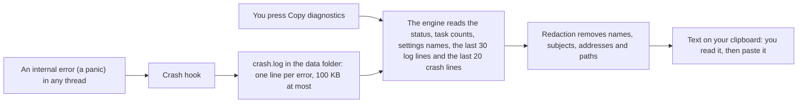

# Runbook: the crash log and diagnostics

> **Status:** current · **Audience:** a user who has hit an internal error, and a maintainer reading a bug report · **Last reviewed:** 2026-11-14

Use this when the app closed on its own, the status bar says `error: internal error, see crash.log in the app's data folder`, or you
want to report a problem. It says where `crash.log` is, what **Copy diagnostics** puts on your clipboard, and what it removes first.

## When to use this

* The bottom bar shows `error: internal error, see crash.log in the app's data folder`.
* The app disappeared, or restarted by itself.
* A **Log** line says `skipped message N: processing it crashed`.
* You are about to file a bug report.

## Before you start

* Nothing in either file is sent anywhere by the app. You decide what you paste.
* `crash.log` is the raw record. **Copy diagnostics** is the same information with private text removed. Share the second, not the
  first.

## What is where



| Item | Where | Notes |
| --- | --- | --- |
| The data folder | `%LOCALAPPDATA%\app.inboxagent.desktop` on Windows. On macOS and Linux it is the matching local application-data folder with the same name (not checked on those systems) | The Tauri identifier is `app.inboxagent.desktop` |
| `crash.log` | In the data folder | Created at the first error. A line is `date time [thread] file:line text`. The text is cut to 300 characters and line breaks become spaces. When the file passes 100 KB the next error starts a new one |
| `agent.db` and its files | In the data folder | The task list; see [damaged database](damaged-database-and-recovery.md) |
| `settings.json` | In the data folder | Server names, addresses and options; the phone hub's access code |

## Steps

1. Show the last lines of the log (Windows PowerShell):

   ```powershell
   Get-Content "$env:LOCALAPPDATA\app.inboxagent.desktop\crash.log" -Tail 20
   ```

   Note the date and the `file:line` of the newest line. The text after it is the error's own words, which can quote data from a
   message.
2. Open **Settings**, section **Export and support**, and press **Copy diagnostics**. The window says "Diagnostics copied. Read it, then
   paste it into your bug report."
3. Paste it into a text file and read it before you share it.
4. If a single message keeps failing, you do not need to act: the engine tries each message twice, then skips it, writes
   `skipped message N: handling it crashed the app 2 times` to the **Log**, and carries on.
5. If the status still says `internal error`, quit from the tray (**Quit**) and open the app again. The engine tries again after 30
   seconds by itself.

## What "Copy diagnostics" holds

A report looks like this (invented values):

```text
Inbox Agent diagnostics
Version: 0.1.0
System: windows x86_64
Status: idle
Tasks: 41 open, 120 done, 3 left the inbox
Options: ranking rules · write-back off · phone hub off · quiet hours off
Mail server: imap.gmail.com

Recent activity (newest first, private text removed):
  triaged “…” → P3, work
  closed “…”: you replied

Crash log (last lines, private text removed):
  none
```

| It holds | It never holds |
| --- | --- |
| The version, the operating system and its architecture, and the status | Mail addresses, subjects, message text |
| How many tasks are open, done, and have left the inbox | Passwords, API keys, the phone hub's access code, the ntfy topic |
| Option names: the ranking mode, and on or off for write-back, the phone hub and quiet hours (there is no sign-in option: reports from before Phase 11 ended the line with "Google sign-in off", which the app never had) | Folder or label names, or your folder paths |
| The first mailbox's server, only if it is one of eleven well-known ones (`imap.gmail.com`, `imap.mail.me.com`, `imap.mail.yahoo.com`, `imap.fastmail.com`, `outlook.office365.com`, `imap.zoho.com`, `imappro.zoho.eu`, `imap.aol.com`, `imap.gmx.com`, `imap.mail.com`, `imap.protonmail.ch`); any other server shows as `custom server` | More than the newest 30 log lines and 20 crash lines |
| The last 30 log lines and the last 20 crash lines, redacted | |

**What the redaction removes.** Anything in quotation marks (a subject, a folder); everything after the colon of an error line, except
for four known harmless endings; the login name in "connected as …"; the inside of "connection lost (…)"; any word containing `@`
(shown as `<address>`); a path under a home folder (shown as `<path>`) and any other word with a slash (`<name>`); control characters;
and anything past 200 characters in a line. A crash line keeps only its date, time, thread and `file:line`, then "(message removed)".

## Verify

You can name the date and the code location of the error, and your diagnostics text has no address, subject or password in it.

## If it does not work

* If `crash.log` is empty or missing and the app still closes, the cause was outside the app's own code (the operating system, or the
  web view). Note what you were doing and the version.
* If the same line repeats on every start, see [damaged database and recovery](damaged-database-and-recovery.md).
* **Sign out and reset** deletes `crash.log` along with the other local data.

## Related

* [Privacy](../../PRIVACY.md): what the crash log and diagnostics may hold
* [Troubleshooting](../troubleshooting.md)
* [Runtime and error containment](../architecture/runtime.md)
