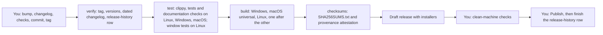

# Runbook: cut a release

> **Status:** current · **Audience:** the release manager · **Last reviewed:** 2026-11-14

Use this to publish a version of Inbox Agent. It follows [RELEASING.md](../../RELEASING.md) step by step and puts the checks in the order
you run them. RELEASING.md stays the owner of the one-time setup and of the list of signing secrets; this page does not repeat them.

## When to use this

You have finished the work for a version, nothing is half done on `main`, and you want installers on a draft GitHub release. A release is
a git tag. Nothing is public until you press **Publish** on the draft.

## Before you start

* The one-time setup in [RELEASING.md](../../RELEASING.md#one-time-setup-needs-your-accounts) is done: the GitHub repository, Actions
  write permission, branch protection, a security contact in SECURITY.md and, if you want signed installers, the secrets named there.
  Without the secrets the build still works and prints a warning that the installer is unsigned.
* You work on `main` with a clean tree (`git status`).
* You will test on **clean machines** (a new Windows user or a VM, a Mac, a Linux box), not on your development computer.
* You must not re-tag a version that was published. A fix is a new patch version.

## The pipeline

This is what happens after you push the tag. Your part is the first and the last two boxes.



A tag with a dash in it (`v0.2.0-beta.1`) becomes a pre-release. The workflow starts on tags that look like `v1.2.3`.

## Steps

Run the checks in this order. Stop at the first one that fails.

1. **Choose the version.** Before 1.0, a minor version (`0.2.0`) may change behaviour and a patch (`0.1.1`) only fixes. Set it
   everywhere (`app/package.json`, `tauri.conf.json`, both `Cargo.toml` and both `Cargo.lock`):

   ```bash
   python scripts/bump_version.py 0.1.0 --dry-run
   python scripts/bump_version.py 0.1.0
   ```

2. **Write the records.** In `CHANGELOG.md` rename `Unreleased` to the date: `## [0.1.0] - 2026-12-01`, and read the notes for truth.
   Add the version's row to `docs/RELEASE_HISTORY.md` (Published: `in preparation`; the row template is in that file), and its milestone
   to `docs/VERSION_HISTORY.md`.
3. **Everything green locally.** Run every command in step 3 of [RELEASING.md](../../RELEASING.md#cutting-a-release): the format check,
   clippy, the engine tests, `cargo doc`, the window's own tests (`npm test`; Node 22 or later and a Chromium-based browser on the
   machine), `test_check_docs.py`, `check_docs.py`, `gen_testcases.py`, the two version scripts, and the licence list (`test_gen_licenses.py` and
   `gen_licenses.py --check`). The release workflow repeats only part of that list: on all three systems it runs
   `cargo clippy --locked --all-targets -- -D warnings`, `cargo test --locked` and the documentation checks (`test_check_docs.py`,
   `check_docs.py` and `test_gen_licenses.py`), and on Linux it runs the licence check (`gen_licenses.py --check`) and the window's tests with
   `INBOX_AGENT_UI_TESTS=require`. It does not run `cargo fmt`, `cargo doc`, `gen_testcases.py` or `test_bump_version.py`, so a green
   run of the workflow does not replace them. If `gen_testcases.py` changes `docs/TESTCASES.md`, the commit must include that change.
4. **Commit, tag, push.**

   ```bash
   git add -A
   git commit -m "Release 0.1.0"
   git tag v0.1.0
   git push && git push origin v0.1.0
   ```

5. **Watch the run** in the repository's Actions tab. A red `verify` or `test` stops the release before anything is built.
6. **Check the draft on clean machines.** For each platform, in [RELEASING.md](../../RELEASING.md#before-you-publish-the-draft)
   order: download the installer and verify it against `SHA256SUMS.txt` (and, optionally, `gh attestation verify`); install; run the
   wizard; work through the live-mailbox plan in [the manual test cases](../TESTCASES.manual.md) (sections A to D at least); check the
   platform's own warnings (SmartScreen, Gatekeeper) and the tray icon; uninstall and confirm nothing keeps running.
7. **Publish.** Edit the release notes (copy from `CHANGELOG.md`), then press **Publish**.
8. **Finish the record.** In `docs/RELEASE_HISTORY.md` set the date published, signed or not, the checksums, which manual tests passed,
   and known problems. Commit and push. A withdrawn release keeps its row, marked withdrawn.

## If a stage fails

| Stage | What failure means | What to do |
| --- | --- | --- |
| `verify` | The tag, a package version, the changelog heading or the release-history row disagree. The message says which: for example "the tag says 0.1.0 but the project says 0.1.1", "has no '## [0.1.0]' heading", "still says Unreleased", or "no row for 0.1.0" | Fix it as the message says. If nothing was published, delete the tag and the draft release, commit the fix, and tag again |
| `test` | A test, a clippy warning, a documentation check or (on Linux) a window test failed | Fix on `main` as in [CI failure](ci-failure.md), and tag again as above |
| `build` | A bundle did not build on one system | Read that job's log; the other two may still finish |
| `checksums` | The release files could not be downloaded or attested | Re-run the job from the Actions tab |
| After publishing | The build is broken, a security problem, a bad dependency | Follow RELEASING.md, [If something is wrong after publishing](../../RELEASING.md#if-something-is-wrong-after-publishing): mark it a pre-release or delete it, fix, bump the patch version, release again |

A tag that was never published can be deleted and made again (RELEASING.md only forbids re-tagging a published version, and does not
describe the commands): `git tag -d v0.1.0`, then `git push origin :refs/tags/v0.1.0`, and delete the draft release on GitHub.

## Verify

The draft release lists an installer for each platform and `SHA256SUMS.txt`; `python scripts/bump_version.py --check` prints "OK"; the
release-history row is complete; and the changelog heading has the date.

## If it does not work

RELEASING.md owns the release procedure. If a step there and a step here disagree, follow RELEASING.md and fix this page in the same
commit ([documentation maintenance](documentation-maintenance.md)).

## Related

* [RELEASING.md](../../RELEASING.md)
* [Release history](../RELEASE_HISTORY.md) and [version history](../VERSION_HISTORY.md)
* [CI failure](ci-failure.md)
* [Test plan for a release](../testing/test-plan.md)
