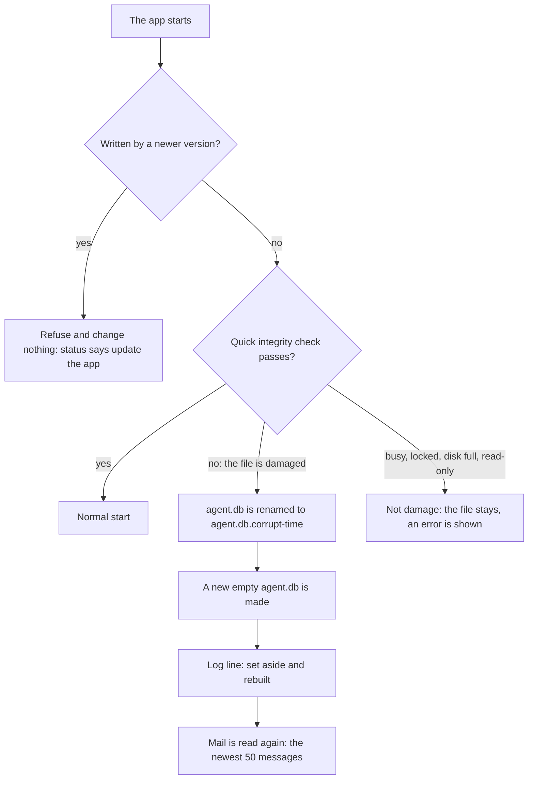

# Runbook: a damaged database, and recovery

> **Status:** current · **Audience:** a user whose local data is damaged, from a newer version, or who wants a clean start · **Last reviewed:** 2026-11-14

Use this when the **Log** says "the local database was damaged; it was set aside and rebuilt, and your mail will sync again", when the
status says the data "was created by a newer version of Inbox Agent", or when you want to start over. The list lives in one SQLite
file, `agent.db`. The app checks it each time it starts and repairs what it can.

## When to use this

| You see | Go to |
| --- | --- |
| Log line: "the local database was damaged; it was set aside and rebuilt, and your mail will sync again" | [Restore from a backup](#restore-from-a-backup) |
| Status: `error: This data was created by a newer version of Inbox Agent (format N). Update the app, or move the data folder aside to start fresh.` | [A newer version wrote the data](#a-newer-version-wrote-the-data) |
| The list or the rules are gone after an upgrade | [The copy made before an upgrade](#the-copy-made-before-an-upgrade) |
| You want everything gone | [Sign out and reset](#sign-out-and-reset) |

## Before you start

* Quit the app from the tray menu (**Quit**) before you touch any file in the data folder. Closing the window leaves it running.
* Do not delete `settings.json` unless you mean to run the wizard again: it holds your mailboxes and options. Passwords are in the
  system keychain, not in the folder.
* A set-aside database can hold message text (up to 3,000 characters per message). Treat it as private.

## What the app does by itself

The check runs once per launch. Only real corruption (a failed integrity check, or a file that is not a database) is treated as
damage. A busy or locked file, a full disk or a read-only folder is an ordinary error and the file is left alone.

## What is where

| File in the data folder | What it is |
| --- | --- |
| `agent.db`, `agent.db-wal`, `agent.db-shm` | The live task list and its journal files |
| `agent.db.corrupt-<unix seconds>` (and `-wal`, `-shm` beside it) | A damaged database that was set aside. The app never reads it again |
| `agent.db.bak` | One copy of the data as it was immediately before the app upgraded the database's format |
| `settings.json` | Mailboxes (server, port, address), options, the phone hub's access code |
| `crash.log` | The crash log: see [crash log and diagnostics](crash-log-and-diagnostics.md) |

The data folder is `%LOCALAPPDATA%\app.inboxagent.desktop` on Windows; elsewhere, the local application-data folder with that name
(not checked on macOS or Linux).

## Restore from a backup

The rebuilt database is empty, but the app is still signed in: your mailboxes and passwords were not in the damaged file. Mail
arrives again by itself (the newest 50 messages of each mailbox). What is lost with the damaged file: your rules, sender choices,
corrections, the tasks you added, notes, snoozes, drafts and the log. A backup holds most of these.

1. Wait until the bottom bar says "Watching your inbox".
2. Open **Settings**, section **Backup**, press **Restore from a backup file**, and choose the newest backup file (look in Downloads
   for `inbox-agent-backup-….json`).
3. Read the preview, then press **Restore**. It adds what is missing and removes nothing. See
   [backup and restore](../guides/backup-and-restore.md).

If you have no backup, those choices cannot be recovered by the app. Make a backup regularly. The set-aside file is not read by the app;
it is an ordinary SQLite file.

## A newer version wrote the data

The data was made by a newer Inbox Agent than the one running, and the older app refuses it and changes nothing. Install the newer
version. If you must go back to the older one, quit the app and move the data folder aside, so that the older version starts fresh and
runs the wizard again. Your backup files stay in Downloads.

## The copy made before an upgrade

When the app upgrades the database's format (the stored version is older than the app's) and the database already has its `tasks` table,
even an empty one, it first saves `agent.db.bak`, a copy of the data as it was. If an upgrade went wrong, quit the app, keep a copy of the current `agent.db`, and copy `agent.db.bak` over it, deleting any
`agent.db-wal` and `agent.db-shm` beside it. This procedure is not covered by an automated test; try it on a copy first. It is
removed by **Sign out and reset**.

## Sign out and reset

Use this for a clean start, before uninstalling, or when the steps above did not help.

1. **Settings**, then **Sign out and reset**. The button changes to "Click again: removes every saved password and key, and the local
   list".
2. Press it again. The app removes every saved mailbox password and your Claude API key, the task list, drafts, notes, the log, your
   corrections, sender choices, rules and follow-up records, entries still waiting from an earlier restore, `crash.log`, `agent.db.bak` and any set-aside
   databases. It turns the phone hub off, forgets its access code and clears the mailbox list. The wizard opens again.
3. Your ntfy topic and ranking choice stay in `settings.json`. Backup files and `.ics` files in Downloads stay: delete them yourself.

## Verify

* The Log shows "the local database was damaged; it was set aside and rebuilt, and your mail will sync again" once, then new lines.
* The bottom bar says "Watching your inbox" and the list refills.
* After a restore, **Settings**, **Your rules** lists your rules again.

## If it does not work

Press **Copy diagnostics** and report with the status text. If the status keeps an `error:` line that is not about a newer version, see
[troubleshooting](../troubleshooting.md).

## Related

* [Data model](../architecture/data-model.md)
* [Decision record: one SQLite file](../adr/0005-sqlite-single-file-store.md)
* [Privacy: deleting everything](../../PRIVACY.md)
