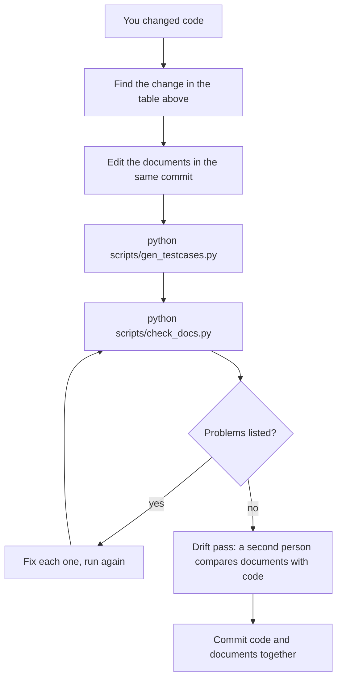

# Runbook: documentation maintenance

> **Status:** current · **Audience:** maintainers who change code or documents · **Last reviewed:** 2026-11-14

Use this when you change the code and need to know which documents to update, when `python scripts/check_docs.py` fails, or when a
reviewer asks for the drift pass. Documents live in the repository and change in the same commit as the code they describe. A change
that makes a document untrue is not finished.

## When to use this

* Before you commit a change to `engine/`, `app/ui`, `app/src-tauri` or a workflow.
* After a run of work, for the drift pass.
* When the documentation check fails.

## Before you start

* Read the [documentation style guide](../standards/docs-style-guide.md): the header line, British spelling, Mermaid, links.
* When a document and the code disagree, the code wins. Fix the document and say so in the commit.

## What to update with which change

Find your change in the first column and update every document in the second.

| You changed | Update |
| --- | --- |
| A button, label or message in `app/ui/*.js` | Every guide that quotes it ([guides](../guides/connect-a-mailbox.md)), the rows of [troubleshooting](../troubleshooting.md), the [FAQ](../faq.md), and the README's feature list |
| A key binding | [Keyboard shortcuts](../reference/keyboard-shortcuts.md), the help card text in `app/ui/drafts.js`, the README |
| An engine command (`rpc` in `core.rs`, `commands.rs`) | [Engine commands](../api/rpc.md): the checker fails without a section for it. If it is in `PUBLIC`, also the [hub interface](../api/hub-http.md), `openapi.yaml`, the limits in [phone and tablet](../guides/phone-and-tablet.md), and SECURITY.md |
| A setting or its default (`settings.rs`) | [Settings](../reference/settings.md), the [state answer](../reference/state-shape.md) if it appears in `state`, and the guide that explains it |
| What is stored, kept or sent | [PRIVACY.md](../../PRIVACY.md), the [data model](../architecture/data-model.md), the [security model](../architecture/security-model.md), and the FAQ answers about data |
| The database tables (`SCHEMA` in `store.rs`) | The [data model](../architecture/data-model.md); and the [damaged database runbook](damaged-database-and-recovery.md) if the files change |
| What a backup holds (`backup.rs`) | [Backup and restore](../guides/backup-and-restore.md), PRIVACY.md, the [phase 7 design](../designs/phase7.md) if the design changed |
| An error or status text of the engine | The matching row of [troubleshooting](../troubleshooting.md) and the runbook that quotes it |
| A thread, a module, or how the engine starts | [Architecture overview](../architecture/overview.md), [runtime](../architecture/runtime.md), [PSEUDOCODE.md](../PSEUDOCODE.md) |
| A choice a newcomer would question | A new [decision record](../adr/README.md): copy [the ADR template](../templates/adr.md), take the next number, add a row to the index |
| `.github/workflows/*.yml` or `scripts/bump_version.py` | [CI failure](ci-failure.md), [cut a release](cut-a-release.md), and RELEASING.md |
| Tests added, renamed or removed | `python scripts/gen_testcases.py`, and the [test plan](../testing/test-plan.md) if the release gates change |
| Anything a user can notice | [CHANGELOG.md](../../CHANGELOG.md) and [the version history](../VERSION_HISTORY.md). The [release history](../RELEASE_HISTORY.md) changes only when something is published |
| A new document | The [documentation map](../README.md), or the README of its folder; the checker fails on a document the map does not reach |
| A document you checked and found true | Its **Last reviewed** date. A document not reviewed for 180 days fails the check |

## Diagnose



## Steps

1. **Run the documentation check** from the repository root (the path is relative to it):

   ```bash
   python scripts/check_docs.py
   ```

   It checks that every relative link and anchor exists; that every code block has a language and every Mermaid block starts with a
   diagram type and is balanced; that documents carry the header line and were reviewed within 180 days; that the documentation map
   reaches every document; that `docs/api/rpc.md` has a section for each engine command and none for a command that does not exist;
   that decision records are numbered without gaps and listed; that public Rust items have doc comments; and that the filler words
   "simply", "obviously" and "please note" are not used. Each problem is printed with the file and line.
2. **Regenerate the test catalogue** whenever tests changed. It rewrites the generated part of `docs/TESTCASES.md` from the tests and
   appends the hand-written manual plan from `docs/TESTCASES.manual.md`:

   ```bash
   python scripts/gen_testcases.py
   ```

   CI runs the same script and fails if the file it rewrites differs from the one you committed. CI also runs `check_docs.py` and its
   own tests (the "Documentation checks" step) and `cargo doc` with warnings denied, so a broken link or a bad doc comment fails the
   build; see [CI failure](ci-failure.md).
3. **The drift pass.** After a run of work, someone other than the author takes each document the run touched, lists its factual
   claims (a message, a path, a limit, a default), opens the code for each, and corrects the document where they differ. Name what was
   found in the review record for the run (for example [the first drift report](../2026-11-13_DRIFT_REPORT.md)). Say which
   documents were checked and which were not.
4. **Check the quoted text.** A message or label in a document must be the text the window shows. Search `app/ui/*.js` and
   `engine/src` for it.
5. **Commit documents with the code** that changed them.

## Verify

`python scripts/check_docs.py` prints "OK" and a count of files, and `git diff docs/TESTCASES.md` is empty after
`python scripts/gen_testcases.py`.

## If it does not work

* A broken anchor: headings become anchors by lower-casing, removing punctuation and turning spaces into hyphens. Check the target's
  heading text.
* "not reachable from docs/README.md": add the document to the map.
* A Mermaid error: quote labels that hold punctuation, such as `A["IMAP: INBOX"]`, and do not use `end` or `graph` as a node name.
* The check has its own tests in `scripts/test_check_docs.py`. If the checker is wrong, fix it there with a test.

## Related

* [Documentation style guide](../standards/docs-style-guide.md)
* [Templates](../templates/README.md)
* [Testing strategy](../testing/strategy.md)
* [Decision record: documentation as code](../adr/0013-documentation-as-code-with-mermaid.md)
