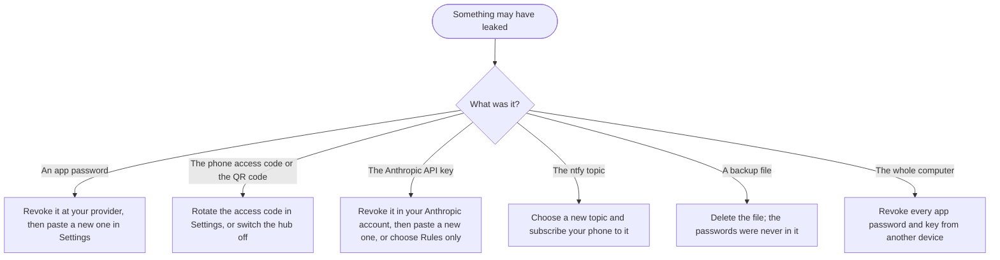

# Runbook: a password, key or code may have leaked

> **Status:** current · **Audience:** anyone who uses the app · **Last reviewed:** 2026-11-14

Use this when an app password, the phone hub's access code, your Anthropic key, your ntfy topic or a backup file may have been seen by
someone else: pasted into a chat, shown on a screen share, left on a lost computer. The steps are short because the order matters:
make the old secret useless first, then give the app the new one.

## Before you start

* Do the provider step first, in your provider's own account page: only the provider can make an old app password or key stop working.
* The app keeps passwords and keys in the operating system keychain, never in a file ([security model](../architecture/security-model.md)).
  The phone hub's access code and the ntfy topic are in `settings.json` in the app's data folder, so treat that folder like a password.

## Which secret?

## Steps

1. **An app password.** In your provider's account page, delete the app password you made for Inbox Agent (for Gmail: your Google
   account, Security, App passwords). Make a new one. In the app open Settings, find the mailbox, paste it under **New app password**
   and press **Save password**. The app checks the password before it saves it and your list, notes and tasks stay as they are.
2. **The phone hub's access code.** Open Settings, **Phone and tablet**, and press **Rotate access code**. The old code stops working at
   once; scan the new QR code on each phone. If you are not sure who has seen the address, switch the **Phone hub** switch off until you are.
   Anyone who had the old code could read and change your list, but not your mailbox login, settings, keys or the AI
   ([API overview](../api/README.md) says exactly what a phone may do).
3. **Your Anthropic key.** In your Anthropic account, delete the key. In the app, open Settings, **Ranking**, and either paste a new
   key into the API key box (the box says "saved — enter a new one to replace") or choose **Rules only**, which sends nothing anywhere.
4. **Your ntfy topic.** The topic name is the only protection of phone alerts. In Settings, **Alerts**, change **ntfy topic** to a new
   private name and subscribe your phone to it ([alerts guide](../guides/alerts-and-reminders.md)). Alerts hold a sender's name and a task title.
5. **A backup file.** Delete it (it was saved in your Downloads folder). It holds no passwords, keys or phone codes, but it does hold
   your rules, sender choices, corrections, tasks and notes, and the sender and subject of the mail you corrected.
6. **A lost or stolen computer.** From another device revoke every app password you made for Inbox Agent and your Anthropic key, and
   change your provider password if you reuse it. The database is not encrypted at rest ([SECURITY.md](../../SECURITY.md)): full-disk
   encryption is what protects it.

## Verify

* The mailbox in Settings says **Connected** after you save the new password.
* After rotating the phone code, the old QR code opens the page with `error: unauthorized` in the bottom bar instead of your list.
* The **Log** tab shows no activity you did not expect.

## If it does not work

Press **Copy diagnostics** (it holds counts and option names, not addresses or text; see
[crash log and diagnostics](crash-log-and-diagnostics.md)) and read it before you share it. If you think the app itself leaked a secret,
follow the reporting steps in [SECURITY.md](../../SECURITY.md).

## Related

* [Security model](../architecture/security-model.md), [privacy](../../PRIVACY.md), [phone and tablet guide](../guides/phone-and-tablet.md).
