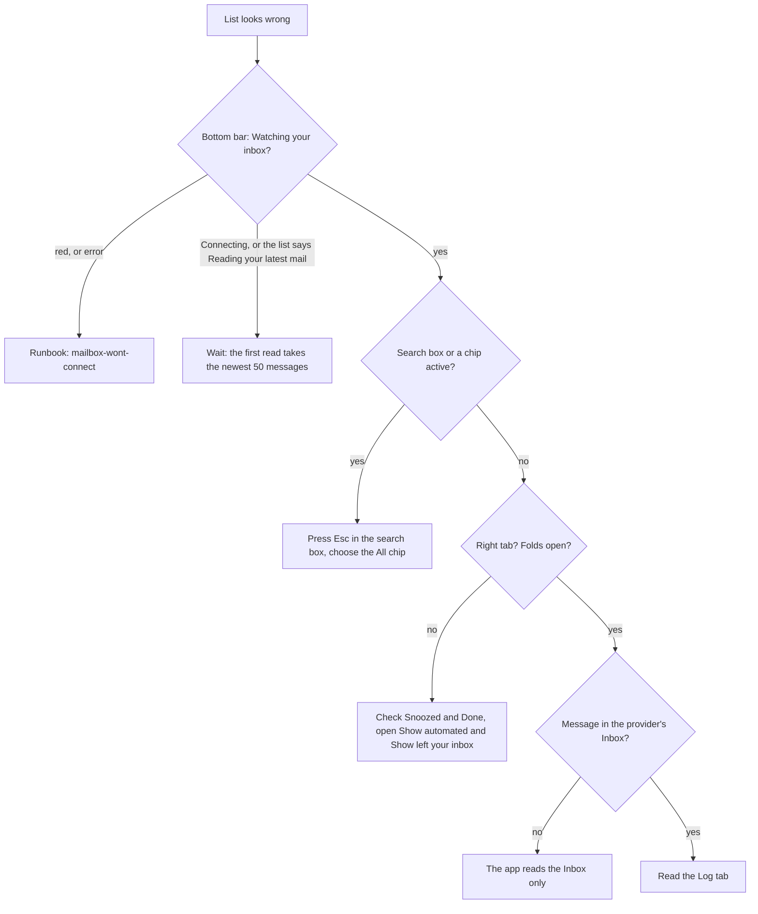

# Runbook: the list is empty or stale

> **Status:** current · **Audience:** a user whose list shows no mail, old mail, or is missing a message they expect · **Last reviewed:** 2026-11-14

Use this when the list says "All clear", "Waiting for mail" or "No matches" and you expect mail, when new mail does not appear, or when
a particular message is missing.

## When to use this

* The **To-do** tab is empty or shows less than your Inbox.
* New mail arrives at your provider but not in the list.
* One message you expect is not there.

## Before you start

* Do not press **Sign out and reset** to fix an empty list. It deletes your rules, choices and notes. Nearly every cause below is
  cheaper to fix.
* The window asks the engine for the list every 3 seconds while it is visible, and again when you bring it back to the front. You do
  not need to refresh.

## Diagnose

The text in the middle of the list tells you which situation you are in:

| The list says | Status | Meaning |
| --- | --- | --- |
| "All clear" and "The agent is still watching your inbox." | Connected | Nothing is open. Look at the other tabs |
| "Reading your latest mail…" and "The first sync can take a minute." | Reading | The first read of a mailbox is under way |
| "Waiting for mail" | Starting, setup, or anything else that is not connected | The engine is not yet reading. Check the bar |
| "No matches" | Any | A search or a filter hides everything |
| "Nothing resting" or "Nothing done yet" | Any | The **Snoozed** or **Done** tab is empty |

## Steps

1. **Look at the bottom bar.** If it is red, fix the connection first: [the mailbox will not connect](mailbox-wont-connect.md).
2. **Clear filters.** Press `/`, then `Esc` to empty the search box, and choose the **All** chip. A mailbox chip, a **Reply** or
   **Drafts** chip, or a category chip hides the rest.
3. **Check the other tabs and folds.** Tasks you snoozed are under **Snoozed**. Finished ones, including tasks closed by a rule that
   files mail or because you replied ("Closed automatically because you replied"), are under **Done**; it shows the newest 200 and
   offers "Show 500 older". Below the main list, **Show automated · N** and **Show left your inbox · N** open the two folds. The first
   holds untouched bulk mail of low priority with no due date; the second holds mail that is no longer in your Inbox (tag **Left
   inbox**: "This message is no longer in your inbox. You may have archived or moved it somewhere else.").
4. **Check where the message is.** The app reads only the Inbox of each mailbox. Mail your provider files into Spam, All Mail or a folder
   of its own (through a filter) is never read.
5. **Remember what a first read takes.** A new mailbox starts with its newest 50 messages. Older mail is not read.
6. **Read the Log tab.** It shows the engine's recent actions, newest first. The lines that explain a missing message are in the
   table below.
7. **Restart the reading.** Quit from the tray menu (**Quit**) and open the app again, or save any setting: both restart every mailbox's
   connection.

| Log line | What happened | What to do |
| --- | --- | --- |
| `skipped message N: larger than 5 MB` | A message over 5 MB is never read | By design; read it in your mail program |
| `could not parse message N: …` | The message could not be read | Nothing: the next message is read |
| `skipped message N: processing it crashed` or `…handling it crashed the app 2 times` | One message made the engine fail; it is skipped | See [crash log and diagnostics](crash-log-and-diagnostics.md) |
| `giving up on message N: the server returned no content 2 times` | The server named the message but sent nothing | Nothing |
| `the mail server renumbered your inbox; starting a fresh sync` | The provider restarted the Inbox's message numbers, so that mailbox's tasks, drafts and queued changes were cleared and its newest 50 messages are read again | Wait for the read. Your rules, sender choices, notes on tasks you added and other mailboxes stay |
| `could not read your Sent folder (…); mail still loads, but replies you have already sent are not detected` | No Sent folder was found | Mail still arrives; "replying to you" is weaker |
| `connection lost (…); retrying in 30s` | A network error | Wait, or see the connection runbook |
| `checked your mailbox: N closed because you replied, M no longer in the inbox` | The app tidied tasks | Look in **Done** and in the fold |

## Verify

Send yourself a test message. It appears within seconds, and the **To-do** tab's count goes up.

## If it does not work

Press **Copy diagnostics** (**Settings**, **Export and support**) and include it in your report; it shows the status, the task counts
and the recent log with private text removed. See [crash log and diagnostics](crash-log-and-diagnostics.md).

## Related

* [Troubleshooting](../troubleshooting.md)
* [Life of a message](../architecture/message-lifecycle.md)
* [Engine step by step, sections 2 and 3](../PSEUDOCODE.md)
