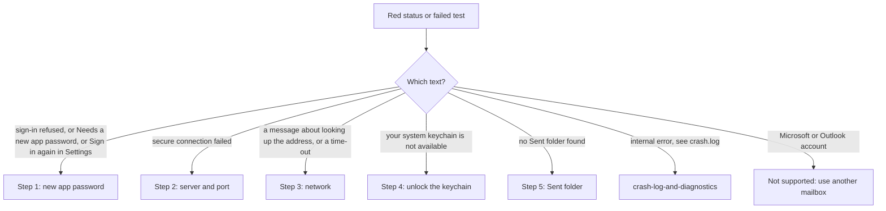

# Runbook: the mailbox will not connect

> **Status:** current · **Audience:** a user whose mail has stopped, or who cannot add a mailbox · **Last reviewed:** 2026-11-14

Use this when the status bar at the bottom of the window is red, **Test connection** shows a red message, or a mailbox in Settings says
"Needs a new app password".

## When to use this

You see one of these:

* The bottom bar, in red: `error: …`, or "Sign in again in Settings".
* In **Settings**, under **Mail**, a mailbox with a red status instead of **Connected**.
* A red message under **Test connection** in the wizard or in **Add a mailbox**.

## Before you start

* Have your provider's app-password page open. The steps for each provider are in [connect a mailbox](../guides/connect-a-mailbox.md).
* Do not paste an app password anywhere except the app's own password boxes. It never belongs in a bug report; "Copy diagnostics" holds
  none.
* Wait a moment before you change anything if the bar says "Connecting…", or a mailbox in **Settings** says "Reading mail…": that is
  not a failure.

## Diagnose

Find the red text in the first column of the table, then follow the matching step.

| Text | Where it comes from | Retry |
| --- | --- | --- |
| `error: your mail server refused the sign-in. Enter your password again in Settings` | The server said no to the address and password | Every 5 minutes. Waiting does not fix a wrong password: use step 1 |
| "Needs a new app password" (Settings) or "Sign in again in Settings" (bar) | No password is saved for that mailbox | None until you save one |
| `error: secure connection failed: …` | The TLS handshake failed | Every 30 seconds |
| `error: …` with a lookup or time-out message | The server was not found, or did not answer within 15 seconds | Every 30 seconds |
| `error: your system keychain is not available (…). Unlock it and restart the app` | The system keychain could not be read | None: unlock it, then restart |

## Steps

1. **A new app password.** At your provider, make a new app password. Providers cancel app passwords whenever you change your account
   password. On Gmail, 2-Step Verification must be on and IMAP must be on in Gmail settings. Then open **Settings**, find the mailbox
   under **Mail**, paste it into **New app password** and press **Save password**. The app checks it ("Checking…"), saves it, and says
   "Saved. Your list is untouched." Every mailbox reconnects at once.
2. **Server and port.** For **Other IMAP server**, check **IMAP server** (letters, digits, dots and hyphens only: "That mail server name
   isn't valid" means something else is in it) and **Port** (a whole number from 1 to 65535: "That mail server port isn't valid" means it
   is empty, 0 or too big, and the app does not shorten it to fit). The app
   connects with TLS from the first byte, usually port 993. A server that offers only STARTTLS (port 143) or a plain connection cannot
   be used. To change the server or address of a mailbox, add it again as a new mailbox and then remove the old one (with only one mailbox, add the
   new one first: **Remove** is not offered for the last one).
3. **Network.** Check that the computer is online and that a VPN or firewall is not blocking the mail server. The app waits 15 seconds
   to connect and 60 seconds for each answer, and tries again every 30 seconds by itself.
4. **Keychain.** Unlock the system keychain (Windows Credential Manager, macOS Keychain or the Secret Service on Linux). Then quit the
   app from the tray menu (**Quit**) and open it again.
5. **Sent folder.** The test needs a folder the server flags as Sent, or one named `[Gmail]/Sent Mail`, `Sent`, `Sent Items`,
   `Sent Messages` or `INBOX.Sent`. If the error is `no Sent folder found among N folders`, the window cannot add that mailbox.
   Report it with the output of **Copy diagnostics**.
6. **Microsoft accounts.** Outlook and Microsoft 365 are not supported (see [connect a mailbox](../guides/connect-a-mailbox.md#what-is-not-supported)). Use another mailbox.

## Verify

* In **Settings**, the mailbox says **Connected**, and the bottom bar says "Watching your inbox".
* Send yourself a test message. It appears in the list within seconds.

## If it does not work

1. Press **Copy diagnostics** in **Settings** (section **Export and support**), read what it copied, and attach it to your report. See
   [crash log and diagnostics](crash-log-and-diagnostics.md).
2. Look at the **Log** tab for lines such as "connection lost (…); retrying in 30s" or "connection lost (…); retrying in 300s". The
   number is the wait before the next try.
3. Check the [troubleshooting page](../troubleshooting.md) for the exact text.

## Related

* [Connect a mailbox](../guides/connect-a-mailbox.md)
* [List is empty or stale](list-is-empty-or-stale.md)
* [Decision record: secrets in the OS keychain](../adr/0004-secrets-in-os-keychain.md)
