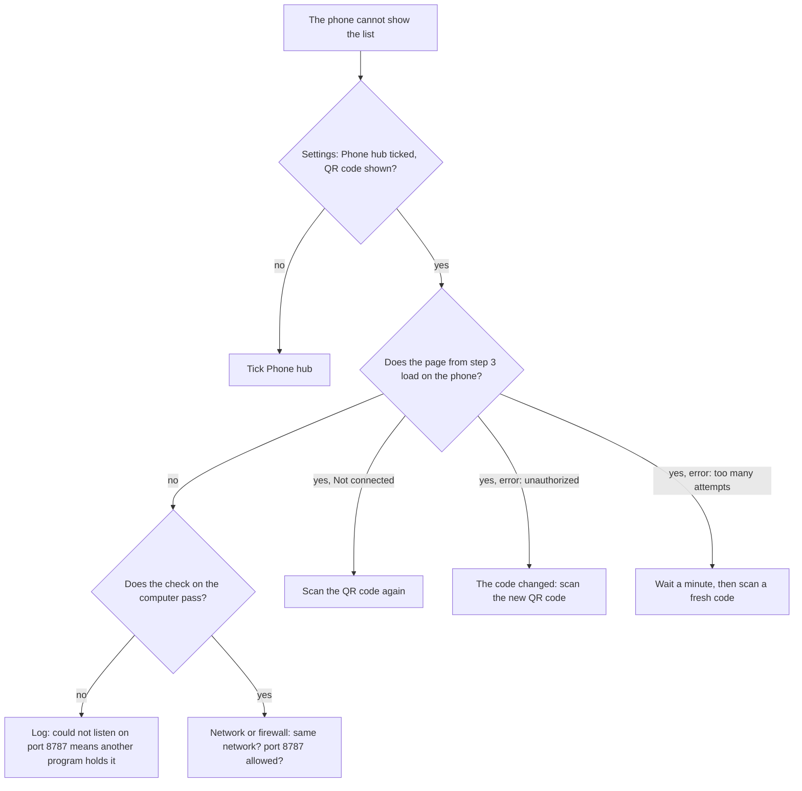

# Runbook: the phone cannot reach the hub

> **Status:** current · **Audience:** a user whose phone or tablet cannot open the list · **Last reviewed:** 2026-11-14

Use this when the page does not load on the phone, shows "Not connected", or shows a status that starts with `error:`. The phone hub is
a small web server inside the app on your computer, on port 8787.

## When to use this

* The phone's browser says it cannot connect, or times out.
* The page loads and says "Not connected", with "This page needs the access code from your computer" under it.
* The page loads, but the bottom bar says `error: unauthorized` or `error: too many attempts`.

## Before you start

* The computer must be on, awake and running Inbox Agent (it can be in the tray).
* The phone and the computer must be on the same private network, or on the same private VPN.
* Do not switch the hub on for a public Wi-Fi. It speaks plain HTTP. See [phone and tablet](../guides/phone-and-tablet.md).

## Diagnose



## Steps

1. **Is the hub on?** Open **Settings**, section **Phone and tablet**. **Phone hub** must be ticked and a QR code and an address must
   appear under it. If the address starts `http://127.0.0.1`, the app found no network address: connect the computer to a network and
   untick and tick **Phone hub** again.
2. **Check the hub on the computer.** In PowerShell:

   ```powershell
   Invoke-WebRequest -UseBasicParsing http://127.0.0.1:8787/ | Select-Object StatusCode
   ```

   or in a POSIX shell:

   ```bash
   curl -s -o /dev/null -w "%{http_code}\n" http://127.0.0.1:8787/
   ```

   `200` means the hub is up. Any failure means it is not listening: read the **Log** tab for "phone hub could not listen on port 8787"
   (another program holds the port; the app tried for about six seconds). Close the other program, then untick and tick **Phone hub**,
   or restart the app. Unticking and ticking also makes a new access code, so scan the new QR code afterwards.
3. **Check the path from the phone.** Open `http://<the computer's address>:8787/` in the phone's browser, without the code. The hub serves
   the page without a code, so you see "Not connected" if the network path works. If nothing loads: the phone and computer are on
   different networks (a guest Wi-Fi, mobile data, a different VPN), the computer's firewall blocks incoming connections on port 8787 (allow the
   app on private networks; this is an operating-system setting, not checked here), or the computer is asleep.
4. **Scan the code again.** "Not connected" means the phone has no stored access code. Scan the QR code. After **Rotate access code**, or
   after the hub was switched off and on, every phone needs the new code: `error: unauthorized` is the sign.
5. **If the bar says `error: too many attempts`:** the hub refuses an address after ten wrong codes in a minute. Wait a minute, then scan the
   current QR code.
6. **The address under the QR code is wrong for your phone** (for example you reach the computer through a VPN): put the computer's
   address on that network in place of the host part, and keep `:8787/?token=…`. Not verified with every VPN.

## Verify

The list appears on the phone. Mark a task done there: the computer's list shows it within a few seconds.

## If it does not work

Press **Copy diagnostics** on the computer and report the **Log** lines about the hub. The hub accepts connections only from loopback,
private, link-local, `100.64.0.0/10` and IPv6 local addresses, and drops all others without an answer, so a phone reaching the computer
through a public address never gets a reply.

## Related

* [Phone and tablet](../guides/phone-and-tablet.md)
* [Phone hub HTTP interface](../api/hub-http.md)
* [Decision record: plain HTTP with a token](../adr/0009-phone-hub-plain-http-with-token.md)
