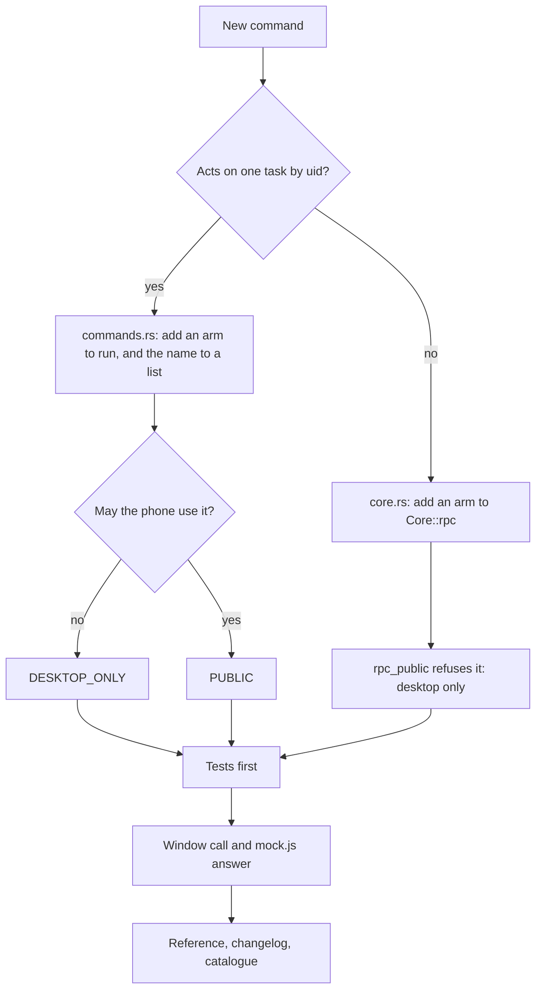
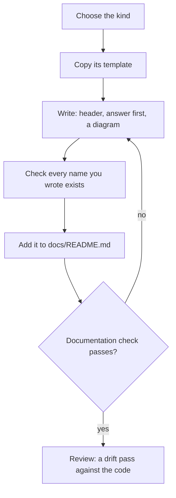

# Coding standards

> **Status:** current · **Audience:** anyone who changes code or tests in this repository · **Last reviewed:** 2026-11-14

These are the rules the code and CI already follow, written down with the reason for each and how it is checked. A rule that no
tool checks says so: a reviewer is expected to look for it. Documents have their own rules in the
[documentation style guide](docs-style-guide.md).

## How a rule is checked

| Mark | Meaning |
| --- | --- |
| **CI** | A job in `.github/workflows/ci.yml` fails when the rule is broken (the release workflow repeats the lint, the engine tests and the documentation checks, and on Linux the window tests) |
| **Test** | A named test fails when the rule is broken |
| **Script** | A script in `scripts/` fails or regenerates a file |
| **Review** | No tool checks it; the three review gates and the author do. Where a command finds the cases, it is given |

`ci.yml` has run on every push since 2026-11-14 and passes on Windows, Linux and macOS; `release.yml` has never run, so the marks that
name it describe what the file does, not a run that was seen. See [the testing strategy](../testing/strategy.md).

## Rust (the engine and the shell)

The engine (`engine/`) is a library; the Tauri shell (`app/src-tauri`) holds one command, `rpc`, that passes the window's request to
`Core::rpc`. Logic goes in the engine, where it has tests; the shell stays thin. The engine uses the 2021 edition and the stable
toolchain (CI installs `stable` with `rustfmt` and `clippy`).

| Rule | Why | Checked by |
| --- | --- | --- |
| Format with `cargo fmt` and its defaults (there is no `rustfmt.toml`) | Diffs show changes, not layout | **CI** `cargo fmt --check` |
| Clippy runs on everything, tests and examples included, and warnings are errors: `cargo clippy --locked --all-targets -- -D warnings` | A warning ignored once is ignored for ever | **CI**, and the release workflow |
| No `unsafe` and no `#[allow(...)]` in `engine/src` (none exists today). A future one needs a comment saying why | Both switch off a check the compiler or clippy makes for you | **Review**: `grep -rn "unsafe \|allow(" engine/src` |
| Functions that can fail return `anyhow::Result`. A message the window will show is a whole sentence that says what to do next ("Pick a day from today (only before 09:00) to a year ahead") | The window shows the engine's text as it is | **Review**; many refusal tests check the text |
| No panic on anything that comes from mail, a server, a file, a model or the person: no `unwrap`, `expect`, `panic!` or unchecked index on such data. Today `engine/src` has two guarded `unwrap`/`expect` calls (`ai.rs` after an `is_some` match arm, `triage.rs` on the rules triager that cannot fail) | One hostile message must not stop the app. The watcher also catches a panic per message (`catch_unwind`) as a net, not as permission | **Review**: `grep -rn "\.unwrap()\|\.expect(" engine/src`. **Test**: `missing_or_strange_headers_never_panic`, `garbage_never_panics_the_parser`, `a_message_that_panics_is_skipped_and_the_rest_of_the_sync_continues` |
| Take a lock with `lock().unwrap_or_else(\|e\| e.into_inner())`, never `unwrap()` | A thread that panicked must not poison the lock for everyone else | **Review** |
| SQL text is a constant. Values reach it only as parameters (`?1` with `params![]`). `format!` into SQL splices a constant only: a table name from a fixed list, the shared `SELECT`, a column definition | A value in the SQL text is an injection | **Review**: read every `format!` in `engine/src/store.rs`. **Test**: `hostile_and_unicode_text_is_stored_verbatim_and_safely` |
| What you type into search never becomes search syntax: `fts_query` keeps at most 8 alphanumeric words, each quoted | `OR`, `NEAR`, a quote or `*` must be plain text | **Test**: `what_you_type_is_never_search_syntax` |
| Change the schema by adding to `ADDED_COLUMNS` (added in place, a copy is kept as `agent.db.bak` first). Raise `SCHEMA_VERSION` only for a change older code cannot read; a database from a newer version is refused and left alone | An upgrade must never lose a person's list | **Test**: `an_old_database_is_upgraded_in_place`, `upgrading_an_older_database_keeps_a_backup`, `data_from_a_newer_version_is_refused_and_left_untouched` |
| Secrets (an app password, an API key) go through `secrets::set`, `get` and `delete` only: never in `settings.json`, a log line, an error text, a backup, diagnostics, or the phone's answer | The keychain is the only place a secret is allowed to rest | **Test**: `a_backup_holds_what_you_did_and_nothing_secret`, `public_state_leaks_neither_account_nor_alert_secrets`, `the_phone_never_sees_the_login_of_a_mailbox_not_even_in_the_log` |
| A write transaction that may read before it writes starts with `TransactionBehavior::Immediate` (`Transaction::new_unchecked(&self.db, rusqlite::TransactionBehavior::Immediate)`), never a plain `transaction()` or `unchecked_transaction()`. A transaction that only reads may stay deferred (`tasks_for_window`) | A deferred transaction takes its view at its first read. If a sync commits before its first write, SQLite fails it at once with `database is locked` (code 517) and the busy timeout does not help. The first CI run found this on Linux, and four transactions had it | **Review**: read each `new_unchecked` and `unchecked_transaction` in `engine/src/store.rs` and `engine/src/store/transfer.rs`. The Phase 6 tests exercise it, and CI runs them on Linux |
| A number that comes from a request is never narrowed with `as` to a smaller type (`as u32`, `as u16`, `as u8`). Use `u32::try_from(n)` (or `u16`, `u8`) and refuse the request, or read it as "none" (task 0, no priority), when it does not fit. An `as` after `clamp` or `min`, or on a row id the engine made, is fine | `as` keeps only the low bits: task 2^32 + n acted on task n, priority 261 was read as 5 and port 66529 as 993 | **Test**: `a_number_too_big_for_its_type_is_refused_not_wrapped`. **Review**: `grep -rnE "as u(8\|16\|32)" engine/src`; each hit is clamped first or is a row id |
| Tests never touch the real keychain. `secrets::in_memory()` is true inside any cargo test binary | A test that signs out must not delete the password of the person running it | **Test**: `the_keychain_is_never_the_real_one_when_the_tests_run` |
| Everything that comes from outside is hostile: bound its size, allow-list its shape, check it before use (a Message-ID, a calendar part, a backup file, a model's reply, a settings patch) | Mail is written by strangers | **Test**: `message_id_accepts_only_a_plain_angle_addr`, `nonsense_in_an_invitation_never_becomes_an_event`, `a_file_over_a_limit_is_refused_whole`, `bad_settings_patches_are_errors_not_crashes` |
| Every outbound HTTP request goes through `ai::http_agent(secs)`: a hard timeout and no redirects. A new destination is named in `PRIVACY.md` before it ships | A redirect could aim a request elsewhere, and a person is told where data goes | **Review**: `grep -rn "ureq::" engine/src` finds one place |
| Nothing sends mail. There is no SMTP code or dependency; the only writes to a mailbox are in `writeback.rs`, on their own connection, when "Let Inbox Agent file mail" is on | The owner's constraint, and the promise in `PRIVACY.md` | **Test**: `a_reply_draft_is_appended_to_drafts_flagged_and_threaded_and_nothing_is_sent`. **Review**: `engine/Cargo.toml` lists no SMTP crate |
| The watcher reads with `EXAMINE` and `BODY.PEEK` so reading never marks mail as read | Reading must leave the mailbox as it was | **Test**: `first_sync_backfills_the_latest_messages_then_only_new_ones_and_never_modifies_the_mailbox` |
| No `println!`, `eprintln!` or `dbg!` in `engine/src`. Use `Store::log` (the Log tab); a panic is written to `crash.log` by `diag` | A release build has no console | **Review**: `grep -rn "println!\|dbg!" engine/src` finds nothing |
| A decision that depends on the time takes the time as an argument (`snooze_until(preset, from)`, `set_reminder(..., now)`), and a reminder is wall-clock text (`YYYY-MM-DD HH:MM`) | A test sets the clock instead of waiting, and a 9 o'clock repeat stays at 9 across a clock change | **Test**: `a_monthly_task_set_for_the_31st_does_not_drift_and_handles_leap_years`, `digest_and_quiet_hours_at_the_boundaries` |
| Every module starts with a `//!` comment saying what it owns and, where one exists, naming its design (`Design: docs/designs/phase5.md`). Every public function, struct, enum, trait, constant and type has a `///` comment (fields and variants are left to the reference pages). Comments say why, not what | A reader finds the reason without reading the history | **Script**: `scripts/check_docs.py` fails on a public item with no `///`. **CI**: `cargo doc --no-deps --locked` with `RUSTDOCFLAGS: -D warnings`. **Review**: `head -1 engine/src/*.rs engine/src/store/*.rs` shows every module comment |
| Keep dependencies few. A new crate needs a reason in the design document, an up-to-date `Cargo.lock` (CI builds with `--locked`), and a clean `cargo audit`. A feature that is not obvious has a comment beside it in `Cargo.toml` (see `float_roundtrip`) | Each crate is code nobody here wrote | **CI**: the `audit` job runs `cargo audit` on both lock files and `npm audit` |

## The window (`app/ui`)

The window is plain HTML, CSS and JavaScript with no build step. `index.html` loads `main.js`, `drafts.js`, `setup.js` and
`boot.js` in that order into one global scope; `demo.html` loads `mock.js` first. The engine's hub serves the same files to a phone.

| Rule | Why | Checked by |
| --- | --- | --- |
| No build step, no framework, no dependency. `app/package.json` has the Tauri command line as a development dependency and nothing else | What is in the repository is what runs; nothing to audit or break on upgrade | **Review**. **CI**: `node --check` on every `app/ui/*.js` |
| Line 1 of every script is `"use strict";` and line 2 is a comment saying what the file holds | Strict mode turns silent mistakes into errors; the header says where to look | **Review**: `head -2 app/ui/*.js` |
| A function whose promise is not clear from its name has a one-line comment above it saying what it promises: what it never does, what it leaves to the caller, what an answer can be. A comment explains why, not what the next line does | The window has no types and no documentation generator, so the comment is the only place a promise is written down | **Review**; `node --check` in CI only proves the files parse |
| Put data into markup only through `esc()` (defined in `main.js`), or set it with `textContent`. Mail text, names and subjects are never trusted | A subject line must not become markup | **Review**: read each `innerHTML` (26 uses in three files today). The content security policy (`script-src 'self'`, in `tauri.conf.json` and in `hub.rs`) limits the harm of a slip, and a slip is still a defect |
| No network call from the window except the hub's same-origin `fetch("/api/rpc")` inside `rpc()` in `main.js`. Everything else is `rpc(cmd, args)` | The window cannot send anything anywhere; the policy's `connect-src 'self'` enforces it | **Review**: `grep -n "fetch(\|XMLHttpRequest\|WebSocket" app/ui/*.js` finds one line |
| Fonts and images are files in `app/ui` | The policy allows only `'self'`, and a font service would see every launch | **Review** |
| Keyboard first: an action that has a key works from the list; shortcuts do nothing while a dialog is open, a field has the focus or a modifier is held; Escape closes a dialog; Tab stays inside it. A changed key is changed in the `?` card and the README | Hands stay on the keys; a typed `x` must not finish a task | **Test**: window tests that press `j`, `k`, `x`, `z`, Enter, Escape. No test covers the Tab trap |
| Accessibility attributes: `role="dialog"` and `aria-modal` on dialogs, `aria-label` on a control with no text, `aria-pressed`, `aria-checked` or `aria-expanded` on a toggle, announcements in the `role="status" aria-live="polite"` regions, a `:focus-visible` outline, and `prefers-reduced-motion` honoured | A person using a screen reader or a keyboard can use every dialog | **Review**. No screen-reader test has been run |
| Colours come from the variables at the top of `style.css`: black, greys, white and one red | The owner's design is a pure black screen with one accent | **Review** |
| A request that fails shows the engine's message to the person (a toast or the dialog's error line); it is never swallowed | The engine's messages are written to be read | **Test**: `a failed add keeps the dialog and says why; after a fix the same dialog adds the mailbox` (window) |
| `mock.js` answers every command the window calls, in the shape the engine answers it | The window tests run against it, and the demo page depends on it | **Review**; the window tests fail on a missing answer |
| A long list draws 150 rows of each part at a time and a cursor key changes classes instead of drawing the page; the window does not poll while hidden | Measured: the page was unusable with thousands of tasks (`docs/designs/phase8.md`) | **Test**: the list and cursor window tests |

## Tests

| Rule | Why | Checked by |
| --- | --- | --- |
| **Red, then green.** Write the test, watch it fail for the reason you expect, then change the code. A fix to a defect starts with a test that reproduces it | A test that was never red may never fail | **Review**; the review records say which tests were red first |
| **Break each new guard once.** Put the old behaviour back, on purpose, and confirm a named test fails. For the window do it on a copy of `app/ui`, so a mutant can never be left in the real files. A test that passes with the guard removed is rewritten | Reviewers found tests that passed for the wrong reason (`docs/2026-11-14_PHASE9_REVIEW.md`) | **Review**. There is no mutation tool in the repository; the records list each mutant and the tests that caught it |
| Engine tests live in `engine/tests/`, not in `src`. New behaviour goes in the run's file (`phaseN.rs`) or a topic file | The tests use the public API only, and the catalogue reads that folder | **Script**: `gen_testcases.py` reads `engine/tests/*.rs` only |
| Name an engine test as a sentence that says what holds: `a_reply_you_archived_is_found_in_all_mail`. A `//` line above `#[test]` becomes its "what it proves" text. After adding or renaming one run `python scripts/gen_testcases.py` and commit `docs/TESTCASES.md` | The catalogue is the list of promises | **CI**: "Test catalogue is up to date" |
| Name a window test as a sentence starting with the subject, inside a `suite(...)`; it presses real keys and clicks through the harness and checks the page, not the code | The title is what the catalogue and a failure show | **Script**: the same generator reads `it("...")` titles |
| Never wait with a fixed pause for something you can wait for. Use `page.waitFor`; hold a slow answer with `wrapMock` (`hold: true`) and let it go with `release(page)`; inject the clock in the engine. Every wait has a time limit | A pause is too long on a fast machine and too short on a slow one, and a test that waits for ever hangs the run | **Review**. The harness limits are 15 s for `waitFor`, 60 s for a browser answer and 120 s for a test. About a dozen short `settle` pauses and eight bounded sleeps in engine tests remain |
| A test uses its own temporary folder and the in-memory keychain, and no real host. The scripted IMAP server listens on `127.0.0.1` and the tests use `connect_plain` | A test must not touch the machine it runs on | **Review** |
| Know what a test proves. An engine test proves what the engine does; a window test proves what the window does with the demo backend's answers. Neither proves the other | The engine's answers and the window's use of them are tested apart | See [the testing strategy](../testing/strategy.md) |

## Git

Commit only when the owner asks, and never push unless asked. The history looks like this:

```text
Phase N: what it gives you

Why, with the measurement or the defect that started it.

Engine:
- what changed, one line each

Window:
- what changed, one line each

Docs: design (docs/designs/phaseN.md), CHANGELOG, README, review record, version history.
470 engine tests, 58 window tests.

Co-Authored-By: Name <address>
```

| Rule | Why | Checked by |
| --- | --- | --- |
| The subject is short (under about 70 characters), says what the change gives, and a phase starts with `Phase N:` | `git log --oneline` reads as the project's story | **Review**: `git log --oneline` |
| One phase is one commit: code, tests, documents, changelog and the review record together | A commit that passes is a state a person could return to | **Review** |
| The commit cannot hold its own hash, so a **follow-up commit** records it: `Record the Phase N commit in the version history`, one line in `docs/VERSION_HISTORY.md` | The history stays true without rewriting a commit | **Review**: `git show --stat HEAD` |
| The body ends with the test counts and a `Co-Authored-By:` line when an assistant wrote part of it | The reader knows what ran and who helped | **Review** |
| Text files use LF (`.gitattributes`: `* text=auto eol=lf`). `target/`, `node_modules/`, `__pycache__/`, `*.log` and `.env` are ignored. Never commit a certificate, a key or a password | Equal diffs on every system; a secret in history cannot be recalled (secrets live in GitHub's settings: `RELEASING.md`) | **Review** |
| Never skip a check to get a commit through (`--no-verify`, a lowered lint level) | A skipped check hides the next defect | **Review** |

## Versions

One version number covers the whole project, kept in `app/package.json`, `app/src-tauri/tauri.conf.json`, both `Cargo.toml` and both
`Cargo.lock`. Never edit them by hand:

```bash
python scripts/bump_version.py 0.2.0            # set every field
python scripts/bump_version.py 0.2.0 --dry-run  # show what would change
python scripts/bump_version.py --check          # every field agrees and the changelog has the entry
```

CI runs the check and `python scripts/test_bump_version.py`. The release workflow also requires a dated changelog heading and a
row in `docs/RELEASE_HISTORY.md`. Versions follow [Semantic Versioning](https://semver.org); before 1.0 a minor version may change
behaviour. See [RELEASING.md](../../RELEASING.md).

## Checklist: add an engine command

A command is a name the window (or the phone) sends with arguments through `rpc`. The reference is `docs/api/rpc.md`.



1. **Decide who may call it.** The phone may call only `state` and the names in `PUBLIC` (`commands.rs`). Anything that spends AI
   quota, writes to a mailbox, or touches an account, a setting or a secret stays desktop only: a stolen access code must not do
   those things. A task command that is in neither list is answered "unknown command".
2. **Write the failing tests first** in the run's `engine/tests/phaseN.rs`: the good case, each refusal (and that nothing changed),
   and for a desktop-only command that `rpc_public` refuses it. Examples: `the_phone_cannot_make_or_restore_a_backup`,
   `search_is_a_desktop_command_the_phone_cannot_use`.
3. **Implement it.** Check every argument (type, length, range) and return `anyhow!("a sentence the person can act on")`. Put the
   SQL in a `Store` method with parameters. A change to mail tasks is queued with `Store::queue` (it ignores your own tasks).
4. **Break the guard once** (remove the validation or the desktop-only entry) and watch a test fail.
5. **The window.** Call `rpc("name", {...})`, show a failure, and make `mock.js` answer the same command in the same shape. Add a
   window test if the screen changes.
6. **Documents.** Add a section headed ``### `name` `` to `docs/api/rpc.md`: `scripts/check_docs.py` fails when a command in
   `commands.rs` or `core.rs` has no section, when a section names a command that does not exist, and when the window calls a
   command the engine does not have. Update `docs/reference/state-shape.md` if `state` changes, and the README, `CHANGELOG.md` and
   `docs/PSEUDOCODE.md` if what a person sees or what the engine does step by step changes.
7. **Regenerate the catalogue:** `python scripts/gen_testcases.py`.

## Checklist: add a setting

| Step | Where | How you know |
| --- | --- | --- |
| Add the field with a `///` comment to its struct and a value in that struct's `Default`. Every struct is `#[serde(default)]`, so an old `settings.json` still loads | `engine/src/settings.rs` | **Test**: `corrupt_or_old_settings_files_fall_back_safely` still passes |
| Reject values that could inject into a URL, a header or an IMAP command; keep ranges small | `Settings::validate` | **Test**: add a case to `settings_reject_values_that_could_inject_into_urls_or_commands`; `defaults_are_valid` still passes |
| A secret is not a setting: use `secrets`. An account change goes through `save_account`, never through `save_settings` | `core.rs` | **Test**: `a_settings_patch_in_any_shape_cannot_change_the_account_or_onboarding` |
| Decide what the phone sees. Its `state` carries only `onboarded` and `writeback`; keep it that way unless a design says why | `Core::state` | **Test**: `public_state_leaks_neither_account_nor_alert_secrets` |
| Decide whether a backup carries it. Options in a backup are an allow-list; add the setting only if it is safe to restore, and never a secret, a network address or a switch for the hub, write-back or the paid ranking | `engine/src/backup.rs` (`Options`) | **Test**: update `what_is_in_the_options_of_a_backup_is_exactly_the_allow_list` |
| Add the control to Settings, save it with `rpc("save_settings", { patch: {...} })`, and give `mock.js` the same default | `app/ui/setup.js`, `app/ui/mock.js` | A window test if it changes behaviour |
| Document it, and say in `PRIVACY.md` if it changes what is stored or sent | `docs/reference/settings.md`, `PRIVACY.md`, `CHANGELOG.md` | The documentation check, and the drift pass over the promises |

## Checklist: add a document



1. Choose the kind from the table in the [style guide](docs-style-guide.md) and copy its [template](../templates/README.md).
2. Write the header line, then one or two sentences saying what the document is for. Put the answer first. Use sentence-case
   headings, British spelling and the glossary words.
3. Add a Mermaid diagram where a picture is shorter than the words, with one sentence before it.
4. Check every file, command, test name and number you wrote against the code (`grep`, open the file). The drift pass will.
5. Link with relative paths to the source of truth instead of copying it.
6. Add the document to the [documentation map](../README.md) with its kind, audience and owner. An ADR also gets a row in
   `docs/adr/README.md` with the next number.
7. Run `python scripts/check_docs.py` (links and anchors, code-block languages, Mermaid blocks, the map, the command reference,
   ADR numbering, header lines, review dates, Rust doc comments). CI runs it with `python scripts/test_check_docs.py`. Update
   `Last reviewed` whenever you check or change a document.
8. Change the document in the same commit as the code it describes.
