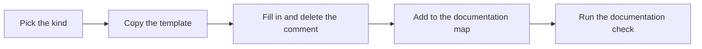

# Document templates

> **Status:** current · **Audience:** anyone who writes a document in this repository · **Last reviewed:** 2026-11-14

Each kind of document that has a fixed shape has a template here. Copy the template, fill it in, and add the new file to the
[documentation map](../README.md). The rules every document follows are in the [style guide](../standards/docs-style-guide.md).

## Which template to use

This table mirrors the kinds in the style guide's table "Kinds of document, and where they live".

| Template | Use it when | Answers | Copy it to |
| --- | --- | --- | --- |
| [how-to-guide.md](how-to-guide.md) | One reader needs to reach one result, such as connecting a mailbox | How do I do one task? | `docs/guides/short-name.md` |
| [adr.md](adr.md) | A decision is hard to reverse or a newcomer would question it | Why did we choose this? | `docs/adr/NNNN-short-title.md`, and a row in `docs/adr/README.md` |
| [design-doc.md](design-doc.md) | Before a change that alters how the product or the engine works | What will this change do? | `docs/designs/phaseN.md` |
| [user-story.md](user-story.md) | A requirement needs a person, a result and acceptance criteria | What should it do, for whom? | an entry in `docs/product/user-stories.md` |
| [runbook.md](runbook.md) | Something is wrong or must be done, and the reader needs steps | What are the steps? | `docs/runbooks/short-name.md` |
| [test-plan.md](test-plan.md) | A release or a risky change needs gates, cases and a sign-off | What do we test and how? | `docs/testing/test-plan.md` (update it in place for the next release), or `docs/testing/test-plan-name.md` for a risky change |
| [release-notes.md](release-notes.md) | You prepare a release for the people who install it | What changed, what was published? | the draft GitHub release; the facts also go to `CHANGELOG.md` and `docs/RELEASE_HISTORY.md` |
| [postmortem.md](postmortem.md) | A release was withdrawn, data was lost or exposed, or a gate missed what it exists to catch | What went wrong, and what changes? | `docs/postmortems/YYYY-MM-DD-short-title.md` |

Kinds with no template: the README, reference pages (tables), architecture pages (diagrams), review records, troubleshooting and
the FAQ, and code comments. The style guide says how to write each.

## Using a template

1. Copy the file to the place in the last column and rename it.
2. Replace every placeholder (`YYYY-MM-DD`, `NNNN`, text in angle brackets or after "...") and delete the comment at the top.
3. Keep the header line: `> **Status:** ... · **Audience:** ... · **Last reviewed:** YYYY-MM-DD`. Put today's date in it.
4. Link to the source of truth instead of copying it, and tag every code block with its language.
5. Add the document to the [documentation map](../README.md). The documentation check (`python scripts/check_docs.py`) fails
   when a document is missing from it.

## Changing a template

A template is a document too. When the shape of the real documents drifts from their template (for example a design document
gains a standard section), change the template in the same commit.
