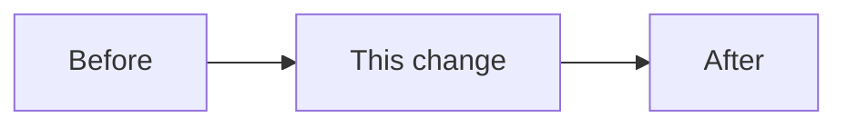

# Phase N: what this change gives you

> **Status:** draft | design for Run N | built · **Audience:** maintainers · **Last reviewed:** YYYY-MM-DD

<!-- Copy this file to docs/designs/phaseN.md (or docs/designs/short-name.md for work that is not a phase) and add it to the
     documentation map in docs/README.md. Write it before the code and correct it after the reviews, so that it says what was built.
     The shape comes from docs/designs/phase8.md and docs/designs/phase9.md. Keep it to about 100 lines. -->

One or two sentences: what changes for the person using the app, or for the maintainer, and why now. Say where the work came from
(a roadmap item, a measurement, a defect found in review) and link the record.

## Problem

What is wrong or missing today? Use measurements, a failing case or a quotation of the symptom, not an opinion. A table of
"what / baseline" rows works well when the problem can be measured.

## Constraints that do not change

What this change must not touch (for example: no new dependency, nothing is sent, no change to what is stored). Link the
decisions behind them (the [decision records](../adr/README.md)).

## Design

State the design in the order a reader needs it. Number the parts if they depend on each other. For each part say what the
code will do, in the present tense, and name the file or function (`engine/src/store.rs`) so a reader can search for it.

Add one diagram where a picture is shorter than the words (a flow, a sequence, a state machine, a data layout):

### Targets

Measurable aims, each with a number and how it is measured. After the work is built, add the figure you measured and say plainly
which target was missed.

| What | Target | Measured |
| --- | --- | --- |
| ... | ... | ... |

## Known limits

What the design does not cover and what a reader could wrongly assume. Each line is a promise you chose not to make.

## Out of scope

Work that was considered and left out, each with the reason (cost, risk, not asked for).

## Test plan

* **Engine** (`engine/tests/phaseN.rs`): the cases, named by the behaviour they pin.
* **The window** (`app/test/*.test.mjs`): the cases that need a real browser.
* **Manual** (`docs/TESTCASES.manual.md`): the cases that need a live mailbox or a real device, with their MT numbers.
* **Mutation checks**: the guards that are broken one at a time to prove a test notices.
* **Review gates**: the council, the drift pass and the single-reviewer loop, and where their record will be written (see
  [the testing strategy](../testing/strategy.md)).
