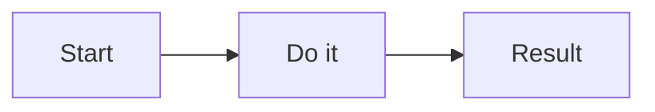

# How to do one task

> **Status:** current · **Audience:** who the guide is for · **Last reviewed:** YYYY-MM-DD

<!-- Copy this file to docs/guides/short-name.md and add it to the documentation map in docs/README.md. A guide gets one reader to one
     result. Put the result first, the background after, and link to reference for the details. -->

By the end of this guide you will have (the result). It takes about (minutes).

## What you need

* Requirement one.
* Requirement two.

## Steps

1. First step. Say what to click or type and what you will see.
2. Second step.

## Check that it worked

What the reader should see.

## If something goes wrong

| What you see | Why | What to do |
| --- | --- | --- |
| ... | ... | ... |

## Next steps

* Links to the related guide or reference.
