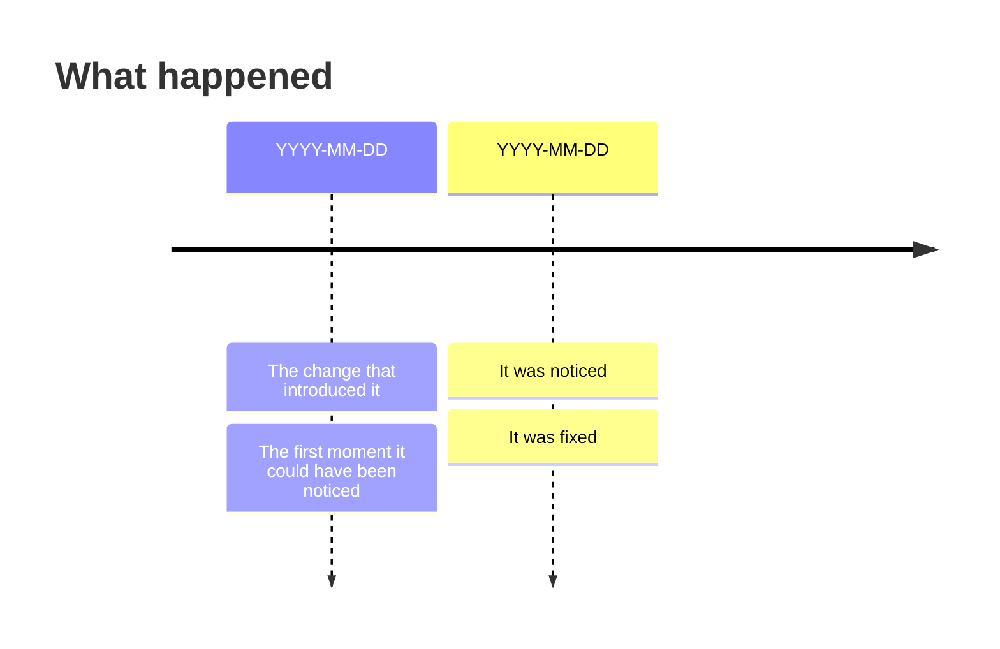
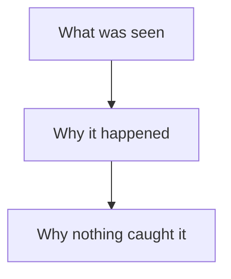

# Postmortem: what went wrong, in a few words

> **Status:** draft | current · **Audience:** maintainers · **Last reviewed:** YYYY-MM-DD

<!-- Copy this file to docs/postmortems/YYYY-MM-DD-short-title.md and add it to the documentation map in docs/README.md. A
     postmortem is blameless: it describes what the system and the process allowed to happen, not who failed. Use it after a
     release that had to be withdrawn, a defect that lost or exposed data, a security finding that reached users, or a gate that
     missed what it exists to catch. Write it within a week, while people remember. -->

Two sentences: what happened, and what changed because of it.

## Summary

What happened, when, how it was noticed, and how it ended. Name the version, the files and the people only by role.

## Impact

Who or what was affected, for how long, and how much. Say whether any data was lost, any mail was changed, or anything was
exposed. If nothing reached a user, say so.

| Measure | Value |
| --- | --- |
| Versions or builds affected | |
| People affected | |
| Duration, from the change to the fix | |
| Data lost or exposed | |

## Timeline

Times in one time zone, with the zone named. Include the moment the defect was introduced, the moment it could first have been
noticed, the moment it was noticed, and the fix.

| When | What happened |
| --- | --- |
| | |

## Root cause

The chain of causes, from what was seen to what allowed it. Ask "why" until the answer is about a missing check or an unclear
rule, not about a person. A defect has usually one cause in the code and another in the process (a test that could not fail, a
gate that did not look there).

## What went well

* What limited the harm or found it early (a test, a gate, a log line, a backup).

## What did not go well

* What made it worse or slower to find, each in terms of the system.

## Actions

Each action has one owner and a date, and is something a person can check. Prefer a test or a gate that fails when the problem
comes back over a promise to be careful.

| Action | Owner | Due | Done |
| --- | --- | --- | --- |
| Add a failing test that reproduces it | role | YYYY-MM-DD | |
| Change the rule, gate or document that allowed it | role | YYYY-MM-DD | |

## Related

* Links to the change, the review record, the changelog entry and the decision record that this led to.
