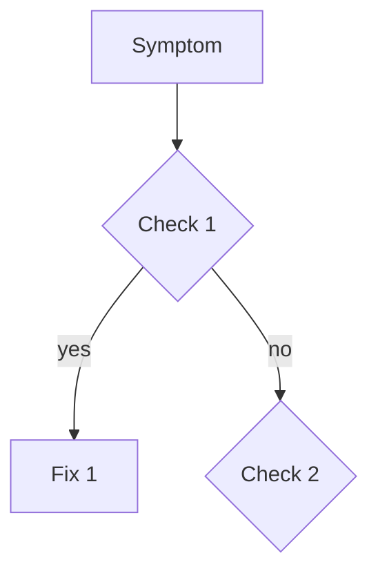

# Runbook: what it is for (a symptom or a task)

> **Status:** current · **Audience:** who runs it (a user, a maintainer, a release manager) · **Last reviewed:** YYYY-MM-DD

<!-- Copy this file to docs/runbooks/short-name.md and add it to docs/runbooks/README.md. A runbook is a list of steps that works when
     the reader is stressed: short sentences, copy-pasteable commands, and a way out at every step. -->

## When to use this

One or two sentences: the symptom ("the list is empty and the status says error") or the task ("cut a release").

## Before you start

* What you need (access, tools, a backup).
* What you must not do.

## Diagnose



## Steps

1. Do this.

   ```bash
   command to run
   ```

2. Check that it worked: what you should see.

## Verify

How to know the problem is solved.

## If it does not work

Who or what to ask next, and what to include (for example the output of "Copy diagnostics").

## Related

* Links to the architecture, the troubleshooting page, the ADR or the design.
