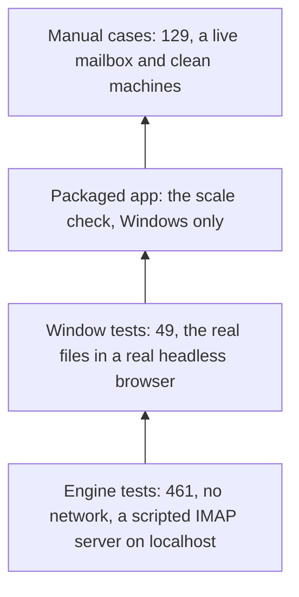
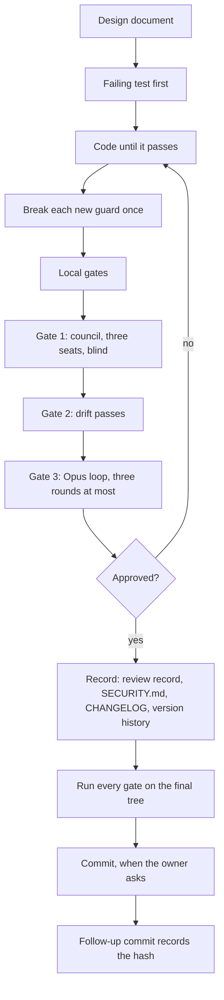

# Testing strategy

> **Status:** current · **Audience:** maintainers, reviewers and anyone adding a test · **Last reviewed:** 2026-11-14

This page says what is tested at which layer, how to run each layer, what CI runs, and the review gates every run of work goes
through. The plan for one release, with its sign-off, is [the test plan](test-plan.md). The catalogue of every test is
[`docs/TESTCASES.md`](../TESTCASES.md) (generated) and [the manual cases](../TESTCASES.manual.md).

## The short version

| Layer | What it proves | Where | Count | Run it with |
| --- | --- | --- | --- | --- |
| Engine tests | What the engine does: parsing, ranking, the store, the commands, the phone hub, and the IMAP client against a scripted server | `engine/tests/*.rs` | 461 in 20 files | `cd engine && cargo test` |
| Window tests | What the real window does with the demo backend's answers, driven by real key presses and clicks in a headless browser | `app/test/*.test.mjs` | 49 in 4 files | `cd app && npm test` |
| Scripts | The version fields agree, the release check works, the catalogue and the documents are current | `scripts/` | the checks, and tests of two of them (`test_bump_version.py` has 9) | see below |
| Packaged app | The installed program under load (Windows only) | `scripts/scale_check/` | one measurement | `python scripts/scale_check/scale.py 3000 5000` |
| Manual cases | Behaviour that needs a real mailbox, a real calendar, a real phone or a clean machine | `docs/TESTCASES.manual.md` | 129 cases, MT-01 to MT-138 | by hand |

## What is tested where

Each layer rests on the one below it. The lower layers are fast, many and cheap, so a defect is found there first; the upper ones
are slow, few and need a person or a machine set aside.



* **The engine tests** use only the engine's public API, a temporary folder and an in-memory keychain. The IMAP client is tested
  against a scripted server on `127.0.0.1` (`engine/tests/imap_flows.rs`, 61 tests, which use `connect_plain`, so the TLS
  handshake itself is not covered). The phone hub is tested over real sockets (`hub.rs`, `hub_edge.rs`, 14 tests). The files
  `phase1.rs` to `phase8.rs` (280 tests) pin each run's behaviour; the security files hold the hostile-input cases.
* **The window tests** run the real `app/ui` files from a small server of Node's own in a browser already on the machine, against
  `mock.js`, the demo backend. They prove what the window does with the answers it is given and what it asks for. They do not
  prove the engine's answers are right. Design: [phase 9](../designs/phase9.md); record:
  [the Phase 9 review](../2026-11-14_PHASE9_REVIEW.md).
* **The packaged app** is checked by a measurement, not a suite: `scripts/scale_check/scale.py` starts the release build with a
  heavy database and checks the targets in [phase 8](../designs/phase8.md). The review records also mention a larger packaged-app
  suite used in earlier runs; it is not kept in the repository, so it cannot be run from these documents.
* **The manual cases** are the only ones that talk to a real mail server, a real calendar or a real phone. None has a recorded
  result yet. See [the test plan](test-plan.md).

### Where a new test goes

| The change is in | Put the test in |
| --- | --- |
| How mail is read, ranked, stored or changed | `engine/tests/phaseN.rs` (the run's file) or the topic file that already holds the area |
| What the client sends to a mail server, or how it reads a reply | `engine/tests/imap_flows.rs`, with a new case in the scripted server |
| The phone hub or what it may do | `engine/tests/hub.rs`, `hub_edge.rs` or the run's file |
| What the window draws, how a key or click behaves | `app/test/*.test.mjs`, with `suite(...)` and `it(...)` |
| Something only a real server, device or machine can show | A new `MT-nn` row in `docs/TESTCASES.manual.md` |

## How to run each layer

Run the commands from the repository root. They are the ones in [the README](../../README.md), `app/package.json` and
`.github/workflows/ci.yml`. CI calls Python as `python3`.

```bash
cd engine && cargo test                                # every engine test
cd engine && cargo test --test phase8                  # one file
cd engine && cargo test --test phase8 newest           # tests of that file whose name contains "newest"
cd engine && cargo fmt --check
cd engine && cargo clippy --locked --all-targets -- -D warnings
cd engine && RUSTDOCFLAGS="-D warnings" cargo doc --no-deps --locked
```

```bash
cd app && npm test                                     # node --test --test-concurrency=2 test/*.test.mjs
cd app && node --test test/list.test.mjs               # one file
cd app && INBOX_AGENT_BROWSER=/path/to/chromium npm test   # a browser the tests do not find themselves
```

The commands in these blocks are for Git Bash and Linux. Windows PowerShell 5.1 has no `&&` (use `;`, as in `cd engine; cargo test`),
and it cannot put a variable before a command, so set the variable first:

```powershell
$env:RUSTDOCFLAGS = "-D warnings"; cd engine; cargo doc --no-deps --locked
$env:INBOX_AGENT_BROWSER = "C:\path\to\chrome.exe"; cd app; npm test
```

The window tests need Node 22 or later (the built-in `WebSocket`) and a Chromium-based browser (Edge or Chrome on Windows; Chrome,
Edge or Chromium on macOS and Linux). Without a browser they are skipped; `INBOX_AGENT_UI_TESTS=require` makes that a failure, which
CI sets (in PowerShell: `$env:INBOX_AGENT_UI_TESTS = "require"; npm test`).

```bash
for f in app/ui/*.js; do node --check "$f"; done        # the window's scripts parse (Git Bash or Linux)
python scripts/bump_version.py --check                 # every version field agrees
python scripts/test_bump_version.py                    # the release check itself
python scripts/gen_testcases.py                        # regenerate docs/TESTCASES.md, then commit it
python scripts/test_check_docs.py                      # the documentation check itself
python scripts/check_docs.py                           # links, diagrams, the map, the command reference, doc comments
```

The same syntax check in PowerShell:

```powershell
Get-ChildItem app\ui\*.js | ForEach-Object { node --check $_.FullName }
```

```bash
cd app && npm ci && npx tauri build                    # the Windows installer (needs Rust, Node and the MSVC Build Tools)
python scripts/scale_check/scale.py 3000 5000          # then measure the packaged app (Windows)
```

`scale.py` refuses to run if the app already has a data folder (`%LOCALAPPDATA%\app.inboxagent.desktop`), because it would have to
delete it afterwards and that may hold your real mail. Move the folder away first and move it back afterwards.

A read-only check of one real mailbox, without the app, is an example program of the engine:

```bash
cd engine && IMAP_HOST=imap.example.com IMAP_USER=you@example.com IMAP_PASS=your-app-password cargo run --example probe --release
```

## What CI runs

The workflows are `.github/workflows/ci.yml` (on every push to `main` and every pull request) and `release.yml` (on a tag). No run
of either is recorded in the project (creating the GitHub repository is an open item), so this table says what the files do, not what
a run showed.

| Job and step | Systems | Command | Stops the build when |
| --- | --- | --- | --- |
| `test`: UI scripts parse | Ubuntu 22.04, Windows, macOS | `node --check` on each `app/ui/*.js` | a script has a syntax error |
| `test`: versions agree | all three | `python3 scripts/bump_version.py --check` | a version field differs, or the changelog or a history file is missing |
| `test`: the release check works | all three | `python3 scripts/test_bump_version.py` | the check's own tests fail |
| `test`: catalogue is up to date | all three | `python3 scripts/gen_testcases.py`, then `git diff --exit-code docs/TESTCASES.md` | the catalogue is stale |
| `test`: documentation checks | all three | `python3 scripts/test_check_docs.py`, `python3 scripts/check_docs.py` | a broken link, bad diagram, missing map entry, undocumented command or public item |
| `test`: format | all three | `cargo fmt --check` | a file is not formatted |
| `test`: lint | all three | `cargo clippy --locked --all-targets -- -D warnings` | a warning |
| `test`: Rust documentation | all three | `cargo doc --no-deps --locked` with `RUSTDOCFLAGS: -D warnings` | a rustdoc warning |
| `test`: engine tests | all three | `cargo test --locked` | a test fails |
| `test`: window tests | **Linux only** | `cd app && npm test` with `INBOX_AGENT_UI_TESTS=require` | a test fails, or no browser is found |
| `audit` | Linux | `cargo audit` (engine), `cargo audit -f app/src-tauri/Cargo.lock`, `npm audit` in `app` | a vulnerable dependency |

`fail-fast` is off, so a failure on one system does not hide the others. The window tests run on Linux only because the runner's
browser and the way it is started are known there; the harness finds a browser on all three systems.

The release workflow runs on a tag like `v0.1.0`: it **verifies** that the tag, every version field, a dated changelog entry and a
row in `docs/RELEASE_HISTORY.md` agree, **tests** (clippy, `cargo test` and the documentation checks on all three systems, and the
window tests on Linux), **builds** the installers, and writes `SHA256SUMS.txt` with a build-provenance attestation to a draft
release. It does not repeat the format check, the Rust documentation build, the catalogue check, the syntax check of the window's
scripts or the tests of the release check; it does run the documentation checks and, on Linux, the window tests. Those it leaves out
come from CI on `main` and from the commands in [RELEASING.md](../../RELEASING.md).

## Review gates

Every run of work ends with three gates, each by a model other than the one that wrote the code. Before them, the engine's fixes
get a failing test first, and every new guard is broken once on purpose to prove a test notices.

| Gate | Who | What they do | Where it is recorded |
| --- | --- | --- | --- |
| 1. Council | Three seats: Opus, Sonnet and Fable, each answering **blind** to the others | The same ship question and the same diff; each seat gives a verdict and findings. A disagreement is looped. Every claim is checked against the code before anything changes | A table of seat, verdict and findings in the run's review record |
| 2. Drift pass | Sonnet over the design documents and the pseudocode; Haiku over what is promised to people (README, privacy statement, security notes, changelog, guides, the in-app text) | Each compares the words with the code and lists what no longer matches; each confirmed difference is fixed in the words or the code | Two rows in the review record, with the number confirmed |
| 3. Single-reviewer loop | Opus as the one reviewer, three rounds at most | A ledger of ids and severities (must, should, nit) given up front; the smallest fix for each; a nit may be pushed back. It ends when the reviewer approves | The rounds, the ledger and the verdict |
| Mutation checks | The author | For each new guard, put the old behaviour back (for the window, on a copy of `app/ui`) and confirm a named test fails | A table of mutant and the tests that caught it |

The council had two seats (Opus and Sonnet) in Phases 4 to 9; the third seat, Fable, was added at the owner's request on
2026-11-14. The records are `docs/2026-11-13_PHASE4_REVIEW.md` to `docs/2026-11-14_PHASE9_REVIEW.md`, and each run adds a "Review N"
section to [SECURITY.md](../../SECURITY.md). There is no mutation-testing tool in the repository: the mutants are made by hand or by
throw-away scripts, and the records list them.

## A run, from design to commit



Findings from a gate are fixed (with a test first) before the next gate starts; the local gates are the commands above. Gates run
on the final tree: a fix made after a gate is checked again by the gates that follow it.

## Flakiness rules

A test that fails once in a hundred runs is a defect in the test or in the code, and is fixed, not retried until it is green.

1. **Every wait has a time limit.** In the window harness a test has 120 seconds, a browser answer 60, a page load 30 and `waitFor`
   15, so a hung test fails instead of stopping the run. Every wait in the harness has a limit.
2. **Wait for a condition, not for a time.** Use `page.waitFor(...)`. A click waits until its target stays where it is and is what
   is under the pointer, because the window moves its own focus a moment after a dialog opens.
3. **Hold and release, do not delay.** To test a late answer, make the demo backend hold it (`wrapMock` with `hold: true`) and let it
   go with `release(page)`. A fixed delay passes or fails with the speed of the machine, and one test passed for the wrong reason
   that way. A fixed pause (`settle`, 30 to 150 ms) is only for the window's own short timers and to show that something did not
   happen.
4. **Inject the clock.** Engine code that depends on the time takes it as an argument, so a test sets it. The few bounded sleeps left
   in the engine tests (eight, mostly in the hub tests) wait for a thread to start.
5. **A fresh page for each test, one browser for each file**, and two files at a time (`--test-concurrency=2`): four at once was
   too many on the author's machine.
6. **Never touch real state.** Temporary folders, the in-memory keychain (`secrets::in_memory()` in any cargo test binary), the
   loopback address and a free port (port 0).
7. **Clean up, with limits.** The browser is asked for its own process number, asked to quit and ended by number; its profile
   folder is deleted, or handed to a small detached process that keeps trying for two minutes. A folder left by a killed run is
   cleared by the next run once it is an hour old.

## What the strategy does not cover

* **Real mail servers.** The scripted server proves what the client sends and how it reads standard replies, not what Gmail, iCloud
  or another provider does, and not TLS. The manual cases MT-01 to MT-39 are the answer, and none has been run.
* **Linux and macOS.** Nothing has been run on either, neither the engine tests, the window tests nor the installer. The window
  tests have not run under Node 22 (the author's machine has a newer Node).
* **The Tauri shell** (`app/src-tauri/src`, two small files) has no test of its own; the packaged-app measurement and the manual cases
  exercise it.
* **Appearance, the phone's layout and screen readers.** No test covers them. The Tab trap in dialogs and selecting a range by key
  have no window test.
* **A published release.** Nothing has been released; the signed-installer, checksum and update paths have never been exercised.

## Related

* [The test plan for a release](test-plan.md) and [its template](../templates/test-plan.md).
* [Coding standards](../standards/coding-standards.md): how tests are named and written.
* [Phase 9 design](../designs/phase9.md) and [review record](../2026-11-14_PHASE9_REVIEW.md): the window tests and their harness.
* [Phase 8 design](../designs/phase8.md): the performance targets and the scale check.
* [RELEASING.md](../../RELEASING.md): the release workflow and the checks on clean machines.
