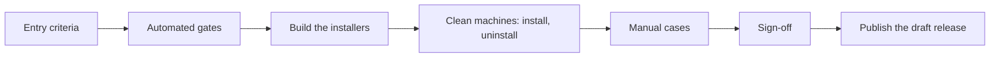

# Test plan: the first release, 0.1.0

> **Status:** current · **Audience:** release manager, maintainers and testers · **Last reviewed:** 2026-11-14

This is the checklist for deciding whether `0.1.0`, the first public build, can be published. It applies [the testing
strategy](strategy.md) in the shape of [the test-plan template](../templates/test-plan.md). Nothing has been released, so every
result column is empty: fill it in on the day you run the gates, and leave the sign-off for the people who read the results.

## Scope

| In scope | Out of scope, and why |
| --- | --- |
| The engine, the window, the phone hub and the installers for Windows, macOS and Linux | Automatic updates and code signing certificates: not built (see [RELEASING.md](../../RELEASING.md)) |
| Reading, ranking, write-back, drafts, rules, follow-ups, reminders, several mailboxes, backup and restore, a big mailbox | Microsoft (Outlook) accounts: Microsoft turned off password sign-in for IMAP, so they are not supported |
| The live-mailbox and real-calendar cases in [the manual plan](../TESTCASES.manual.md) | Sign-in with Google: deferred by the owner ([phase 3](../designs/phase3.md)) |

## Environments

| Environment | What runs there | Status |
| --- | --- | --- |
| Windows (the development machine), Edge, Node 24 | Engine tests, window tests, the packaged build, the scale check, the install and uninstall cycle | verified by the author; not on a clean machine |
| Windows, Ubuntu 22.04 and macOS in CI | Format, lint, engine tests, documentation checks; the window tests | passes (run 11, 2026-11-14); one earlier Linux run of the window tests failed and the next passed, cause not found |
| Node 22 (the version CI uses) | Window tests | passes in CI |
| Linux and macOS, on a real machine | The installer and the manual cases | **not yet run** |
| A real mailbox: Gmail with an app password, and one other provider | Manual cases A to D | **not yet run** |
| A phone or tablet on the same Wi-Fi | MT-50 to MT-55 | **not yet run** |
| A real calendar (for example Google, Outlook or Apple) | MT-91 to MT-96 | **not yet run** |

## Entry criteria

* The version is set everywhere (`python scripts/bump_version.py 0.1.0`) and `CHANGELOG.md` has a dated `## [0.1.0]` heading.
* `docs/RELEASE_HISTORY.md` has a `0.1.0` row marked "in preparation", and `docs/VERSION_HISTORY.md` has the milestone.
* The working tree is clean and the last run's review gates are recorded (the council, the drift passes and the Opus loop).
* The one-time setup in [RELEASING.md](../../RELEASING.md) is done: a GitHub repository with Actions permissions and branch
  protection, a security contact in `SECURITY.md`, and a decision about code signing (unsigned builds are allowed, and the release
  notes say so).

## Exit criteria

* Every gate below passes on the commit that will be tagged.
* Every manual case in the required rows below has a recorded result, and no failure loses data, sends mail, or changes a
  mailbox the person did not ask to change.
* The platforms the release names have been installed, started and uninstalled on a clean machine.
* Known problems are in the release notes and in `docs/RELEASE_HISTORY.md`.

## Gates

Run them in order from the repository root and stop at the first red one. CI runs most of them (see
[what CI runs](strategy.md#what-ci-runs)); run them locally as well before you tag.

| # | Gate | Command | Pass criterion | Result |
| --- | --- | --- | --- | --- |
| 1 | The window's scripts parse | `for f in app/ui/*.js; do node --check "$f"; done` | No output, exit code 0 | |
| 2 | Versions and records agree | `python scripts/bump_version.py --check 0.1.0` | Prints `OK`; every version field is `0.1.0`, the changelog heading is dated and the release history has the row | |
| 3 | The release check works | `python scripts/test_bump_version.py` | All 9 tests pass | |
| 4 | The catalogue is current | `python scripts/gen_testcases.py`, then `git diff --exit-code docs/TESTCASES.md` | No difference | |
| 5 | Documentation checks | `python scripts/test_check_docs.py`, then `python scripts/check_docs.py` | Both pass; the second prints `OK` | |
| 6 | Format | `cd engine && cargo fmt --check` | Exit code 0 | |
| 7 | Lint | `cd engine && cargo clippy --locked --all-targets -- -D warnings` | No warning | |
| 8 | Rust documentation | `cd engine && RUSTDOCFLAGS="-D warnings" cargo doc --no-deps --locked` | No warning | |
| 9 | Engine tests | `cd engine && cargo test --locked` | Every test passes; the count equals the catalogue's | |
| 10 | Window tests | `cd app && INBOX_AGENT_UI_TESTS=require npm test` | Every test passes and none is skipped; the count equals the catalogue's | |
| 11 | Dependency scans | `cd engine && cargo audit`, `cargo audit -f app/src-tauri/Cargo.lock`, `cd app && npm audit` | No vulnerability; any notice is already explained in [SECURITY.md](../../SECURITY.md) | |
| 12 | Installers build | the release workflow on tag `v0.1.0`, or `cd app && npm ci && npx tauri build` on Windows | An installer for each platform; the unsigned warning, if any, is expected | |
| 13 | The scale check (Windows) | `python scripts/scale_check/scale.py 3000 5000` | Every target of [phase 8](../designs/phase8.md) holds, except that the poll answer may reach 250 ms and 3 MB | |
| 14 | Checksums | `sha256sum -c SHA256SUMS.txt` (Windows: `Get-FileHash <file>`) | Every file reports `OK`; optionally `gh attestation verify <file> --repo <owner>/<repo>` passes | |
| 15 | Review gates of the final change | [the review gates](strategy.md#review-gates) | The council, both drift passes and the loop are recorded, and every must-fix is fixed | |

The commands are written for Git Bash or Linux. In PowerShell there is no `&&` before PowerShell 7, so run `cd engine; cargo test`;
set a variable on its own first (gate 8: `$env:RUSTDOCFLAGS = "-D warnings"; cargo doc --no-deps --locked`; gate 10:
`$env:INBOX_AGENT_UI_TESTS = "require"; npm test`); and for gate 1 run
`foreach ($f in Get-ChildItem app/ui/*.js) { node --check $f.FullName }`.

Gate 13 refuses to run when the app already has a data folder: move `%LOCALAPPDATA%\app.inboxagent.desktop` away first.

## Manual cases

All 129 cases in [the manual plan](../TESTCASES.manual.md) are still owed: no result is recorded for any of them. The cases are
run on **clean machines** (a fresh Windows user or VM, a Mac, a Linux box), not the development computer, with a throwaway message
wherever a case changes mail.

| Section | Cases | Count | Needs | For 0.1.0 |
| --- | --- | --- | --- | --- |
| A. Connection and sign-in | MT-01 to MT-08 | 8 | A Gmail app password, another provider, the network switched off | **Required** ([RELEASING.md](../../RELEASING.md): A to D at minimum) |
| B. Reading and ranking | MT-10 to MT-19 | 10 | A real mailbox with a few kinds of mail | **Required** |
| C. Write-back | MT-20 to MT-29 | 10 | One throwaway message | **Required** |
| D. Drafts | MT-30 to MT-39 | 10 | A mailbox that offers a Drafts folder | **Required** |
| E. List, sort, snooze | MT-40 to MT-49 | 10 | A real list | Run once for a first release |
| F. Phone and tablet | MT-50 to MT-55 | 6 | A device on the same Wi-Fi | Run once for a first release |
| G. Install and lifecycle | MT-60 to MT-65 | 6 | A clean machine | **Required** (RELEASING.md steps 2 to 4: install, platform checks, uninstall) |
| H. Select many, rules, follow-ups | MT-70 to MT-81 | 12 | A second address to write to | Run once for a first release |
| I. Reminders, search, calendar | MT-82 to MT-98 | 17 | A real notification and a real calendar | **MT-91 to MT-96 required** (the real-calendar cases named in [the version history](../VERSION_HISTORY.md)); the rest once |
| J. Several mailboxes | MT-99 to MT-111 | 13 | A second real mailbox | Run once for a first release |
| K. Backup and restore | MT-112 to MT-127 | 16 | A second computer, or "Sign out and reset" | Run once for a first release |
| L. A big mailbox | MT-128 to MT-138 | 11 | A mailbox with thousands of tasks, or a copy | Run once for a first release |

Record each result where `docs/RELEASE_HISTORY.md` asks for it: which MT numbers passed, failed or were not run. For a failure,
keep the text of the Log tab (never a password).

## Risks and what is not covered

* The scripted IMAP server does not speak TLS and is not Gmail. Everything about real servers rests on sections A to D.
* `ci.yml` passes, but one Linux run of the window tests failed and the next passed, and the cause was not found. `release.yml` has
  never run.
* Appearance, the phone's layout and screen readers have no test, manual or automatic.
* macOS asks you to open an unsigned app with right-click and Open; Windows shows SmartScreen. Say so in the release notes.

## Sign-off

Left blank until the gates and cases above have results.

| Role | Name | Date | Decision | Notes |
| --- | --- | --- | --- | --- |
| Maintainer | | | | |
| Release manager | | | | |
| Owner | | | | |
