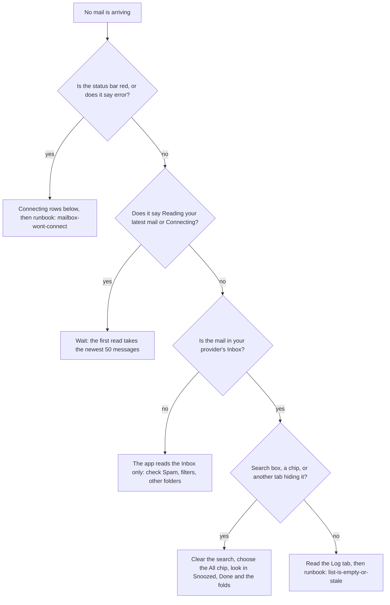

# Troubleshooting

> **Status:** current · **Audience:** anyone using Inbox Agent when something does not work · **Last reviewed:** 2026-11-14

Find what you see in the first column, read the likely cause, and do what the third column says. Every message here is the text the
window or the engine produces. The fourth column links to the step-by-step runbook or guide. If nothing matches, press **Copy
diagnostics** in **Settings** and read [crash log and diagnostics](runbooks/crash-log-and-diagnostics.md).

Where to look: the **status bar** is the line at the bottom of the window; the **Log** tab (top bar) lists what the engine did,
newest first; a **toast** is the short message that appears at the corner.

## No mail is arriving

Follow the arrows from the top. Each end point is a row below or a runbook.

## Connecting

| What you see | Likely cause | What to do | More |
| --- | --- | --- | --- |
| Status bar: `error: your mail server refused the sign-in. Enter your password again in Settings` | The app password is wrong or was cancelled, or IMAP is off at the provider. The app retries every 5 minutes | Make a new app password. **Settings**, **New app password**, **Save password** | [Mailbox will not connect](runbooks/mailbox-wont-connect.md) |
| Status bar: "Sign in again in Settings". Settings: "Needs a new app password" | No password is saved for a mailbox (for example a mailbox restored from a backup, which comes without one) | Paste its app password and press **Save password** | [Backup and restore](guides/backup-and-restore.md) |
| **Test connection**: `sign-in refused: …` | The same as the first row, with the server's own words after the colon | Make a new app password; on Gmail check that IMAP is on | [Connect a mailbox](guides/connect-a-mailbox.md) |
| `secure connection failed: …` | Wrong server or port, or the server does not start TLS at once | Use the server and the IMAP-over-TLS port your provider names (usually 993) | [Connect a mailbox](guides/connect-a-mailbox.md) |
| `error: …` about looking up an address, or a time-out | The server name is wrong, the network is down, or something blocks the connection. The app retries every 30 seconds | Check the spelling and your connection | [Mailbox will not connect](runbooks/mailbox-wont-connect.md) |
| `error: your system keychain is not available (…). Unlock it and restart the app` | The system keychain is locked or not running | Unlock it, quit the app from the tray, open it again | [Mailbox will not connect](runbooks/mailbox-wont-connect.md) |
| "Connected · no Sent folder found, so a task will not close by itself when you reply" (not an error: the mailbox can be added) | The server flags no Sent folder and none has a common name. The mailbox works, but nothing closes by itself when you reply and there are no follow-up reminders | Add it anyway, or report the folder names if you want those two | [Connect a mailbox](guides/connect-a-mailbox.md) |
| The provider entry "Outlook / Microsoft 365 (not supported yet)" | Microsoft turned off password sign-in for IMAP, and the app has no Microsoft sign-in | Use another mailbox | [Connect a mailbox](guides/connect-a-mailbox.md#what-is-not-supported) |
| `That mailbox is already in the app` | The same server and address is there already | Nothing to do | [Connect a mailbox](guides/connect-a-mailbox.md) |
| `You can read at most five mailboxes at once`, or **Add another mailbox** is greyed out | Five mailboxes are in use | Remove one first | [Connect a mailbox](guides/connect-a-mailbox.md) |
| Toast: "Setup failed: Enter the app password for this mailbox" | **Finish** saves the first mailbox first, and its password box was empty. Nothing is saved and setup is not finished | Go back to the mailbox step, paste the password, test, finish again | [Connect a mailbox](guides/connect-a-mailbox.md) |
| `Paste the new password first` | **Save password** in Settings with the box empty. Nothing is sent | Paste the new app password and press **Save password** | [Connect a mailbox](guides/connect-a-mailbox.md) |
| `Enter the app password` | **Test connection** with an empty password | Paste the app password and test again | [Connect a mailbox](guides/connect-a-mailbox.md) |
| `Enter the mail server and the email address` | **Test connection** with the server or the address empty | Fill in both, then test again | [Connect a mailbox](guides/connect-a-mailbox.md) |
| `That mail server name isn't valid` | The server name has a space or a character other than letters, digits, `.` and `-` (for example a pasted web address) | Type the server's name only, such as `imap.example.com` | [Connect a mailbox](guides/connect-a-mailbox.md) |
| `That mail server port isn't valid` | The **Port** box (under **Other IMAP server**) is empty, 0, above 65535 or not a whole number. The app does not shorten it to fit | Type the port your provider names (usually 993) | [Connect a mailbox](guides/connect-a-mailbox.md) |
| Toast: "Setup failed: …" at the end of the wizard | The settings or the keychain refused something, for example "That mail server name isn't valid" | Go back, fix the field, test, finish again | [Connect a mailbox](guides/connect-a-mailbox.md) |
| Toast: "Setup failed: Enter the mail server and the email address" | **Finish** saves the first mailbox first, and its server or address was empty. Setup is not finished | Go back to the mailbox step, fill it in, test, finish again | [Connect a mailbox](guides/connect-a-mailbox.md) |
| Status bar: "Setup needed" | The wizard is not finished | Finish it on the computer | [Connect a mailbox](guides/connect-a-mailbox.md) |

## The list

| What you see | Likely cause | What to do | More |
| --- | --- | --- | --- |
| "Reading your latest mail…" and "The first sync can take a minute." | A mailbox's first read (the newest 50 messages) | Wait | [List is empty or stale](runbooks/list-is-empty-or-stale.md) |
| "Waiting for mail" | The engine has not started reading (status starting, setup or similar) | Look at the status bar | [List is empty or stale](runbooks/list-is-empty-or-stale.md) |
| "All clear" but you expect mail | The mail is in another tab or fold, filed by a rule, or not in the Inbox | Check **Snoozed**, **Done**, **Show automated** and **Show left your inbox** | [List is empty or stale](runbooks/list-is-empty-or-stale.md) |
| "No matches" | The search box or a chip hides everything | Press `/`, then `Esc`, and choose the **All** chip | [List is empty or stale](runbooks/list-is-empty-or-stale.md) |
| Status bar: "Connecting…" for minutes | The network is down or the server does not answer | Wait for the retry (30 seconds); see the connecting rows | [Mailbox will not connect](runbooks/mailbox-wont-connect.md) |
| A task with the tag **Left inbox**, in the fold "Show left your inbox · N" | You archived or moved the message elsewhere; the task stays open | Press `x` if it is dealt with | [FAQ](faq.md) |
| "Closed automatically because you replied." | The app saw your reply in the Sent folder | Press `x` or the circle to reopen it | [FAQ](faq.md) |
| Log: `skipped message N: larger than 5 MB` | A message over 5 MB is never read | Read it in your mail program | [List is empty or stale](runbooks/list-is-empty-or-stale.md) |
| Log: `the mail server renumbered your inbox; starting a fresh sync` | The provider restarted its message numbering, so that mailbox's tasks were cleared and its newest 50 are read again | Wait. Rules, sender choices and your own tasks stay | [List is empty or stale](runbooks/list-is-empty-or-stale.md) |
| Log: `could not read your Sent folder (…); mail still loads, but replies you have already sent are not detected` | No Sent folder was found | Mail still arrives; replies are not noticed | [Connect a mailbox](guides/connect-a-mailbox.md) |
| Log: `connection lost (…); retrying in 30s` (or `300s`) | A network error, or a refused sign-in for 300 | Wait, or fix the cause named by the status bar | [Mailbox will not connect](runbooks/mailbox-wont-connect.md) |

## Data and crashes

| What you see | Likely cause | What to do | More |
| --- | --- | --- | --- |
| Log: "the local database was damaged; it was set aside and rebuilt, and your mail will sync again" | The database file failed its integrity check, so it was set aside as `agent.db.corrupt-…` and a new one made | Wait for the list to refill, then restore a backup | [Damaged database](runbooks/damaged-database-and-recovery.md) |
| Status bar: `error: This data was created by a newer version of Inbox Agent (format N). Update the app, or move the data folder aside to start fresh.` | An older app opened data from a newer one | Install the newer version | [Damaged database](runbooks/damaged-database-and-recovery.md) |
| Status bar: `error: internal error, see crash.log in the app's data folder` | An internal error in the connection attempt; the engine retries in 30 seconds | Read `crash.log`, copy diagnostics | [Crash log](runbooks/crash-log-and-diagnostics.md) |
| Log: `skipped message N: processing it crashed`, or `skipped message N: handling it crashed the app 2 times` | One message makes the engine fail; it is skipped | Nothing to do; report with diagnostics | [Crash log](runbooks/crash-log-and-diagnostics.md) |
| Log: `could not parse message N: …` | The message could not be read | Nothing: the next one is read | [Crash log](runbooks/crash-log-and-diagnostics.md) |

## Write-back and drafts

| What you see | Likely cause | What to do | More |
| --- | --- | --- | --- |
| "N change(s) waiting" in Settings does not go down | **Let Inbox Agent file mail** is off, or the mailbox cannot be reached | Switch it on; check the status bar | [Let the app file mail](guides/let-the-app-file-mail.md) |
| Log: `mailbox update “archive” failed: …`, then `gave up on “archive” for message N` | The server refused the change five times | Do it in your mail program | [Let the app file mail](guides/let-the-app-file-mail.md) |
| Log: `message “…” not found for archive`, or `“…” has no usable Message-ID, so your mailbox could not be updated for archive` | The message was moved, deleted, or has no usable Message-ID. The app never guesses | Do it in your mail program | [Let the app file mail](guides/let-the-app-file-mail.md) |
| Log: `could not reach mailbox for updates: …` | The write-back connection failed; it tries again in 15 seconds | Check the network | [Let the app file mail](guides/let-the-app-file-mail.md) |
| Toast: "Turn on “Let Inbox Agent file mail” in Settings to save drafts to your mailbox" | **Save to Drafts** needs write-back | Switch it on in **Settings**, **Mailbox** | [Let the app file mail](guides/let-the-app-file-mail.md) |
| Toast: "Your login name isn't an email address, so drafts can't be saved to your mailbox" | The mailbox login is not an address | Nothing can be saved for that mailbox | [Let the app file mail](guides/let-the-app-file-mail.md) |
| Toast: "The AI didn’t answer, so a quick reply was used" | The model failed: not running, wrong key, an unreadable answer | Press **Test** in **Ranking**: "No model is chosen" or "No API key is saved" says what is missing, and a model's own error says why it failed; start Ollama or fix the key | [Choose how mail is ranked](guides/choose-how-mail-is-ranked.md) |
| Log: "daily draft limit reached; no draft written" | The **Daily limit** of automatic drafts was reached | Raise it in **Reply drafts**, or write the draft yourself | [Choose how mail is ranked](guides/choose-how-mail-is-ranked.md) |
| A red warning on a draft, and "Address differs. Click again to save" | The reply address is not the sender's, or the mail failed its sender check | Check the address before you click again | [Let the app file mail](guides/let-the-app-file-mail.md) |

## Phone and tablet

| What you see | Likely cause | What to do | More |
| --- | --- | --- | --- |
| The phone's page does not load | The computer is asleep, the app is not running, the hub is off, the networks differ, or a firewall blocks port 8787 | Follow the runbook | [Phone hub unreachable](runbooks/phone-hub-unreachable.md) |
| "Not connected", with "This page needs the access code from your computer" under it | The phone has no stored access code | Scan the QR code | [Phone and tablet](guides/phone-and-tablet.md) |
| Phone status bar: `error: unauthorized` | The access code was rotated or the hub was switched off and on | Scan the new QR code | [Phone and tablet](guides/phone-and-tablet.md) |
| Phone status bar: `error: too many attempts` | Ten wrong codes in a minute from that address | Wait a minute, then scan a fresh code | [Phone and tablet](guides/phone-and-tablet.md) |
| Log: "phone hub could not listen on port 8787" | Another program holds the port | Close it, then untick and tick **Phone hub** | [Phone hub unreachable](runbooks/phone-hub-unreachable.md) |
| "Open the desktop app to write a draft for this message." or "Open the desktop app to sign in again" | The phone cannot do these | Use the computer | [Phone and tablet](guides/phone-and-tablet.md) |

## Alerts, reminders and snooze

| What you see | Likely cause | What to do | More |
| --- | --- | --- | --- |
| No notification for important mail | Quiet hours, the category list, priority below 4, or it was in a mailbox's first read | Check **Alert schedule** and the task's priority | [Alerts and reminders](guides/alerts-and-reminders.md) |
| Toast: "Set both a start and an end for quiet hours" | Only one of the two times is set | Set both, or clear both | [Alerts and reminders](guides/alerts-and-reminders.md) |
| Toast: "Couldn't save: Alert topic can only use letters, digits, - and _" | A space or other character in the ntfy topic | Remove it | [Alerts and reminders](guides/alerts-and-reminders.md) |
| Toast: "Pick a time that has not passed" | The reminder time is in the past | Choose a later time | [Alerts and reminders](guides/alerts-and-reminders.md) |
| Toast: "Reminders are for tasks you added yourself. To see a message later, snooze it" | Reminders exist only for your own tasks | Snooze the message | [Alerts and reminders](guides/alerts-and-reminders.md) |
| Toast: "A repeat needs a reminder time or a due date" | A repeat with neither | Set a reminder or a due date | [Alerts and reminders](guides/alerts-and-reminders.md) |
| Toast: "Pick a day from today (only before 09:00) to a year ahead" | A snooze date that is not a real day, is more than a year ahead, or is today after 09:00 | Pick another day | [Alerts and reminders](guides/alerts-and-reminders.md) |

## Backup, rules and invitations

| What you see | Likely cause | What to do | More |
| --- | --- | --- | --- |
| "Finish setting up your first mailbox before restoring a backup" | Restore needs a connected first mailbox | Finish the wizard, then restore | [Backup and restore](guides/backup-and-restore.md) |
| "This is not a backup made by Inbox Agent", sometimes followed by ": it could not be read" or ": it has no version" | The file is not one of the app's backups | Choose the right file | [Backup and restore](guides/backup-and-restore.md) |
| "This backup was made by a newer version of Inbox Agent. Update the app, then restore it" | The file's version is newer | Update the app | [Backup and restore](guides/backup-and-restore.md) |
| "You have rule changes that are not saved. Save the rules first, then restore." | Unsaved edits in **Your rules** | Press **Save rules** | [Rules and sender choices](guides/rules-and-sender-choices.md) |
| `Could not save the backup file: …`, or "The app could not find your Downloads folder" | The Downloads folder is missing or not writable | Fix the folder | [Backup and restore](guides/backup-and-restore.md) |
| "At most 50 rules", or "Save the rules first" next to **Apply to my list** | The limit; or unsaved edits | Remove a rule; press **Save rules** | [Rules and sender choices](guides/rules-and-sender-choices.md) |
| "This event was cancelled, so there is nothing to add to a calendar" | The invitation is a cancellation | Update your calendar yourself | [Calendar invitations](guides/calendar-invitations.md) |
| "Time zone “…” is not one this app knows, so the time is shown as written" | The invitation names a zone the app cannot convert | Read the time as the sender wrote it | [Calendar invitations](guides/calendar-invitations.md) |
| Toast: "Couldn't save: …" with other words | The engine refused a change; its reason follows the colon | Read the reason; fix the field | [Settings reference](reference/settings.md) |

## Related

* [Runbooks](runbooks/README.md)
* [FAQ](faq.md)
* [Privacy](../PRIVACY.md)
